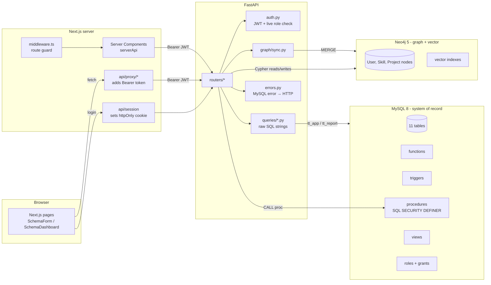
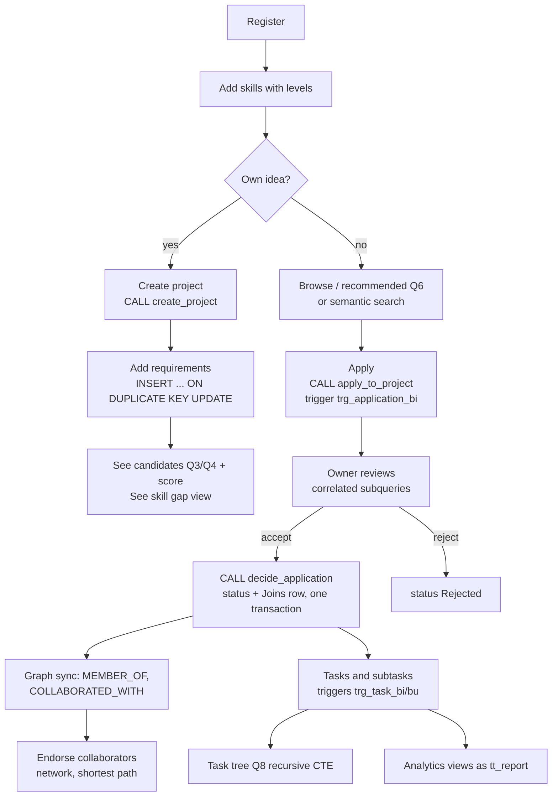
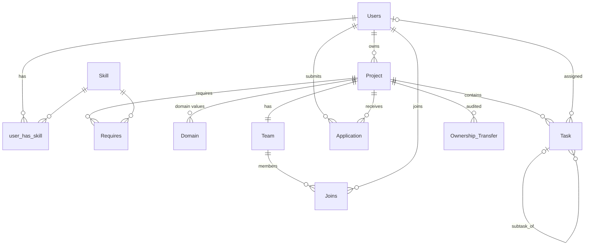
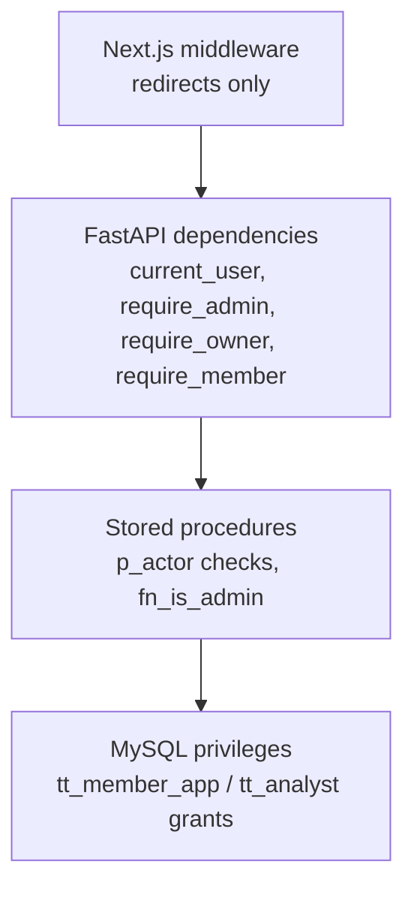
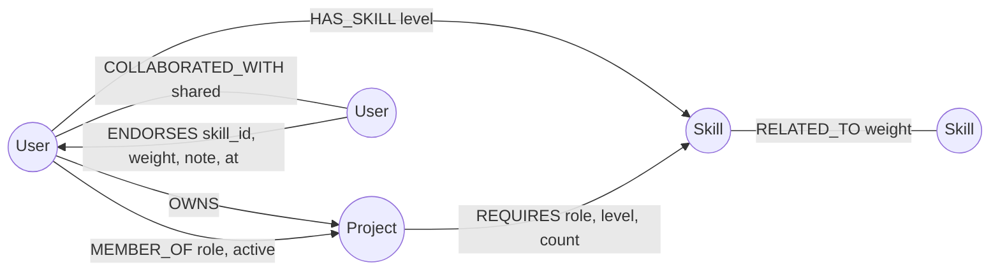

# TeamTREE: Complete Learning and Viva Guide

> **What this is.** One document that teaches TeamTREE from zero: the problem, the concepts, the database, every query, the code, the features, the tests, and the viva. It was written by reading the actual repository (branch `p8-p9-completion`, commit `c03c495`) and by running the read-only catalogue queries against the seeded database. Wherever this guide shows a result table, that table is real output from the seed data, not an invented example.
>
> **Source of truth rule.** If this guide and the code ever disagree, the code wins. File references look like `db/004_procedures.sql` so you can open them.
>
> **Labels used throughout.**
> - **[IMPLEMENTED]** exists in the repository and runs.
> - **[THEORY]** taught because examiners ask about it, but not used in TeamTREE.
> - **[GAP]** something missing, inconsistent or risky that you should know before the viva.

---

## Table of contents

1. [How to study this guide](#0-how-to-study-this-guide)
2. [The official rubric and how TeamTREE meets it](#1-the-official-rubric-and-how-teamtree-meets-it)
3. [Project fundamentals: the big picture](#2-project-fundamentals-the-big-picture)
4. [Technical concepts taught from scratch](#3-technical-concepts-taught-from-scratch)
5. [DBMS fundamentals](#4-dbms-fundamentals)
6. [ER diagram and database design](#5-er-diagram-and-database-design)
7. [Relational schema and ER-to-relational mapping](#6-relational-schema-and-er-to-relational-mapping)
8. [Normalization](#7-normalization)
9. [Constraints and integrity](#8-constraints-and-integrity)
10. [SQL reference: every statement in the project](#9-sql-reference-every-statement-in-the-project)
11. [Stored functions](#10-stored-functions)
12. [Triggers](#11-triggers)
13. [Stored procedures](#12-stored-procedures)
14. [Views](#13-views)
15. [Transactions, ACID and concurrency](#14-transactions-acid-and-concurrency)
16. [Indexing and query optimization](#15-indexing-and-query-optimization)
17. [Database security: roles, grants, RBAC](#16-database-security-roles-grants-rbac)
18. [NoSQL and vector database: Neo4j](#17-nosql-and-vector-database-neo4j)
19. [Application implementation and code walkthrough](#18-application-implementation-and-code-walkthrough)
20. [Features, one by one](#19-features-one-by-one)
21. [Testing and validation](#20-testing-and-validation)
22. [The X factor](#21-the-x-factor)
23. [Demonstration guide](#22-demonstration-guide)
24. [Viva question bank](#23-viva-question-bank)
25. [The four questions professors already asked](#24-the-four-questions-professors-already-asked)
26. [Team contribution and design decisions](#25-team-contribution-and-design-decisions)
27. [Quick revision sheet](#26-quick-revision-sheet)
28. [Self-audit and coverage matrix](#27-self-audit-and-coverage-matrix)

---

## 0. How to study this guide

Read in this order if you have little time:

1. Section 1 (rubric) so you know what is being graded.
2. Section 2 (big picture) so you can explain the project in plain words.
3. Sections 4 to 16 (the database), slowly. This is where most of the marks are: rows 1, 2, 3, 6, 7, 8 and 12 of the rubric are pure DBMS, 32 of 50 marks.
4. Section 17 (Neo4j), because rows 4 and 9 are worth 11 marks together.
5. Section 24 (the four reported questions) and Section 26 (revision sheet) the night before.

Read with the repository open. Every time a section quotes SQL, open the file and find the line. Examiners often say "show me where that is", and being able to open `db/004_procedures.sql` and scroll straight to `decide_application` is worth more than a memorised definition.

Things you must be able to do live, without notes:

- Open the ER diagram and name every entity, relationship and cardinality.
- Explain `decide_application` line by line (it is the heart of the project).
- Run a query from `db/queries/catalogue.sql` and explain its output.
- Show a trigger firing (apply to a full project) and a privilege error (`UPDATE Application ...` as `tt_app`).
- Run a Cypher read, update and delete in the Neo4j Browser.

---

## 1. The official rubric and how TeamTREE meets it

### 1.1 Where the rubric comes from

The official rubric is `docs/DBMS Level 3.pdf`: *PES University, Department of CSE, Database Management System, Aug–Dec 2026, Experiential Learning Level 3, MiniProject Evaluation Criteria*. It is an image-only PDF, so text search will not find it; open it and read it. Its content, transcribed exactly:

**Summary table (7 criteria, 50 marks)**

| # | Criteria | Distribution | Marks |
|---|---|---|---|
| 1 | Database Design | ER diagram (2), relational schema with keys, relationships, and constraints (3) | 5 |
| 2 | Database Creation | SQL database implementation, DDL with constraints (4); NoSQL/Vector database creation (4); Technology justification (1) | 9 |
| 3 | SQL Operations and Queries | DML operations (4); Nested/correlated/Recursive Queries, Join SQL queries (4) | 8 |
| 4 | Advanced Database Concepts | Advanced database concepts (Procedure/function, trigger, CTE) (6); NoSQL/Vector feature RUD (7) | 13 |
| 5 | Web Application and Database Integration | Next.js interface (3); Backend/API and database integration (2) | 5 |
| 6 | Authentication and Authorization | Authentication implementation (front end and minimum two roles and role-based access control in database) (4) | 4 |
| 7 | Documentation, Git/GitHub, Demonstration, Testing, and Originality | Documentation, Git/GitHub (2); Originality and individual contribution (4) | 6 |
| | | **Total** | **50** |

**Detailed rubric (14 components, with partial-credit levels)**

| # | Evaluation component | Max | Correct execution | Partially correct | Absent / incorrect |
|---|---|---|---|---|---|
| 1 | ER diagram | 2 | 2 | 1 | 0 |
| 2 | Relational schema with keys, relationships, and constraints | 3 | 3 | 2 | 0 |
| 3 | SQL database implementation, DDL with constraints | 4 | 4 | 3 | 0 |
| 4 | NoSQL/Vector database creation | 4 | 4 | 3 | 0 |
| 5 | Technology justification | 1 | 1 | 0 | 0 |
| 6 | DML operations | 4 | 4 | 3 | 0 |
| 7 | Nested/correlated/Recursive Queries, Join SQL queries | 4 | 4 | 3 | 0 |
| 8 | Advanced SQL concepts (Procedure/function, trigger, CTE) | 6 | 6 | 3 | 0 |
| 9 | NoSQL/Vector feature, RUD | 7 | 7 | 4 | 0 |
| 10 | Next.js interface | 3 | 3 | 2 | 0 |
| 11 | Backend/API and database integration | 2 | 2 | 1 | 0 |
| 12 | Authentication implementation (front end and minimum two roles and role-based access control in database) | 4 | 4 | 3 | 0 |
| 13 | Documentation, Git/GitHub | 2 | 2 | 1 | 0 |
| 14 | Originality, individual contribution, Modification/Viva | 4 | 4 | 2 | 0 |
| | **Total** | **50** | **50** | **31** | **0** |

How to read the partial-credit columns: "Correct execution" means it exists *and works when demonstrated*. "Partially correct" means it exists but is incomplete or does not run properly. So a working demo matters as much as the code. Note three harsh rows: row 5 (technology justification) gives 0 for a partial answer, row 8 drops from 6 to 3, and row 9 drops from 7 to 4. Those three are where a weak demo costs the most.

Note also what the rubric literally asks for in row 9: **RUD**, meaning Read, Update and Delete on the NoSQL/vector side. Creation is graded separately in row 4.

### 1.2 Mapping: rubric row → what is expected → how TeamTREE satisfies it → evidence

The project's own map is `IMPLEMENTATION.md` §0. This table checks it against the code.

| # | Rubric row (marks) | What an examiner expects | How TeamTREE satisfies it | Evidence (open these) | Status |
|---|---|---|---|---|---|
| 1 | ER diagram (2) | A correct conceptual diagram: entities, attributes, relationships, cardinality, participation, keys | Chen-notation diagram for schema v2 (rectangles, diamonds, ovals, double ovals for multivalued, dashed oval for derived, double lines for total participation), plus a crow's-foot version | `docs/ER Diagram.png`, `docs/er_chen.svg` (generated by `docs/tools/gen_er_chen.py` from `docs/er_chen.dot`), `docs/er.svg` from `docs/er.mmd`; old sketch `docs/er_v1_handdrawn.png` | [IMPLEMENTED] |
| 2 | Relational schema with keys, relationships, constraints (3) | Every relation with PK, FK, UNIQUE, CHECK; mapping from ER; FDs and normal form | `docs/RELATIONAL_SCHEMA.md`: all 11 relations, the ER → relation mapping table, FDs per table, 1NF/2NF/3NF/BCNF argument | `docs/RELATIONAL_SCHEMA.md` | [IMPLEMENTED], see §7 of this guide for nuances |
| 3 | DDL with constraints (4) | `CREATE TABLE` with PK, FK and chosen referential actions, UNIQUE, CHECK, NOT NULL, DEFAULT | 11 InnoDB tables, 17 FKs with explicit `ON DELETE` choices, 11 CHECK constraints, ENUM domains, 3 stored generated columns, 5 named UNIQUE keys | `db/001_schema.sql` | [IMPLEMENTED] |
| 4 | NoSQL/Vector DB creation (4) | A NoSQL database actually created with its schema objects, and loaded with data | Neo4j 5.26: 3 uniqueness constraints, 2 range indexes, 2 **vector indexes** (384 dimensions, cosine); data loaded by a MySQL → Neo4j projection plus graph-only seed | `graph/001_constraints.cypher`, `graph/002_vector_indexes.cypher`, `api/scripts/graph_init.py`, `api/scripts/sync_graph.py --full`, `graph/seed_graph.cypher` | [IMPLEMENTED] |
| 5 | Technology justification (1) | Why these technologies, with alternatives | Table of choices and an "alternatives considered" table | `docs/TECH_JUSTIFICATION.md` | [IMPLEMENTED] |
| 6 | DML operations (4) | INSERT, UPDATE, DELETE, ideally more advanced forms, used by the app | D1 multi-row upsert, D2 `INSERT … SELECT`, D3 `UPDATE … JOIN`, D4 soft delete, D5 `DELETE`, D6 single upsert, D7 transactional accept; each labelled with the endpoint that uses it | `db/queries/dml_demo.sql`, `api/app/queries/*.py`, `db/004_procedures.sql` | [IMPLEMENTED] |
| 7 | Nested, correlated, recursive, join queries (4) | At least one of each kind, used for real | Q1 5-table join; Q-browse nested `IN` + `EXISTS`; Q3 two-level nested `IN`; Q4 double `NOT EXISTS` (relational division); Q5 correlated subquery in `HAVING`; Q6 correlated `EXISTS`; Q7 correlated scalar subquery; Q8 recursive CTE (tree); Q9 recursive CTE (date series); Q10 CTE + window; Q11 self-join; Q12 `UNION ALL` | `db/queries/catalogue.sql` (each query names its endpoint) | [IMPLEMENTED] |
| 8 | Procedure/function, trigger, CTE (6) | Working stored routines and triggers with a real purpose, and CTEs | 5 stored functions, 4 triggers + 1 trigger-helper procedure, 15 stored procedures with transactions, row locks and error handlers, 9 views (one built with CTEs + window function), 2 recursive CTEs | `db/002_functions.sql`, `db/003_triggers.sql`, `db/004_procedures.sql`, `db/005_views.sql`, catalogue Q8/Q9/Q10 | [IMPLEMENTED] |
| 9 | NoSQL/Vector feature: Read, Update, Delete (7) | The app reads, updates and deletes NoSQL data, including a vector feature | **Read:** collaboration network, recommended collaborators, shortest path, related skills, gap candidates, endorsements, vector search, similar projects/people. **Update:** endorse (MERGE + SET), change endorsement weight, curate skill relation, re-embed project. **Delete:** remove endorsement, remove skill relation | `api/app/queries/graph.py`, `api/app/queries/graph_write.py`, `api/app/routers/graph.py`, `api/app/routers/graph_write.py`, `graph/003_demo_queries.cypher`, pages `/graph/network`, `/graph/search` | [IMPLEMENTED] |
| 10 | Next.js interface (3) | A working Next.js front end covering the features | Next.js 15 App Router, shadcn/ui, 25 pages, schema-driven forms (19 JSON specs) and dashboards (8 JSON specs) | `web/app/**`, `web/components/schema/*`, `web/specs/dashboards/*.json`, `api/app/ui_schemas/*`, `docs/screenshots/*` | [IMPLEMENTED] |
| 11 | Backend/API and DB integration (2) | API that really talks to the database(s) | FastAPI with raw SQL (aiomysql) and Cypher (neo4j async driver); procedures called with OUT params; views read by a separate read-only user; MySQL → Neo4j sync after each commit | `api/app/db.py`, `api/app/graph/*`, `api/app/routers/*` | [IMPLEMENTED] |
| 12 | Auth (front end) + ≥ 2 roles + RBAC in DB (4) | Login/register UI, at least two roles, and access control **inside the database** | Login/register pages; JWT in httpOnly cookie; app roles `admin`/`member`; MySQL `CREATE ROLE` (`tt_admin`, `tt_member_app`, `tt_analyst`), users `tt_app` and `tt_report`, table-, column- and routine-level `GRANT`s; actor checks inside procedures; Next.js middleware route guards | `db/007_rbac.sql`, `api/app/auth.py`, `web/middleware.ts`, `web/lib/route-guard.ts`, tests `test_rbac_db.py` | [IMPLEMENTED] |
| 13 | Documentation, Git/GitHub (2) | README, docs, meaningful Git history | `README.md`, `IMPLEMENTATION.md`, `docs/*`, `phases/*`, CI workflow | repo; `git log` | [IMPLEMENTED] with a [GAP]: only 9 commits, phases landed in bulk (see §27) |
| 14 | Originality, individual contribution, modification/viva (4) | Each member explains their own part and can modify code live | `docs/CONTRIBUTIONS.md`, `docs/VIVA_NOTES.md` (includes modification drills) | those files | [GAP]: `CONTRIBUTIONS.md` still has placeholder names `_Name 1_` … `_Name 4_` |

### 1.3 Mandatory, optional, implemented, missing

**Mandatory (graded):** everything in the 14 rows. Nothing in the rubric is optional.

**Implemented beyond the minimum:** concurrency-safe acceptance with row locks, a deterministic concurrency test, column-level grants, a read-only analyst database user, a recursive date-series CTE, relational division, `EXPLAIN` evidence for indexes, vector search with real embeddings, CI that runs everything on fresh containers.

**Partially implemented or missing:**

- [GAP] `docs/CONTRIBUTIONS.md` has placeholder names. Row 14 explicitly grades *individual contribution*. Fill it in with real names and real work before the viva. Git shows two authors: `nishit d b` (6 commits) and `is-stuthi` (3 commits).
- [GAP] Git history is thin (9 commits). Row 13 grades Git/GitHub. `IMPLEMENTATION.md` promises "branch-per-phase PRs and conventional commits", but the history shows "Add P0-P3" and "Add P4-P9" as single commits. Be ready to explain this honestly.
- [GAP] The working tree has uncommitted UI changes under `web/` (a new app shell with sidebar and breadcrumbs, the profile page moved to `/dashboard/profile`, many modified components). Commit them before submission so the demo matches the repository.
- No task deletion feature. `tt_member_app` has no `DELETE` privilege on `Task`, and no endpoint deletes tasks. This is a design choice (history), but an examiner asking for "full CRUD on tasks" will notice.

### 1.4 Where examiners will spend their attention

Rows 8 (6 marks) and 9 (7 marks) are the two largest single rows and both drop sharply for partial answers. Expect deep questions on: the triggers, `decide_application`, a CTE, and the Neo4j R/U/D plus vector search. Row 12 (4 marks) is unusual because it asks for RBAC *in the database*, and most projects only do it in the app; TeamTREE's `007_rbac.sql` is a strong answer and you should demo the 1142 error. Row 14 includes "Modification", meaning the examiner may ask you to change something live (add a column, a trigger, a query). Section 25.3 prepares you for that.

---

## 2. Project fundamentals: the big picture

### 2.1 Title and one-sentence purpose

**TeamTREE** is a skill-based team formation and collaboration platform. People list their skills; project owners post projects with skill requirements; other people apply; owners accept applicants into the project's team; the team tracks tasks. A graph database adds collaborator networks, endorsements and meaning-based ("semantic") project search.

### 2.2 The problem, in plain words

Imagine a college. Priya has an idea: an app that detects crop disease from leaf photos. She can do the machine-learning part, but she needs someone who knows React to build the upload page. Meanwhile Rahul knows React well and wants a real project to work on. They never meet, because:

- Priya has no structured way to say "I need one React developer at Intermediate level or above".
- Rahul has no structured way to search "projects that need what I know".
- Even if they found each other through a WhatsApp group, nobody tracks who applied, who was accepted, whether the team is already full, or who is doing which task.

The design document (§2) states it as: people struggle to find collaborators with the right skills, experience and availability, and contributors struggle to find projects that match what they can do.

**What happens without a solution:** recruitment happens through chat groups and spreadsheets. Applications get lost. Two people get told "you're in" for the last slot. Nobody knows which skills are in short supply. Work is assigned verbally and forgotten.

**How TeamTREE solves it:** it stores skills, requirements, applications, teams and tasks as structured, related data, so the database can answer questions like:

- Which open projects need a skill I have at the level they want? (Q6)
- Who meets *every* requirement of my project? (Q4, relational division)
- What skills is my team still missing? (`SkillGap` view)
- Is the team full? (trigger + locked count inside a transaction)
- Who has worked with whom, and who could introduce me to someone? (Neo4j shortest path)
- Which projects are *about* "machine learning for farmers", even if they don't use those words? (vector search)

### 2.3 Target users and their roles

There is **one** kind of account, `Users`. A person plays different roles in different contexts (design doc §4):

| Context | Role | What they can do |
|---|---|---|
| A project they created | **Owner** | Edit the project, define skill requirements, review applications, accept/reject, manage the team, transfer ownership, close the project |
| Someone else's project | **Applicant** | Browse, apply with a message, withdraw a pending application |
| A project that accepted them | **Team member** | See the team, create and update tasks, assign tasks, leave the team |
| The whole platform | **Admin** (`Users.role = 'admin'`) | Manage the skill catalogue, change user roles, deactivate users, curate skill relations in the graph, see admin-only analytics |

The same person can own Project A, apply to Project B and be a member of Project C at once. That is why owner/applicant/member are **not** separate tables: they are relationships (`Project.owner_id`, `Application`, `Joins`). Only `admin`/`member` is a stored role, and that is the "minimum two roles" the rubric asks for.

### 2.4 Functional requirements (what the system must do)

Taken from design doc §3 and verified against the routers:

1. Register, log in, edit profile, change password, deactivate own account.
2. Add skills to a profile with a proficiency level (Beginner, Intermediate, Advanced, Expert).
3. Create, browse, search, filter, edit and close projects.
4. Owners define requirements: skill, minimum level, role, number of people.
5. Apply to projects; withdraw pending applications.
6. Owners accept or reject applications; acceptance adds the applicant to the team.
7. Each project has exactly one team; membership history is kept.
8. Teams create tasks and subtasks, assign them to members, update status.
9. Skill-based candidate matching, project recommendations, skill-gap report.
10. Analytics computed by SQL.
11. Admin management of skills and roles.
12. Graph features: network, recommendations, path, endorsements, related skills, semantic search.

### 2.5 Non-functional requirements

| Requirement | How it is met |
|---|---|
| **Integrity**: rules hold no matter which client writes | Rules live in MySQL (constraints, triggers, procedures), not only in Python |
| **Security**: least privilege | API connects as `tt_app`, which cannot write `Application`, `Joins`, `Team`, `Skill`, `Domain` directly; passwords are bcrypt hashes; JWT kept in an httpOnly cookie |
| **Concurrency safety** | Row locks (`FOR UPDATE`, `FOR SHARE`) in `decide_application`; deadlocks mapped to a `RETRY` error |
| **Availability of core features** | If Neo4j is down, MySQL features keep working (sync failures are logged, not raised) |
| **Maintainability** | ≤ 150 lines per custom file (ESLint `max-lines`), forms and dashboards as JSON specs, generated TypeScript types |
| **Testability** | 133 pytest test functions against real MySQL and Neo4j, plus vitest tests for the front end; CI runs all of them |
| **Explainability** | Match score is a transparent weighted sum with a per-factor breakdown, not a black box |

### 2.6 Technologies

| Layer | Technology |
|---|---|
| Relational database (system of record) | MySQL 8.0, InnoDB engine |
| NoSQL + vector database | Neo4j 5.26 (graph database with native vector indexes) |
| Embedding model | `sentence-transformers/all-MiniLM-L6-v2` (384-dimensional vectors, runs on CPU) |
| Backend API | Python 3.12, FastAPI, Pydantic, aiomysql (async MySQL driver), neo4j async driver, bcrypt, PyJWT |
| Frontend | Next.js 15 (App Router), React 19, TypeScript, shadcn/ui, Tailwind CSS, react-hook-form + zod, Recharts, react-force-graph-2d |
| Infrastructure | Docker Compose (MySQL and Neo4j containers) |
| Quality | pytest, vitest, ESLint, TypeScript compiler, GitHub Actions CI |
| Code generation | openapi-typescript (API → TS types), plop (boilerplate), shadcn CLI |

### 2.7 Architecture diagram



Three tiers:

1. **Presentation**: Next.js. Renders pages, guards routes, never holds the JWT in browser JavaScript.
2. **Application**: FastAPI. Validates input (Pydantic), authenticates (JWT), runs SQL and Cypher, maps database errors to HTTP errors.
3. **Data**: MySQL (all business data and rules) and Neo4j (a projection of MySQL plus graph-only data).

### 2.8 End-to-end workflow



### 2.9 Inputs, processes, outputs

| Input | Process | Output |
|---|---|---|
| Profile and skills | Upsert into `user_has_skill`; re-embed user in Neo4j | Profile page, recommendations |
| Project details and requirements | `create_project` procedure (Project + Team + owner Joins + Domains in one transaction); upserts into `Requires` | Project page, candidates, skill gap |
| Application message | `apply_to_project` → trigger validation → INSERT | Pending application |
| Accept/reject decision | `decide_application` with locks | Updated application, new team member |
| Tasks | INSERT/UPDATE validated by triggers | Task list and tree |
| Graph actions | Cypher MERGE/SET/DELETE | Endorsements, relations |
| Search text | Embedding → vector index query | Ranked similar projects |
| (none) | Views and analytic queries | Dashboards |

### 2.10 Modules and how they talk

| Module | Responsibility | Talks to |
|---|---|---|
| `db/` | Schema, rules, routines, views, roles, seed | Applied by `api/scripts/migrate.py` as root |
| `graph/` | Neo4j constraints, vector indexes, seed, demo Cypher | Applied by `graph_init.py` / `sync_graph.py` |
| `api/app/routers/` | HTTP endpoints | `queries/`, `db.py`, `graph/driver.py`, `graph/sync.py` |
| `api/app/queries/` | SQL and Cypher strings | Executed by routers |
| `api/app/auth.py` | Passwords, JWT, current user, role checks | `Users` table |
| `api/app/errors.py` | Converts MySQL/Neo4j errors to HTTP JSON errors | Installed on the FastAPI app |
| `api/app/graph/` | Neo4j driver, embeddings, MySQL → Neo4j sync | MySQL (reads), Neo4j (writes) |
| `api/app/services/matching.py` | Candidate score | Pure Python |
| `api/app/ui_schemas/` | JSON form specs generated from Pydantic models | Served at `/ui-schemas/{name}` |
| `web/` | Pages, guards, schema-driven rendering | FastAPI over HTTP |

### 2.11 A complete real-world example, using the seed data

The seed (`db/seed.sql`) contains 15 users, 25 skills, 10 projects, 21 applications, 21 memberships and 17 tasks. Follow one story through the system.

1. **Chitra** (user 4) owns project 3, *Smart Inventory Tracker*. Its requirements: Python (Intermediate, Backend Developer), React (Intermediate, Frontend Developer), Docker (Advanced, DevOps Engineer). Max team size 4.
2. Farhan (user 7) applied earlier and was accepted (application 6), so the team is Chitra (Owner) + Farhan (Frontend Developer): 2 of 4.
3. Chitra opens **Skill gap**. The `SkillGap` view returns (real output):

   | s_name | req_role | required_level | qualified_members | shortfall |
   |---|---|---|---|---|
   | Python | Backend Developer | Intermediate | 1 | 0 |
   | React | Frontend Developer | Intermediate | 1 | 0 |
   | Docker | DevOps Engineer | Advanced | 0 | **1** |

   Farhan has Docker, but only at Beginner, so he counts in `members_with_skill` but not in `qualified_members`.
4. Chitra opens **Candidates** with "fully qualified only". Q4 (relational division: "users for whom no requirement is unmet") returns exactly one person: **Jay Kumar** (user 11, Docker Expert, Python Expert, React Advanced).
5. Jay, meanwhile, sees project 3 at the top of his **Recommended projects** (Q6) with `matched_requirements = 3` of `3`.
6. Jay applies. MySQL runs `apply_to_project(11, 3, msg)`; inside it the `BEFORE INSERT` trigger checks: project is Open, Jay is not the owner, team (2) < capacity (4). A `Pending` row is inserted. If Jay clicks twice, the second insert fails on the UNIQUE key `uq_application_pending` and he sees "DUPLICATE_PENDING".
7. Chitra accepts. `decide_application` locks the project row, locks the application row, checks Chitra is the owner and the application is Pending, counts active members with a locking read, inserts Jay into `Joins`, sets the application to Accepted with a decision date, and commits all of it together.
8. The API then syncs Neo4j: Jay gets a `MEMBER_OF` edge to project 3 and `COLLABORATED_WITH` edges to Chitra and Farhan.
9. The skill gap now shows Docker shortfall 0. Chitra creates a task "Containerise services" assigned to Jay; the task trigger confirms Jay is an active member and the due date is before the project deadline.
10. Later, Jay can endorse Farhan for React in the graph, because they now share a team.

That one story touches: a view, a nested `NOT EXISTS` query, a correlated `EXISTS` query, a stored procedure, a trigger, a generated-column UNIQUE key, a transaction with row locks, a Neo4j projection and a graph update. That is the whole project in miniature.

### 2.12 What makes it more than a basic implementation

A basic version of this idea is: a few tables, a form for each, and `INSERT`/`SELECT` from the app. TeamTREE differs in five concrete ways:

1. **Rules are enforced by the database, not trusted to the app.** Triggers and procedures refuse invalid writes from any client.
2. **The app cannot bypass the rules even if it wanted to.** Its MySQL user has no write privilege on the guarded tables; the only path is a `DEFINER` procedure that checks who is acting.
3. **It is correct under concurrency.** Two simultaneous accepts cannot overfill a team, and there is a test that forces that exact interleaving.
4. **History is preserved.** Soft delete, membership history with rejoin support, ownership-transfer audit.
5. **Two database models, each used for what it is good at.** SQL for transactions and integrity; a graph for multi-hop relationships and vector similarity.

---

## 3. Technical concepts taught from scratch

The database concepts get their own sections (4 to 17). This section covers everything else the project stands on. Each concept follows the same eight steps: what, why, how, example, where in TeamTREE, why we chose it, alternatives, viva questions.

### 3.1 Client–server and three-tier architecture

1. **What.** A *client* asks for something; a *server* provides it. In a *three-tier* system there are three separate layers: presentation (what the user sees), application logic, and data storage.
2. **Why.** Separating them lets each layer change independently, and keeps the database away from the public internet.
3. **How.** The browser (client) talks to the Next.js server, which talks to the FastAPI server, which talks to MySQL and Neo4j. Each hop is a network request.
4. **Example.** Opening `/projects/3` makes Next.js call `GET /projects/3` on FastAPI, which runs query Q1 on MySQL.
5. **Where.** `web/` (presentation), `api/` (logic), `db/` + `graph/` (data). `docker-compose.yml` runs the data tier.
6. **Why we chose it.** The rubric grades "Next.js interface" and "Backend/API and database integration" as separate rows, so a clear split shows both.
7. **Alternatives.** A two-tier app (Next.js route handlers talking straight to MySQL). Fewer moving parts, but it blurs the backend row and loses the OpenAPI → TypeScript pipeline (`docs/TECH_JUSTIFICATION.md`).
8. **Viva.** *Q: Why not let the browser talk to MySQL directly?* A: The browser is untrusted; it would need database credentials, and any user could run any SQL. The API is the gatekeeper, and even the API runs as a restricted MySQL user.

### 3.2 HTTP, REST, JSON and status codes

1. **What.** HTTP is the request/response protocol of the web. A request has a *method* (GET read, POST create/action, PUT replace/upsert, PATCH partial update, DELETE remove), a *path*, headers and an optional body. REST is a style where URLs name resources (`/projects/3/applications`). JSON is the text format for the bodies.
2. **Why.** A uniform, language-neutral way for the Next.js (TypeScript) side and FastAPI (Python) side to talk.
3. **How.** The server answers with a status code: 200 OK, 201 Created, 401 not logged in, 403 not allowed, 404 not found, 409 conflict with current state, 422 invalid input, 503 dependency unavailable.
4. **Example.** `POST /applications/7/decision` with body `{"decision":"Accepted","role":"Frontend Developer"}`. If the team is full the response is `409 {"code":"PROJECT_FULL","message":"PROJECT_FULL"}`.
5. **Where.** Every router in `api/app/routers/`. The status mapping for database errors is in `api/app/errors.py` (`SIGNAL_STATUS`, `ERRNO_STATUS`).
6. **Why.** Status codes let the UI react correctly (redirect to login on 401, show a toast on 409) without parsing messages.
7. **Alternatives.** GraphQL (one endpoint, client chooses fields) or gRPC (binary, typed). REST is simpler and what FastAPI and OpenAPI support natively.
8. **Viva.** *Q: Why is PROJECT_FULL a 409 and SELF_APPLICATION a 422?* A: 409 means the request is valid but conflicts with the current state (the team happens to be full now; it might not be later). 422 means the request itself is invalid (you can never apply to your own project).

### 3.3 APIs, FastAPI, routers and dependency injection

1. **What.** An API is a set of operations a program exposes. FastAPI is a Python web framework where each endpoint is a Python function decorated with its method and path.
2. **Why.** It gives validation, documentation (`/docs`) and async support with very little code.
3. **How.** `@router.post("/projects/{p_id}/applications")` binds a function. Parameters come from the path (`p_id`), the body (a Pydantic model), or *dependencies*: `user: CurrentUser = Depends(current_user)` tells FastAPI to run `current_user` first (which checks the JWT) and pass its result in. If the dependency raises an error, the endpoint never runs.
4. **Example.** `api/app/routers/applications.py`:
   ```python
   @router.post("/projects/{p_id}/applications", response_model=ApplicationOut, status_code=201)
   async def apply(p_id: int, body: ApplicationCreate, user: CurrentUser = Depends(current_user)):
       (a_id,) = await db.call_proc("apply_to_project", user.id, p_id, body.msg.strip(), out=1)
       return await _one(a_id)
   ```
5. **Where.** `api/app/main.py` creates the app and includes 15 routers (auth, users, skills, admin, ui_schemas, projects, requirements, discovery, applications, teams, tasks, matching, graph, graph_write, analytics).
6. **Why.** Small, readable endpoints; the SQL stays visible in `queries/`.
7. **Alternatives.** Django (heavier, ORM-centric), Flask (no built-in validation), Express.js (Node).
8. **Viva.** *Q: What does `require_admin` do?* A: It is a dependency built by `require_role("admin")`; it first runs `current_user` (valid token, active account, role re-read from the database) and then returns 403 `FORBIDDEN_ROLE` unless the role is `admin`.

### 3.4 Pydantic validation and OpenAPI-generated types

1. **What.** Pydantic models are Python classes that declare field types and limits. OpenAPI is a machine-readable description of an API.
2. **Why.** Bad input should be rejected at the door with a clear 422, before it reaches the database. And the front end should know the exact request/response shapes.
3. **How.** FastAPI validates each request body against its model. It also produces `openapi.json` describing every endpoint. `npm run gen` turns that into `web/lib/api/schema.d.ts`, so TypeScript catches mismatches at compile time. The same models also produce the JSON form specs in `api/app/ui_schemas/`.
4. **Example.** `ApplicationCreate.msg: str = Field(min_length=20, max_length=2000)`. Sending `{"msg":"hi"}` returns 422 (test `test_message_is_validated`).
5. **Where.** `api/app/models/*.py`; `api/scripts/dump_openapi.py`; CI step "Generated TS defs are up to date" fails if they drift.
6. **Why.** One source of truth for validation, docs, TS types and form fields.
7. **Alternatives.** Hand-written validation and hand-written TS types (drift risk).
8. **Viva.** *Q: If Pydantic validates, why do you also have CHECK constraints?* A: Defence in depth. Pydantic protects the API; CHECK constraints protect the data from every client, including scripts, the MySQL console and future apps.

### 3.5 Asynchronous I/O and connection pooling

1. **What.** *Async* code can pause while waiting for the network (a database reply) and let other requests run meanwhile. A *connection pool* keeps a set of open database connections to reuse.
2. **Why.** Opening a MySQL connection per request is slow; blocking a thread while waiting wastes it.
3. **How.** `aiomysql.create_pool(minsize=1, maxsize=10, autocommit=True, ...)`; each query does `async with _pool.acquire() as conn`. The sentence-embedding model is CPU-bound, so it runs in a worker thread (`asyncio.to_thread`) to avoid freezing the event loop.
4. **Example.** `api/app/db.py` creates two pools: `_pool` as `tt_app` (max 10) and `_report_pool` as `tt_report` (max 4).
5. **Where.** `api/app/db.py`, `api/app/graph/embed.py`.
6. **Why.** Two pools means two MySQL identities with different privileges, which is part of the RBAC story.
7. **Alternatives.** Synchronous drivers with a thread pool; an ORM session factory.
8. **Viva.** *Q: Why `autocommit=True`?* A: Each single statement commits immediately. Multi-statement atomic work lives inside stored procedures, which run their own `START TRANSACTION … COMMIT`. `db.py` warns never to CALL a procedure inside a client-side transaction, because the procedure's `START TRANSACTION` would implicitly commit the outer one.

### 3.6 Password hashing with bcrypt

1. **What.** A hash is a one-way function: easy to compute, infeasible to reverse. bcrypt is a deliberately slow password hash with a built-in random *salt*.
2. **Why.** If the database leaks, attackers must not get passwords. Plain hashes (SHA-256) are too fast to brute-force safely; salts stop precomputed tables.
3. **How.** `bcrypt.hashpw(password, bcrypt.gensalt(12))` stores something like `$2b$12$<salt><hash>`. To check a login, `bcrypt.checkpw(given, stored)` re-hashes with the stored salt and compares.
4. **Example.** All seed users have the password `password123`; `migrate.py` computes one bcrypt hash and substitutes it for `${SEED_PASSWORD_HASH}` in `seed.sql`.
5. **Where.** `api/app/auth.py` (`hash_password`, `verify_password`), column `Users.password_hash VARCHAR(255)`.
6. **Why.** Industry standard, built-in salt, adjustable cost (12 rounds).
7. **Alternatives.** Argon2 (newer, memory-hard), scrypt, PBKDF2.
8. **Viva.** *Q: v1 had a `password` column. What changed?* A: It became `password_hash`; hashing happens in Python before the value reaches `register_user`. The database never sees the plain password.

### 3.7 JWT sessions and httpOnly cookies

1. **What.** A JSON Web Token is a signed string with three parts: header, payload (claims such as user id, role, expiry), signature. HS256 signs with a shared secret.
2. **Why.** The server can verify who you are on every request without storing sessions, just by checking the signature.
3. **How.** On login FastAPI returns `create_token(user_id, role, name)` with claims `sub`, `role`, `name`, `iat`, `exp` (720 minutes). The Next.js route `/api/session` stores it in an **httpOnly** cookie `tt_session` (JavaScript cannot read httpOnly cookies, which defeats token theft by injected scripts). Client-side calls go to `/api/proxy/...`, which reads the cookie and forwards it as `Authorization: Bearer <token>`.
4. **Example.** `web/app/api/session/route.ts` sets the cookie with `httpOnly: true, sameSite: "lax", secure` in production, `maxAge` 12 hours.
5. **Where.** `api/app/auth.py`, `web/lib/session.ts` (verifies with `jose`), `web/app/api/proxy/[...path]/route.ts`.
6. **Why.** Stateless, works for both server-rendered pages and browser calls.
7. **Alternatives.** Server-side sessions in a table (easy revocation, needs storage); OAuth providers.
8. **Viva.** *Q: A JWT is valid for 12 hours. If an admin deactivates a user, can they keep using the app?* A: No. `current_user` does not trust the token alone: it re-reads `role` and `is_active` from `Users` on every request and rejects inactive accounts with 401 `USER_INACTIVE`. Test: `test_self_deactivation_invalidates_session`.

### 3.8 Authentication, authorization and RBAC

1. **What.** *Authentication* answers "who are you?" (login). *Authorization* answers "what may you do?". *Role-based access control (RBAC)* grants permissions to roles, and roles to users.
2. **Why.** Different users need different powers; granting per role is easier to manage and audit than per user.
3. **How.** TeamTREE has four layers:
   - **Next.js middleware** redirects anonymous users away from protected pages and non-admins away from `/admin` (UX only).
   - **FastAPI** dependencies: `current_user`, `require_admin`, `require_owner`, `require_member`.
   - **Stored procedures** check the acting user (`p_actor`) with `fn_is_admin` and ownership comparisons.
   - **MySQL privileges**: roles `tt_admin`, `tt_member_app`, `tt_analyst` with table-, column- and routine-level grants.
4. **Example.** A member calling `POST /admin/skills` is stopped by `require_admin` (403). Even if that check were deleted, `create_skill` would `SIGNAL 'NOT_ADMIN'`. Even if the API tried `INSERT INTO Skill` directly, MySQL would refuse with error 1142 because `tt_member_app` has no INSERT on `Skill`.
5. **Where.** `web/middleware.ts`, `api/app/auth.py`, `api/app/ownership.py`, `db/004_procedures.sql`, `db/007_rbac.sql`.
6. **Why.** Rubric row 12 asks specifically for RBAC *in the database*.
7. **Alternatives.** App-only checks (one bug away from a breach), row-level security (PostgreSQL has it natively; MySQL does not).
8. **Viva.** *Q: Which layer is the real enforcement?* A: The database. The middleware comment says it is "UX layer only"; FastAPI is the second line; MySQL grants and procedure checks are the last line and cannot be bypassed by application code.

### 3.9 Next.js App Router, Server Components, middleware and the proxy

1. **What.** Next.js is a React framework. The *App Router* maps folders under `web/app/` to URLs. *Server Components* render on the server and can fetch data before sending HTML. *Middleware* runs before a request reaches a page.
2. **Why.** Server-side fetching keeps tokens off the browser and makes pages load with data already in them.
3. **How.** Folder names in parentheses, like `(public)` and `(dashboard)`, group routes without changing the URL. `[id]` is a dynamic segment. `loading.tsx` shows a skeleton while data loads. `layout.tsx` wraps child pages. `middleware.ts` uses a `matcher` to run only on protected paths.
4. **Example.** `web/app/(manage)/projects/[id]/manage/gap/page.tsx` is the owner's skill-gap page at `/projects/3/manage/gap`.
5. **Where.** `web/app/**`; server API client `web/lib/api/server.ts` (`serverApi`, `getMe`, `fetchSource`); browser client `web/lib/api/client.ts` (base URL `/api/proxy`).
6. **Why.** Required by the rubric (row 10).
7. **Alternatives.** Plain React single-page app, Vue, Angular.
8. **Viva.** *Q: The middleware checks the role from the JWT, which may be stale. Is that a security hole?* A: No, it only decides redirects. `web/app/admin/layout.tsx` re-checks the live role via `GET /auth/me`, and the API and MySQL enforce it again. (Caveat for the demo: see §22.6.)

### 3.10 Schema-driven UI

1. **What.** Instead of writing a React form per screen, each form is a JSON *spec* (fields, types, limits, endpoint), and one generic component renders any spec. Dashboards work the same way.
2. **Why.** New screens become data, not code; validation rules come from the same Pydantic models the API enforces, so client and server can't disagree.
3. **How.** `api/app/ui_schemas/*.py` calls `spec(name, title, PydanticModel, method, path, fields=…)`. `GET /ui-schemas/{name}` serves it. `SchemaForm.tsx` builds a zod validator from the JSON Schema (`buildZod.ts`), renders a field per property (`FieldRenderer`), and submits to the endpoint (`useSubmitSpec`). `SchemaDashboard.tsx` reads `web/specs/dashboards/*.json` and renders widgets (stat, bars, line, meters, table) from API sources.
4. **Example.** `web/specs/dashboards/skill_gap.json` defines three stats, a meter per requirement and a table, all from `/projects/{id}/skill-gap`.
5. **Where.** 19 form specs (login, register, profile_edit, password_change, skill_add, skill_admin, project_create, project_edit, project_filter, requirement_add, requirement_copy, application_create, application_accept, task_create, task_edit, transfer_ownership, graph_search, endorse, relation_add); 8 dashboard specs.
6. **Why.** Keeps every file under 150 lines and makes UI changes fast (useful for the "modification" part of row 14).
7. **Alternatives.** Hand-written forms per page; low-code form builders.
8. **Viva.** *Q: How would you add a field to the project form?* A: Add it to `ProjectCreate` in `api/app/models/projects.py` (and to the table and the procedure if it is stored), then `npm run gen`. The form picks it up automatically.

### 3.11 Docker and Docker Compose

1. **What.** Docker runs software in *containers*: isolated processes with their own filesystem image. Compose starts several containers from one YAML file.
2. **Why.** Everyone on the team (and CI) gets the same MySQL 8.0 and Neo4j 5.26 with one command.
3. **How.** `docker compose up -d db graph` starts `mysql:8.0` (host port `${MYSQL_PORT}`, 3307 on this machine) and `neo4j:5.26` (7474 browser, 7687 Bolt protocol). Named volumes `tt_mysql_v2` and `tt_neo4j_v2` keep data across restarts. Health checks (`mysqladmin ping`, `cypher-shell 'RETURN 1'`) report readiness.
4. **Example.** MySQL starts with `--log-bin-trust-function-creators=1` (needed because binary logging is on and the stored functions read data; see §10.6) and `--default-time-zone=+05:30` (so `CURDATE()` is Indian date).
5. **Where.** `docker-compose.yml`; optional `api` service under the `full` profile.
6. **Why.** Reproducible demo and CI.
7. **Alternatives.** Installing MySQL and Neo4j natively; cloud-hosted databases.
8. **Viva.** *Q: What happens to the data if you restart the containers?* A: It survives, because it lives in named volumes. `migrate.py` is what resets it.

### 3.12 Graph databases and the property-graph model

1. **What.** A graph database stores *nodes* (things) and *relationships* (connections) directly, each with properties. Neo4j uses the *labelled property graph* model: a node has labels (`:User`), a relationship has one type (`:COLLABORATED_WITH`) and a direction.
2. **Why.** Questions that follow chains of connections ("friends of friends", "shortest path") are expensive in SQL (repeated self-joins or recursive CTEs) but natural in a graph, where each node points to its neighbours (*index-free adjacency*).
3. **How.** Cypher is Neo4j's query language, written as ASCII-art patterns: `(a:User)-[:COLLABORATED_WITH]-(b:User)`. `MATCH` finds patterns, `MERGE` finds-or-creates, `SET` updates properties, `DELETE` removes, `shortestPath` finds the shortest route.
4. **Example.** Real result from the seed: shortest collaboration path from Esha to Liam is Esha → Farhan → Chitra → Liam, 3 hops.
5. **Where.** Section 17 covers it fully.
6. **Why.** Rubric rows 4 and 9 require a NoSQL/vector database.
7. **Alternatives.** MongoDB (document), Redis (key-value), Cassandra (wide-column). None has native graph traversal.
8. **Viva.** *Q: Could you do shortest path in MySQL?* A: Yes, with a recursive CTE over a pairs table, tracking visited nodes to avoid cycles and stopping at the first hit. It works but is verbose and slows down quickly as depth grows. In Cypher it is one line.

### 3.13 Embeddings, cosine similarity and vector indexes

1. **What.** An *embedding* is a list of numbers (a vector) that represents the meaning of a piece of text; texts with similar meaning get vectors that point in similar directions. *Cosine similarity* measures the angle between two vectors (1 = same direction). A *vector index* finds the nearest vectors quickly.
2. **Why.** Keyword search misses "crop leaf disease detection" when the user types "AI for farmers". Embeddings match on meaning.
3. **How.** `all-MiniLM-L6-v2` turns text into 384 numbers, normalised to length 1 (`normalize_embeddings=True`), so cosine similarity equals the dot product. For a project, the text is name + description + domains + required skills (`project_text`); for a user, bio + skills with levels (`user_text`). The vectors are stored as node properties `p.embedding`/`u.embedding`. `CREATE VECTOR INDEX … cosine` builds an approximate nearest-neighbour index (Neo4j's vector indexes use the HNSW graph algorithm). A search embeds the query text and calls `db.index.vector.queryNodes('project_embedding', k, $vec)`.
4. **Example.** Real output: projects most similar to *Plant Disease Classifier*: Campus Event Hub 0.598, Smart Inventory Tracker 0.591, Mental Health Journal App 0.576, Developer Portfolio Generator 0.569. (The seed has no second agriculture project, so scores are close; with free-text search such as "machine learning image classifier", the test `test_vector_search_ranks_the_ml_project_first` checks the ML project comes first.)
5. **Where.** `api/app/graph/embed.py`, `graph/002_vector_indexes.cypher`, `api/app/queries/graph.py` (`SEARCH_PROJECTS`, `SIMILAR_PROJECTS`, `SIMILAR_USERS`).
6. **Why.** Free, offline, CPU-friendly model; Neo4j already holds the nodes, so no extra vector store.
7. **Alternatives.** pgvector (PostgreSQL), a dedicated vector DB (Pinecone, Qdrant, Milvus), paid embedding APIs.
8. **Viva.** *Q: Is this "AI"?* A: Only the embedding model is a trained neural network, used as-is. There is no training, no generation. The candidate *match score* is not ML at all; it is a transparent formula (§19.8).

### 3.14 Polyglot persistence and eventual consistency

1. **What.** *Polyglot persistence* means using more than one kind of database, each for what it does best. *Eventual consistency* means two copies may briefly differ but converge.
2. **Why.** One system of record (MySQL) keeps the rules simple; a second store (Neo4j) gives graph and vector features.
3. **How.** After a MySQL write commits, the router calls a `sync.*` function that re-reads the affected rows from MySQL and `MERGE`s them into Neo4j. Every sync function is wrapped in `_safe`, which logs failures instead of raising. `scripts/sync_graph.py` rebuilds the whole projection when needed.
4. **Example.** `POST /applications/{id}/decision` with Accepted → `sync.upsert_membership(p_id)` → `REPLACE_MEMBERS` and `UPSERT_COLLABORATIONS` Cypher.
5. **Where.** `api/app/graph/sync.py`, `api/app/graph/source.py`.
6. **Why.** MySQL features must keep working if Neo4j is down (test `test_neo4j_down_does_not_block_mysql`).
7. **Alternatives.** Two-phase commit across both databases (complex, slow, poorly supported); an outbox table plus a background worker (more robust, more code); change-data-capture from the MySQL binlog.
8. **Viva.** *Q: What if the sync fails after MySQL commits?* A: MySQL keeps the truth; the graph is stale until the next sync of that row or a full re-sync. The trade-off is documented in `docs/TECH_JUSTIFICATION.md`.

### 3.15 SQL injection and parameterised queries

1. **What.** SQL injection happens when user input is pasted into SQL text, so input like `' OR 1=1 --` changes the query's meaning.
2. **Why it matters.** It can leak or destroy data.
3. **How it is prevented.** Values are never concatenated; they are passed separately as parameters (`%s` or `%(name)s` placeholders) and the driver escapes them. Where SQL text *is* built dynamically (PATCH endpoints), only column names from a fixed whitelist are inserted (`PROFILE_COLUMNS`, `PATCH_COLUMNS`), and values remain parameters. In Cypher, values are `$parameters`.
4. **Example.** `users.profile_update(fields)` keeps only names in `PROFILE_COLUMNS`, producing `UPDATE Users SET bio = %s, location = %s WHERE id = %s`.
5. **Where.** Every file in `api/app/queries/`; `api/app/graph/cypher.py` ("Always parameterised").
6. **Why.** Also, even a successful injection would run as `tt_app`, which cannot write the guarded tables (`docs/VIVA_NOTES.md`).
7. **Alternatives.** ORMs (parameterise automatically but hide SQL).
8. **Viva.** *Q: `PAIRS.format(ids=ph)` uses string formatting. Is that injectable?* A: No. `ph` is only a string of `%s` placeholders, one per id; the ids themselves are passed as parameters.

### 3.16 Automated testing and continuous integration

1. **What.** Tests are code that checks other code. CI (continuous integration) runs them automatically on every push.
2. **Why.** Business rules are easy to break silently; tests make them executable.
3. **How.** `api/tests/` uses pytest against real MySQL and Neo4j containers. Fixtures (`conftest.py`) reset the database once per test module (`fresh_db`) and give connections as `root`, `tt_app` and `tt_report`. `.github/workflows/ci.yml` starts both databases, migrates, syncs the graph, runs pytest, regenerates TS types and checks they are unchanged, then lints, type-checks, runs vitest and builds the web app.
4. **Example.** `test_app_user_cannot_update_application_directly` asserts MySQL error 1142.
5. **Where.** `api/tests/*.py` (133 test functions, more cases via `parametrize`), `web/**/*.test.ts(x)`.
6. **Why.** Section 20 covers the full test strategy.
7. **Alternatives.** Manual testing only; mocking the database (faster, but would not test triggers and grants).
8. **Viva.** *Q: Why not mock the database?* A: Most of the logic *is* in the database (triggers, procedures, grants). A mock would test nothing that matters.

---

## 4. DBMS fundamentals

This section starts from zero. Every term is tied to a TeamTREE example.

### 4.1 Data, information, database

- **Data** are raw recorded facts: `'Jay'`, `'Docker'`, `'Expert'`.
- **Information** is data organised so it means something: "Jay has Docker at Expert level".
- A **database** is an organised, persistent collection of related data. TeamTREE's MySQL database is called `teamtree` (`CREATE DATABASE IF NOT EXISTS teamtree CHARACTER SET utf8mb4 COLLATE utf8mb4_0900_ai_ci`). `utf8mb4` stores any Unicode character, including emoji; the `ai_ci` collation compares accent- and case-insensitively.

### 4.2 DBMS and RDBMS

A **DBMS** (database management system) is the software that stores, retrieves, protects and shares the database: MySQL, Neo4j, PostgreSQL, Oracle. An **RDBMS** is a DBMS based on the *relational model*: data as tables (relations), manipulated with SQL, related through keys. MySQL is an RDBMS. Neo4j is a DBMS but not relational: it is a graph DBMS.

**Why use a DBMS instead of files (e.g. one CSV per table)?**

| Problem with files | How a DBMS solves it | TeamTREE example |
|---|---|---|
| Redundancy and inconsistency | Normalised tables, one fact in one place | Skill names live only in `Skill`; others reference `s_id` |
| Integrity rules scattered in code | Constraints declared once, enforced always | `CHECK (req_count > 0)` |
| Concurrent access corrupts data | Transactions, locking | Two owners accepting at once (`decide_application`) |
| Partial updates after a crash | Atomicity, durability (logs) | Accept = status + membership, all or nothing |
| No security granularity | Users, roles, privileges | `tt_app` cannot write `Application` |
| Hard to query | Declarative SQL | One query finds users meeting *every* requirement |

**Limitations:** cost and complexity, a learning curve, performance overhead for very simple use, and the schema must be designed up front (changing it needs migrations).

### 4.3 Three-schema architecture and data independence

| Level | Meaning | TeamTREE |
|---|---|---|
| **External** (views) | What a particular user or app sees | Views such as `ProjectListing`, `SkillGap`; `tt_report` sees only views |
| **Conceptual** (logical) | All entities, attributes, relationships, constraints | `db/001_schema.sql` |
| **Internal** (physical) | Files, pages, indexes | InnoDB clustered B+-tree per table, secondary indexes (`db/006_indexes.sql`) |

*Logical data independence*: you can change the conceptual schema without breaking external views (the analytics code reads `TopInDemandSkills`, not the base tables). *Physical data independence*: you can add an index without changing any query (that is exactly what `006_indexes.sql` does).

### 4.4 Schema versus instance

- **Schema**: the structure, which rarely changes. Example: `Users(id, f_name, …, is_active, created_at)`.
- **Instance** (state): the data at a moment. Example: right now `Users` has 15 rows.

### 4.5 Relational vocabulary

| Formal term | Everyday term | Example |
|---|---|---|
| Relation | Table | `Project` |
| Tuple | Row | `(3, 4, 'Smart Inventory Tracker', …)` |
| Attribute | Column | `status` |
| Domain | Allowed values of an attribute | `status ∈ {Open, Ongoing, Completed, Closed}` (ENUM) |
| Degree | Number of attributes | `Domain` has degree 2 |
| Cardinality (of a table) | Number of tuples | `Skill` has cardinality 25 |
| NULL | "unknown / not applicable" | `Task.u_id` is NULL for an unassigned task |

A relation is a *set* of tuples: no duplicate rows (guaranteed by the primary key) and no meaningful row order.

### 4.6 Keys, from scratch

A **key** is a set of attributes whose values identify a tuple.

| Key type | Definition | TeamTREE example |
|---|---|---|
| **Superkey** | Any set of attributes that uniquely identifies a row | In `Users`: `{id}`, `{email}`, `{id, email}`, `{id, f_name}`… |
| **Candidate key** | A *minimal* superkey (remove any attribute and it stops being unique) | `Users`: `{id}` and `{email}`. `Team`: `{t_id}` and `{p_id}`. `Skill`: `{s_id}` and `{s_name_norm}` |
| **Primary key** | The candidate key chosen as the main identifier; NOT NULL and unique | `Users.id`, `Team.t_id` |
| **Alternate key** | A candidate key not chosen as primary | `Users.email` (`uq_users_email`), `Team.p_id` (`uq_team_project`), `Skill.s_name_norm` |
| **Composite key** | A key with more than one attribute | `user_has_skill(u_id, s_id)`, `Requires(p_id, s_id, req_role)`, `Domain(project_id, d_name)` |
| **Surrogate key** | An artificial key with no business meaning (often AUTO_INCREMENT) | `Joins.j_id`, `Application.a_id` |
| **Natural key** | A key made of real-world data | `email`, `(project_id, d_name)` |
| **Foreign key** | Attribute(s) in one table referring to a candidate key of another | `Project.owner_id → Users.id` |

**Why surrogate keys for Users?** Email is a natural candidate key, but people change emails. If email were the PK, every FK in `Project`, `Application`, `Joins`, `Task` would have to change with it. `id` never changes.

**Why a surrogate `j_id` for Joins instead of `(t_id, u_id)`?** Because the same person may join, leave and rejoin the same team. With PK `(t_id, u_id)` the second join would be a duplicate. See §6.2.

### 4.7 Integrity constraints

| Constraint | Rule | TeamTREE |
|---|---|---|
| **Domain constraint** | Each value comes from the attribute's domain | ENUMs, data types, `CHECK (email LIKE '%_@_%._%')` |
| **Entity integrity** | Primary key values are unique and never NULL | Every table has a PK; InnoDB rejects NULL PKs |
| **Referential integrity** | A foreign key value must match an existing referenced key, or be NULL if allowed | `Task.u_id` must be an existing `Users.id` or NULL |
| **Key constraint** | Candidate keys are unique | `UNIQUE KEY uq_users_email (email)` |
| **Semantic / business constraints** | Rules from the domain that need logic | "Can't apply to a full project" → trigger |

### 4.8 MySQL storage engine: InnoDB

Every table ends with `ENGINE=InnoDB`. InnoDB is MySQL's default transactional engine. It gives: ACID transactions, row-level locking, foreign keys, crash recovery through a redo log, and MVCC (multi-version concurrency control, §14). Each table is stored as a **clustered index**: a B+-tree ordered by the primary key whose leaf pages hold the full rows. [THEORY] The older MyISAM engine has no transactions and no foreign keys, so none of TeamTREE's guarantees would hold on it.

---

## 5. ER diagram and database design

### 5.1 ER modelling vocabulary

| Concept | Meaning | Chen notation | In TeamTREE |
|---|---|---|---|
| Entity | A thing with independent existence | Rectangle | USERS, PROJECT, SKILL, APPLICATION, TEAM, TASK |
| Strong entity | Has its own key | Single rectangle | All six above |
| Weak entity | Identified only through an owner entity + partial key | Double rectangle | None in the final design (see §5.6) |
| Attribute | A property | Oval | `p_name`, `deadline` |
| Key attribute | Identifies the entity | Underlined oval | `id`, `p_id`, `s_id`, `a_id` |
| Composite attribute | Made of sub-parts | Oval with child ovals | `name` = (`f_name`, `m_name`, `l_name`) |
| Multivalued attribute | Can hold several values | Double oval | PROJECT `domain` |
| Derived attribute | Computed from others | Dashed oval | USERS `age` (from `dob`) |
| Relationship | Association between entities | Diamond | SUBMITS, REQUIRES, JOINS… |
| Relationship attribute | Describes the association, not either entity | Oval on the diamond | `u_s_level` on HAS |
| Cardinality ratio | 1:1, 1:N, M:N | Labels on lines | PROJECT HAS TEAM is 1:1 |
| Participation | Total (every entity must take part) or partial | Double line = total | Every APPLICATION must be submitted by a user (total) |
| Recursive relationship | An entity related to itself | Diamond with two lines to one entity | TASK SUBTASK_OF TASK |

### 5.2 The diagrams in the repository

| File | What it is |
|---|---|
| `docs/ER Diagram.png` | The Chen-notation diagram for schema v2 (what you show the examiner) |
| `docs/er_chen.svg` | Same diagram as a vector image |
| `docs/er_chen.dot` + `docs/tools/gen_er_chen.py` | Graphviz source and the script that generates it |
| `docs/er.mmd` → `docs/er.svg` | Crow's-foot (Mermaid) diagram with all columns, PK/FK/UK markers |
| `docs/er_v1_handdrawn.png` | The original v1 sketch, kept for history |

### 5.3 Entities

**USERS.** One account type for everyone. Exists because people are the centre of the platform: they own, apply, join, get assigned, and transfer.
- Attributes: `id` (key), composite `name` (`f_name`, `m_name`, `l_name`), `email`, `password_hash`, `role`, `bio`, `location`, `u_photo`, `dob`, derived `age`, `experience_level`, `availability`, `is_active`, `created_at`.
- Participates in: CREATES/OWNS, HAS (skills), SUBMITS, REVIEWS, JOINS, ASSIGNED_TO, TRANSFERS (from/to).
- Why one entity and not Owner/Applicant/Member entities: the same person plays all three roles in different projects; separate entities would duplicate personal data (design doc §4).

**PROJECT.** The thing people collaborate on.
- Attributes: `p_id` (key), `p_name`, `description`, `deadline`, `status`, `max_team_size`, `creation_date`, multivalued `domain`.
- Participates in: CREATES/OWNS (as the N side), REQUIRES, RECEIVES, HAS (team), CONTAINS, TRANSFERS.

**SKILL.** A catalogue entry ("Docker"), managed by admins.
- Attributes: `s_id` (key), `s_name`, `category`.
- Participates in: HAS (with users), REQUIRES (with projects).

**APPLICATION.** A request by a user to join a project. Modelled as an entity, not just a relationship, because it has its own life: an id, a message, a status that changes, dates, and a reviewer decision.
- Attributes: `a_id` (key), `msg`, `status`, `a_date`.
- Participates in: SUBMITS (from USERS, total on the APPLICATION side), RECEIVES (from PROJECT, total), REVIEWS (by the owner; attribute `decision_date`).

**TEAM.** The group working on a project.
- Attributes: `t_id` (key), `team_name`, `create_date`.
- Participates in: HAS (1:1 with PROJECT), JOINS (M:N with USERS).

**TASK.** A unit of work.
- Attributes: `task_id` (key), `t_name`, `description`, `status`, `priority`, `due_date`, `created_at`.
- Participates in: CONTAINS (each task belongs to exactly one project: total), ASSIGNED_TO (optional), SUBTASK_OF (recursive, optional).

**OWNERSHIP_TRANSFER** exists in the relational schema as an audit table. In the Chen diagram it is drawn as the relationship **TRANSFERS** (PROJECT N, USERS "from" 1, USERS "to" 1) with attribute `transferred_at`.

### 5.4 Relationships

| Relationship | Entities | Cardinality | Participation | Attributes | Meaning |
|---|---|---|---|---|---|
| CREATES / OWNS | USERS–PROJECT | 1:N | PROJECT total (every project has an owner), USERS partial | — | A user owns many projects; a project has one current owner |
| HAS | USERS–SKILL | M:N | partial both | `u_s_level` | A user has many skills; a skill is had by many users |
| REQUIRES | PROJECT–SKILL | M:N | partial both | `p_s_level`, `req_role`, `req_count` | A project needs skills at a level, for a role, a number of people |
| SUBMITS | USERS–APPLICATION | 1:N | APPLICATION total | — | Each application has exactly one applicant |
| RECEIVES | PROJECT–APPLICATION | 1:N | APPLICATION total | — | Each application is for exactly one project |
| REVIEWS | USERS (owner)–APPLICATION | 1:N | partial | `decision_date` | The project owner decides |
| HAS (team) | PROJECT–TEAM | 1:1 | total both in the Chen diagram | — | One team per project |
| JOINS | USERS–TEAM | M:N | TEAM total (every team has at least its owner) | `role`, `join_date`, `leave_date` | Membership with history |
| CONTAINS | PROJECT–TASK | 1:N | TASK total | — | Each task belongs to one project |
| ASSIGNED_TO | USERS–TASK | 1:N | partial both | — | A task may have one assignee |
| SUBTASK_OF | TASK–TASK | 1:N recursive | partial | — | A task may have one parent and many children |
| TRANSFERS | PROJECT–USERS (from), USERS (to) | N:1:1 | partial | `transferred_at` | Audit of owner changes |

**Why is REVIEWS not a column?** In the ER diagram it is a relationship, but in the relational schema the reviewer is *derived*: the reviewer of an application is always the owner of its project, so `Application.p_id → Project.owner_id` already gives it. Storing `reviewer_id` would duplicate that fact (§7.6).

**Why is TEAM a separate entity if it is 1:1 with PROJECT?** A team has its own identity, name and creation date, and JOINS attaches to it. It also keeps the model open to "a project may need several teams" (design doc §13.16), which would only need dropping the UNIQUE on `Team.p_id`.

### 5.5 Special attributes

| Kind | Attribute | How it is implemented |
|---|---|---|
| Composite | USERS `name` | Three columns `f_name`, `m_name`, `l_name` (only the leaves are stored) |
| Multivalued | PROJECT `domain` | Separate table `Domain(project_id, d_name)` |
| Derived | USERS `age` | Not stored; would be computed from `dob` |
| Derived (not in the ER, but in the design) | team size, is_overdue, acceptance rate, skill gap | Computed by functions and views: `fn_active_member_count`, `ProjectListing.is_overdue`, `fn_acceptance_rate`, `SkillGap` |
| Relationship attribute | `u_s_level`, `p_s_level`, `req_role`, `req_count`, JOINS `role/join_date/leave_date`, REVIEWS `decision_date`, TRANSFERS `transferred_at` | Stored in the junction table or on the N side |

### 5.6 Weak entities: why there are none, and what is close

A *weak entity* cannot be identified by its own attributes; it needs its owner's key plus a *partial key*, through an *identifying relationship*. Example from textbooks: `DEPENDENT(name)` of an `EMPLOYEE`.

In TeamTREE, `Domain` looks like one: its key is `(project_id, d_name)`, it cannot exist without a project, and it is deleted with it (`ON DELETE CASCADE`). But in the ER model, domain is a **multivalued attribute** of PROJECT, not an entity, and the table is the standard mapping for a multivalued attribute. If an examiner insists, the honest answer is: "the `Domain` table has the same *shape* as a weak entity (owner key + partial key `d_name`), but conceptually it is a multivalued attribute; it has no other attributes of its own."

### 5.7 Differences between the ER diagram and the implementation

| Point | ER diagram | Implementation | Consequence |
|---|---|---|---|
| REVIEWS | A relationship with `decision_date` | No reviewer column; `decision_date` on `Application` | Avoids a transitive dependency; reviewer always correct after a transfer |
| TRANSFERS | Relationship | Table `Ownership_Transfer` with surrogate key | Allows the same pair to transfer more than once (audit trail) |
| JOINS | M:N relationship | Table with surrogate `j_id` and generated `active_flag` | Allows rejoining while forbidding two active memberships |
| PROJECT–TEAM participation | Total on both sides (double lines) | `Team.p_id` is NOT NULL + UNIQUE (total on TEAM side). Nothing in DDL forces a project to have a team, but `create_project` always creates one in the same transaction | [GAP] `docs/RELATIONAL_SCHEMA.md` says "a project may exist before its team (partial participation on the PROJECT side)", which disagrees with the diagram. In practice every project has a team, because the app can only create projects through `create_project` (no INSERT on `Project` for `tt_app`). Say: "total in practice, enforced by the procedure, not by a constraint; a plain FK cannot express 'every project must have a team' without a circular FK." |
| Derived values | `age` dashed | Not stored; other derived values are views | No update anomalies |
| `max_team_size`, `role`, `is_active` | Highlighted (new in v2) | Columns | Supports capacity, RBAC and soft delete |

### 5.8 v1 → v2: why the design changed

The team's first schema is kept in `raw/schema.sql`. `IMPLEMENTATION.md` §3.0 lists the changes:

| Area | v1 | v2 | Why |
|---|---|---|---|
| Password | `password` | `password_hash` | Never store plain passwords |
| Admin flag | `is_admin BOOLEAN` | `role ENUM('admin','member')` | Rubric needs ≥ 2 roles; extensible |
| Users | — | `is_active`, `experience_level`, `availability` | Soft delete; matching inputs |
| Project status | Planning/Active/Completed/Cancelled | Open/Ongoing/Completed/Closed | Clear lifecycle: Open = recruiting |
| Capacity | — | `max_team_size`, deadline CHECK | Business rules |
| FKs to Users/Project | `ON DELETE CASCADE` | `RESTRICT` (soft delete) | Deleting a user must not wipe projects, applications and history |
| Skill | case-sensitive UNIQUE | generated `s_name_norm` UNIQUE | "Python" and "python " can't both exist |
| Requires PK | `(s_id, p_id)` | `(p_id, s_id, req_role)` | Same skill for different roles |
| Team.p_id | not unique | UNIQUE | Enforce 1:1 |
| Joins | composite PK | surrogate PK + history | Rejoin support |
| Application | no Withdrawn; stored reviewer | Withdrawn; reviewer derived; one Pending per pair | Lifecycle; 3NF |
| new | — | `Ownership_Transfer` | Audit |

Being able to explain these changes is strong viva material: it shows the design was reasoned about, not copied.

---

## 6. Relational schema and ER-to-relational mapping

### 6.1 Mapping rules (taught generally, then applied)

| ER construct | Standard mapping rule | Applied in TeamTREE |
|---|---|---|
| Strong entity | One table; simple attributes become columns; key becomes PK | `Users`, `Project`, `Skill`, `Application`, `Team`, `Task` |
| Composite attribute | Store only the leaf components | `f_name`, `m_name`, `l_name` |
| Multivalued attribute | New table: (owner PK as FK, value); PK = both | `Domain(project_id, d_name)` |
| Derived attribute | Usually not stored | `age`; team size etc. via views |
| Weak entity | Table with owner PK as FK; PK = owner PK + partial key; FK `ON DELETE CASCADE` | (not used; `Domain` has this shape) |
| 1:1 relationship | FK on one side (prefer the side with total participation) + UNIQUE on the FK | `Team.p_id` FK + `UNIQUE uq_team_project` |
| 1:N relationship | FK on the N side | `Project.owner_id`, `Application.applicant_id`, `Application.p_id`, `Task.p_id`, `Task.u_id`, `Task.parent_task_id` |
| M:N relationship | Junction table with both FKs; PK usually the pair; relationship attributes become columns | `user_has_skill`, `Requires`, `Joins` |
| Relationship attributes of 1:N | Columns on the N side | `Application.decision_date` (REVIEWS) |
| Recursive 1:N | FK to the same table | `Task.parent_task_id → Task.task_id` |
| n-ary / audit relationship | Its own table with FKs to each participant | `Ownership_Transfer(p_id, from_user, to_user)` |

### 6.2 The complete relational schema

Notation: **bold** = primary key, *italic* = generated column, → = foreign key.

```
Users(**id**, f_name, m_name, l_name, email UK, password_hash, role, bio, location, u_photo,
      dob, experience_level, availability, is_active, created_at)
Project(**p_id**, owner_id → Users, p_name, description, deadline, status, max_team_size, creation_date)
Domain(**project_id** → Project, **d_name**)
Skill(**s_id**, s_name, *s_name_norm* UK, category)
Requires(**p_id** → Project, **s_id** → Skill, **req_role**, p_s_level, req_count)
user_has_skill(**u_id** → Users, **s_id** → Skill, u_s_level)
Team(**t_id**, p_id → Project UK, team_name, create_date)
Joins(**j_id**, t_id → Team, u_id → Users, role, join_date, leave_date, *active_flag*)
        UNIQUE(t_id, u_id, active_flag)
Task(**task_id**, p_id → Project, u_id → Users NULL, parent_task_id → Task NULL, t_name, description,
     status, priority, due_date, created_at)
Application(**a_id**, applicant_id → Users, p_id → Project, msg, status, a_date, decision_date, *pending_flag*)
        UNIQUE(applicant_id, p_id, pending_flag)
Ownership_Transfer(**ot_id**, p_id → Project, from_user → Users, to_user → Users, transferred_at)
```



### 6.3 Each relation in detail

For each table: purpose, keys, foreign keys with referential action, other constraints, and what happens if it were removed.

#### Users
- **Purpose:** every person; also the app role and soft-delete flag.
- **PK:** `id INT AUTO_INCREMENT`. **Candidate keys:** `{id}`, `{email}`.
- **Constraints:** `NOT NULL` on names, email, hash, role, levels, flags; `UNIQUE uq_users_email`; `CHECK chk_users_email (email LIKE '%_@_%._%')` (at least one character, `@`, at least one character, a dot, at least one character); ENUMs `role`, `experience_level`, `availability`; DEFAULTs `role='member'`, `experience_level='Beginner'`, `availability='Part-time'`, `is_active=TRUE`, `created_at=CURRENT_TIMESTAMP`.
- **Referenced by:** `Project.owner_id`, `user_has_skill.u_id`, `Joins.u_id`, `Task.u_id`, `Application.applicant_id`, `Ownership_Transfer.from_user/to_user`.
- **Without it:** nothing works; there is no identity.

#### Project
- **Purpose:** a project and its lifecycle.
- **PK:** `p_id`. **FK:** `owner_id → Users(id) ON DELETE RESTRICT` (an owner cannot be hard-deleted while owning projects).
- **CHECKs:** `chk_project_deadline (deadline IS NULL OR deadline >= DATE(creation_date))`; `chk_project_capacity (max_team_size IS NULL OR max_team_size >= 1)`; `chk_project_name (TRIM(p_name) <> '')`.
- **Why `deadline >= DATE(creation_date)` and not `deadline >= CURDATE()`?** MySQL forbids non-deterministic functions such as `CURDATE()` inside CHECK constraints (the reason is noted in `raw/schema.sql`). A CHECK must give the same answer every time it is evaluated; "today" changes. Comparing with the row's own `creation_date` is deterministic and expresses "a project can't be due before it was created".
- **`max_team_size`** includes the owner; NULL means uncapped.

#### Domain
- **Purpose:** multivalued attribute "domain" (e.g. Web, Education).
- **PK:** `(project_id, d_name)` — all-key table. **FK:** `project_id → Project ON DELETE CASCADE` (pure child data: domains mean nothing without the project).
- **Writes:** only through `create_project` and `set_project_domains` (no write grant for `tt_app`).

#### Skill
- **Purpose:** admin-managed skill catalogue.
- **PK:** `s_id`. **Generated column:** `s_name_norm VARCHAR(100) AS (LOWER(TRIM(s_name))) STORED` with `UNIQUE uq_skill_name_norm`. So `'Python'`, `'  python '`, `'PYTHON'` all normalise to `'python'` and only one can exist (test `test_skill_name_unique_after_normalisation`).
- **CHECK:** `chk_skill_name (TRIM(s_name) <> '')`.
- **Referenced by:** `Requires.s_id`, `user_has_skill.s_id`, both `ON DELETE RESTRICT` (you cannot delete a skill someone uses).

#### Requires
- **Purpose:** M:N PROJECT–SKILL with attributes.
- **PK:** `(p_id, s_id, req_role)`: the same skill can be required for two roles (e.g. Python for "Backend Developer" and for "Data Engineer").
- **FKs:** `p_id → Project ON DELETE CASCADE`; `s_id → Skill ON DELETE RESTRICT`.
- **CHECK:** `req_count > 0`. **Default:** `req_role = 'Contributor'`, `req_count = 1`.

#### user_has_skill
- **Purpose:** M:N USERS–SKILL with the relationship attribute `u_s_level`.
- **PK:** `(u_id, s_id)`: one level per user per skill.
- **FKs:** `u_id → Users ON DELETE CASCADE`; `s_id → Skill ON DELETE RESTRICT`.

#### Team
- **Purpose:** the project's team.
- **PK:** `t_id`. **FK:** `p_id → Project ON DELETE RESTRICT`. **UNIQUE** `uq_team_project (p_id)` makes the relationship 1:1, and `p_id` a second candidate key.
- **CHECK:** `TRIM(team_name) <> ''`.

#### Joins
- **Purpose:** membership with history.
- **PK:** `j_id` (surrogate). **FKs:** `t_id → Team`, `u_id → Users`, both `RESTRICT`.
- **Generated column:** `active_flag TINYINT AS (IF(leave_date IS NULL, 1, NULL)) STORED`.
- **UNIQUE** `uq_joins_active (t_id, u_id, active_flag)`.
- **CHECK** `chk_joins_dates (leave_date IS NULL OR leave_date >= join_date)`.

**The generated-flag trick, step by step.** A UNIQUE index in MySQL treats NULLs as distinct from each other, so it never rejects two rows whose key contains NULL.

| j_id | t_id | u_id | leave_date | active_flag | Allowed? |
|---|---|---|---|---|---|
| 26 | 4 | 12 | 2026-10-22 | NULL | yes (past: Kavya left team 4, real seed row) |
| (new) | 4 | 12 | NULL | 1 | yes (she rejoins) |
| (new) | 4 | 12 | NULL | 1 | **no**: a second `(4, 12, 1)` |

So: unlimited past rows, at most one current row. The test `test_joins_allows_history_but_one_active_row` does exactly this with Kavya (user 12), who left team 4 in the seed. [THEORY] PostgreSQL would use a *partial unique index* (`CREATE UNIQUE INDEX … WHERE leave_date IS NULL`); MySQL has no partial indexes, hence this pattern.

#### Task
- **Purpose:** work items and subtasks.
- **PK:** `task_id`. **FKs:** `p_id → Project ON DELETE RESTRICT`; `u_id → Users ON DELETE SET NULL` (if a user row were ever hard-deleted, their tasks become unassigned rather than vanishing); `parent_task_id → Task ON DELETE CASCADE` (deleting a parent removes its subtree).
- **CHECK:** `TRIM(t_name) <> ''`. ENUMs `status`, `priority`.

#### Application
- **Purpose:** an application's lifecycle.
- **PK:** `a_id`. **FKs:** `applicant_id → Users RESTRICT`, `p_id → Project RESTRICT`.
- **Generated column:** `pending_flag = IF(status = 'Pending', 1, NULL)`; **UNIQUE** `uq_application_pending (applicant_id, p_id, pending_flag)`: at most one *Pending* application per user per project; any number of Rejected/Withdrawn/Accepted history rows, so reapplying after rejection works (`test_reapply_after_rejection_is_allowed`).
- **CHECK** `chk_application_decision`: Pending or Withdrawn ⇒ `decision_date IS NULL`; Accepted or Rejected ⇒ `decision_date IS NOT NULL`. This ties the status to the presence of a decision date, so a row can never claim "Accepted" without saying when.

#### Ownership_Transfer
- **Purpose:** audit trail of owner changes.
- **PK:** `ot_id`. **FKs:** `p_id`, `from_user`, `to_user`, all `RESTRICT`. **CHECK** `from_user <> to_user`.
- **Written only by** `transfer_ownership`.

### 6.4 Referential actions summary

| FK | ON DELETE | Reasoning |
|---|---|---|
| Project.owner_id → Users | RESTRICT | Users are soft-deleted; projects must keep their owner |
| Domain.project_id → Project | CASCADE | Pure child data of the project |
| Requires.p_id → Project | CASCADE | Requirements mean nothing without the project |
| Requires.s_id → Skill | RESTRICT | Don't silently remove requirements when a skill is deleted |
| user_has_skill.u_id → Users | CASCADE | A profile's skills belong to it |
| user_has_skill.s_id → Skill | RESTRICT | Same as Requires |
| Team.p_id → Project | RESTRICT | Teams have history |
| Joins.t_id / u_id | RESTRICT | Membership history must survive |
| Task.p_id → Project | RESTRICT | Work history |
| Task.u_id → Users | SET NULL | Task survives, becomes unassigned |
| Task.parent_task_id → Task | CASCADE | Subtasks of a deleted task go with it |
| Application.* | RESTRICT | Application history |
| Ownership_Transfer.* | RESTRICT | Audit must never vanish |

No FK uses `ON UPDATE CASCADE`; MySQL's default `ON UPDATE` is `RESTRICT`/`NO ACTION`. Primary keys are surrogate integers that never change, so cascading updates are unnecessary.

[GAP] `CLAUDE.md` states "No ON DELETE CASCADE to Users or Project", but three FKs do cascade from them (`Domain`, `Requires` from Project; `user_has_skill` from Users). These are child/attribute tables, and in practice the cascade never fires: nothing in the app hard-deletes users or projects (soft delete only, and `tt_app` has no DELETE on `Users` or `Project`). Answer if asked: "cascades exist only on pure child data, and they would only matter for a DBA hard delete; the history tables (Application, Joins, Task, Ownership_Transfer) all RESTRICT."

---

## 7. Normalization

### 7.1 Why normalise: anomalies

Imagine one wide table instead of TeamTREE's design:

`ProjectApplications(a_id, applicant_email, applicant_name, p_id, p_name, owner_id, owner_name, skills_csv, status)`

- **Update anomaly:** Chitra changes her name; it must be updated in every row where she is owner. Miss one and the data contradicts itself.
- **Insertion anomaly:** you cannot record a new project until someone applies to it (no `a_id` to key the row).
- **Deletion anomaly:** delete the only application to project 8 and you lose the fact that project 8 exists.
- **Non-atomic values:** `skills_csv = 'Python,React'` cannot be indexed or joined properly.

Normalisation splits the table along its *functional dependencies* so each fact is stored once.

### 7.2 Functional dependencies (FDs)

`X → Y` ("X determines Y") means: any two rows that agree on X must agree on Y. Example: `email → f_name` in `Users`, because one email belongs to one person.

- **Trivial FD:** Y ⊆ X (e.g. `{u_id, s_id} → u_id`).
- **Armstrong's axioms:** reflexivity (if Y ⊆ X then X → Y), augmentation (X → Y ⇒ XZ → YZ), transitivity (X → Y and Y → Z ⇒ X → Z). Derived rules: union, decomposition, pseudo-transitivity.
- **Attribute closure X⁺:** all attributes determined by X. Algorithm: start with X; repeatedly add the right side of any FD whose left side is already inside; stop when nothing changes.
- **Superkey test:** X is a superkey iff X⁺ contains all attributes.

**Worked closure on `Requires`.** Attributes `{p_id, s_id, req_role, p_s_level, req_count}`. FD: `{p_id, s_id, req_role} → {p_s_level, req_count}`.
- `{p_id, s_id}⁺ = {p_id, s_id}`: not a key (the same skill can be needed for two roles at different levels).
- `{p_id, s_id, req_role}⁺` = all five: a superkey. Remove any attribute and the closure shrinks, so it is a candidate key.

**Worked closure on `Team`.** FDs: `t_id → p_id, team_name, create_date`; `p_id → t_id` (UNIQUE). `{p_id}⁺ = {p_id, t_id, team_name, create_date}`: all attributes, so `p_id` is also a candidate key.

### 7.3 The normal forms

| Normal form | Condition | Violation looks like |
|---|---|---|
| **1NF** | Every attribute holds atomic (single) values; no repeating groups | `domains = 'Web, Education'` |
| **2NF** | 1NF, and no non-prime attribute depends on *part* of a candidate key (no partial dependency) | In `user_has_skill(u_id, s_id, u_s_level, s_name)`, `s_id → s_name` |
| **3NF** | 2NF, and no non-prime attribute depends transitively on a key: for every FD X → A, either X is a superkey or A is prime (part of some candidate key) | `Application(a_id, p_id, reviewer_id)` with `a_id → p_id → reviewer_id` |
| **BCNF** | For every non-trivial FD X → A, X is a superkey | Stricter than 3NF: no exception for prime A |

*Prime attribute* = belongs to some candidate key.

**Decomposition properties.**
- **Lossless join:** splitting R into R1, R2 is lossless iff the common attributes are a key of R1 or of R2. Joining the pieces gives back exactly the original rows, no spurious ones.
- **Dependency preservation:** every original FD can be checked inside a single resulting table. BCNF decomposition is always lossless but may lose dependencies; 3NF synthesis can always keep both.

### 7.4 Table-by-table evaluation

| Table | Candidate keys | Non-trivial FDs | Highest NF | Reasoning |
|---|---|---|---|---|
| Users | `{id}`, `{email}` | `id → all`, `email → all` | BCNF | Both determinants are keys. Names, bio, etc. depend on the whole person, not on each other |
| Project | `{p_id}` | `p_id → all` | BCNF | `owner_name` is *not* stored (it would be `owner_id → owner_name`, transitive) |
| Domain | `{project_id, d_name}` | none | BCNF | All-key relation |
| Skill | `{s_id}`, `{s_name_norm}`, `{s_name}` | `s_id → s_name, category`; `s_name → s_name_norm` | BCNF | `s_name` is itself a candidate key: two equal names would normalise equally and break the UNIQUE. So every determinant is a key |
| Requires | `{p_id, s_id, req_role}` | key → `p_s_level, req_count` | BCNF | Needs all three columns; skill name not stored |
| user_has_skill | `{u_id, s_id}` | key → `u_s_level` | BCNF | Level needs both user and skill (no partial dependency) |
| Team | `{t_id}`, `{p_id}` | `t_id ↔ p_id`, both → rest | BCNF | Both determinants are keys |
| Ownership_Transfer | `{ot_id}` | `ot_id → all` | BCNF | |
| Joins | `{j_id}` | `j_id → all`; **`leave_date → active_flag`** | 3NF/BCNF *except for the generated flag* | See 7.5 |
| Application | `{a_id}` | `a_id → all`; **`status → pending_flag`** | same | See 7.5 |
| Task | `{task_id}` | `task_id → all`; **`parent_task_id → p_id`** (for non-null parents) | see 7.5 | See 7.5 |

### 7.5 The honest nuances (prepare these; a sharp examiner will find them)

`docs/VIVA_NOTES.md` says "all tables are in BCNF". That is true for the *business* attributes, but three documented, deliberate exceptions exist. Knowing them shows real understanding.

**(a) Generated flags: `leave_date → active_flag` and `status → pending_flag`.** `active_flag` is a function of `leave_date`, and `leave_date` is not a key, so strictly this is a transitive dependency `j_id → leave_date → active_flag`. Why it is acceptable:
- The value is computed by MySQL (`GENERATED … STORED`); no client can write it, so it can never disagree with `leave_date`. The usual anomaly (updating one copy but not the other) cannot happen.
- It exists only to drive the UNIQUE index, because MySQL has no partial unique index.
- Equivalent statement: the redundancy is *controlled by the DBMS*.

**(b) `Task.parent_task_id → p_id`.** A subtask must be in its parent's project (trigger rule `PARENT_OTHER_PROJECT`), so the parent determines the project. Strictly, `task_id → parent_task_id → p_id` is transitive. Why it is kept:
- Root tasks have no parent, so `p_id` must be stored for them anyway.
- Removing `p_id` for subtasks would make every "tasks of project X" query recursive.
- Consistency is enforced: the trigger rejects a parent from another project, and `tt_app` has no UPDATE privilege on `p_id` or `parent_task_id` (column-level grant), so the two can never drift.

**(c) `Joins.role = 'Owner'` mirrors `Project.owner_id`.** Documented in `docs/RELATIONAL_SCHEMA.md` §3 as "controlled redundancy". Only `create_project` and `transfer_ownership` write it, in the same transaction as `owner_id`.

**Values that were deliberately *not* stored**, to stay in 3NF: reviewer of an application, owner name, team size, acceptance rate, age, overdue flag, skill gap. All of these are computed at read time by views and functions.

**How to answer "Is your database in BCNF?"** "Every business relation is in BCNF: every determinant is a candidate key. There are three deliberate, controlled exceptions: two DBMS-generated flag columns used only for conditional uniqueness, and `Task.p_id`, which is kept for root tasks and query speed. All three are protected so they cannot become inconsistent. Every other derived value lives in a view."

### 7.6 Worked example: why the reviewer is not stored

Suppose `Application(a_id, applicant_id, p_id, reviewer_id, …)`.
- FDs: `a_id → p_id`, `p_id → owner_id` (in Project), and the business rule reviewer = owner, so `a_id → p_id → reviewer_id`.
- That is a transitive dependency: 3NF violation.
- **Anomaly:** after `transfer_ownership`, every pending application still names the old owner as reviewer. You'd need an extra UPDATE and could forget it.
- **Fix (what TeamTREE does):** drop `reviewer_id`; derive it by joining `Application.p_id` to `Project.owner_id`. `decide_application` checks `v_owner <> p_actor` against the *current* owner.

### 7.7 Lossless decomposition example from the project

Decompose the bad wide table `UserSkillWide(u_id, s_id, s_name, category, u_s_level)` into `Skill(s_id, s_name, category)` and `user_has_skill(u_id, s_id, u_s_level)`. Common attribute: `s_id`, which is the key of `Skill`. So the join `user_has_skill ⋈ Skill` is lossless. FDs `s_id → s_name, category` (in `Skill`) and `{u_id, s_id} → u_s_level` (in `user_has_skill`) are each checkable in one table: dependency-preserving.

---

## 8. Constraints and integrity

Every constraint type actually used, what it protects, and the exact error you get when it is violated. The API maps these errors in `api/app/errors.py`.

| Constraint | Example | Violation example | MySQL error | API response |
|---|---|---|---|---|
| NOT NULL | `Users.f_name NOT NULL` | `INSERT … f_name = NULL` | 1048 Column cannot be null | 422 `MISSING_VALUE` |
| PRIMARY KEY | `user_has_skill (u_id, s_id)` | Same pair twice (plain INSERT) | 1062 Duplicate entry for key 'PRIMARY' | 409 `ALREADY_EXISTS` |
| UNIQUE | `uq_users_email` | Register with an existing email | 1062 … key 'uq_users_email' | 409 `EMAIL_TAKEN` |
| UNIQUE (generated) | `uq_application_pending` | Second Pending application | 1062 | 409 `DUPLICATE_PENDING` |
| UNIQUE (generated) | `uq_joins_active` | Second active membership | 1062 | 409 `ALREADY_MEMBER` |
| UNIQUE | `uq_skill_name_norm` | Add skill " python " | 1062 | 409 `SKILL_EXISTS` |
| UNIQUE | `uq_team_project` | Second team for a project | 1062 | 409 `TEAM_EXISTS` |
| FOREIGN KEY (child insert) | `user_has_skill.s_id → Skill` | Add skill id 999 | 1452 Cannot add or update a child row | 422 `INVALID_REFERENCE` |
| FOREIGN KEY (parent delete, RESTRICT) | `Requires.s_id → Skill` | Delete a skill in use | 1451 Cannot delete a parent row | 409 `IN_USE` |
| CHECK | `chk_project_deadline` | Deadline before creation | 3819 Check constraint is violated | 422 `CHECK_VIOLATION` |
| CHECK | `chk_application_decision` | Status Accepted, no decision date | 3819 | 422 |
| DEFAULT | `status DEFAULT 'Open'` | (not a violation: fills missing values) | — | — |
| ENUM | `Task.status` | `'Finished'` | 1265 Data truncated (strict mode error) | (Pydantic rejects it first with 422) |
| Generated column | `s_name_norm` | Writing to it directly | 3105 value not allowed for generated column | (never attempted) |
| Trigger SIGNAL | `trg_application_bi` | Apply to full project | 1644 with message `PROJECT_FULL` | 409 `PROJECT_FULL` |
| Privilege | no UPDATE on `Application` for `tt_app` | `UPDATE Application …` as tt_app | 1142 command denied | 403 `DB_PERMISSION_DENIED` |
| Column privilege | no UPDATE on `Users.role` | `UPDATE Users SET role='admin'` as tt_app | 1143 column command denied | 403 |

**How `errors.py` handles them:**
```python
def map_mysql_error(err):
    errno, msg = (err.args + (None, ""))[:2]
    if errno == 1644:                         # SIGNAL from a trigger/procedure
        return ApiError(SIGNAL_STATUS.get(msg, 400), msg)
    if errno == 1062:                         # duplicate key: find which key
        key = re.search(r"for key '(?:[\w]+\.)?([\w]+)'", msg)
        code = DUPLICATE_KEYS.get(key.group(1) if key else "", "DUPLICATE")
        return ApiError(409, code, msg)
    if errno in ERRNO_STATUS:                 # 1142, 1143, 1370, 3819, 1452, 1451, 1048, 1213, 1205 ...
        status, code = ERRNO_STATUS[errno]
        return ApiError(status, code, msg)
    return None
```
Line by line: MySQL errors carry `(errno, message)`. Error 1644 is "unhandled user-defined exception", i.e. a `SIGNAL SQLSTATE '45000'`; its message is the stable code such as `PROJECT_FULL`, which is looked up for an HTTP status. For duplicate keys (1062), the regex pulls the key name out of the message ("Duplicate entry … for key 'Application.uq_application_pending'") and turns it into a friendly code. Everything else is matched by number. Deadlock (1213) and lock-wait timeout (1205) become 409 `RETRY`.

**Why named constraints matter:** naming them (`chk_project_deadline`, `uq_application_pending`) makes errors readable and lets the API map them to codes. Unnamed constraints get system names like `Application_chk_1`.

---

## 9. SQL reference: every statement in the project

### 9.1 SQL sub-languages

| Sub-language | Purpose | Statements used in TeamTREE | Not used |
|---|---|---|---|
| **DDL** (definition) | Create/alter/drop structure | `CREATE DATABASE`, `CREATE TABLE`, `DROP TABLE IF EXISTS`, `CREATE INDEX`, `CREATE OR REPLACE VIEW`, `CREATE/DROP FUNCTION`, `CREATE/DROP PROCEDURE`, `CREATE/DROP TRIGGER` | `ALTER TABLE`, `TRUNCATE`, `RENAME` (the schema is applied as a full reset, so it never alters in place) |
| **DML** (manipulation) | Change data | `INSERT … VALUES`, multi-row `INSERT`, `INSERT … SELECT`, `INSERT … ON DUPLICATE KEY UPDATE`, `UPDATE`, `UPDATE … JOIN`, `DELETE`, `CALL` | `REPLACE`, `MERGE` (MySQL has none), `LOAD DATA` |
| **DQL** (query) | Read data | `SELECT` with joins, subqueries, `GROUP BY`, `HAVING`, `DISTINCT`, aggregates, `WITH` / `WITH RECURSIVE`, window functions, `UNION ALL` | `INTERSECT`/`EXCEPT` (MySQL 8.0.31+ supports them; not needed) |
| **DCL** (control) | Permissions | `CREATE ROLE`, `CREATE USER`, `ALTER USER`, `GRANT`, `REVOKE`, `SET DEFAULT ROLE` | — |
| **TCL** (transactions) | Transaction boundaries | `START TRANSACTION`, `COMMIT`, `ROLLBACK` (inside procedures and handlers) | `SAVEPOINT` (not needed: each procedure is all-or-nothing) |

### 9.2 The logical order a SELECT is evaluated in

You write `SELECT … FROM … WHERE … GROUP BY … HAVING … ORDER BY … LIMIT`, but the database evaluates it logically as:

1. `FROM` and `JOIN … ON` build the combined rows
2. `WHERE` filters rows
3. `GROUP BY` forms groups
4. `HAVING` filters groups
5. `SELECT` computes output columns (and window functions)
6. `DISTINCT` removes duplicates
7. `ORDER BY` sorts
8. `LIMIT` cuts

This is why you cannot use a `SELECT` alias inside `WHERE` (it doesn't exist yet), but MySQL lets you use it in `ORDER BY` and, as an extension, in `HAVING`/`GROUP BY` (Q11 groups by `u1, u2`, which are aliases).

### 9.3 Joins, taught generally

Two small example tables: `Users` and `Task (u_id)`. Some users have no tasks; one task (id 15) has no user.

| Join | Returns | Used in TeamTREE? |
|---|---|---|
| **INNER JOIN** (`JOIN`) | Only pairs that match the `ON` condition | Yes, everywhere (Q1 `JOIN Users u ON u.id = p.owner_id`) |
| **LEFT (OUTER) JOIN** | Every row of the left table; NULLs where the right has no match | Yes: Q1 (`LEFT JOIN Joins`, `LEFT JOIN Domain`), Q2 (projects with zero applications), Q9 (days with zero applications), task lists (`LEFT JOIN Users` for unassigned tasks), `SkillGap`, `TopInDemandSkills` |
| **RIGHT (OUTER) JOIN** | Every row of the right table | No. Any RIGHT JOIN can be rewritten as a LEFT JOIN by swapping tables, which is the usual style |
| **FULL OUTER JOIN** | Rows from both sides | No (MySQL doesn't support it; emulate with `LEFT JOIN … UNION … RIGHT JOIN`) |
| **CROSS JOIN** | Every combination (Cartesian product) | No explicit one. [THEORY] `SELECT * FROM Users CROSS JOIN Skill` would give 15 × 25 = 375 rows |
| **SELF JOIN** | A table joined to itself under two aliases | Yes: Q11 (`Joins a JOIN Joins b`); also the recursive CTE Q8 joins `Task` to the tree of `Task` |
| **NATURAL JOIN** | Joins on all same-named columns | No (fragile; explicit `ON` is clearer) |

**Fan-out warning (important for Q1).** Joining one project to 2 members *and* 2 domains gives 2 × 2 = 4 rows. Any `COUNT(*)` would then say 4, not 2. Q1 solves it with `COUNT(DISTINCT j.j_id)` and `GROUP_CONCAT(DISTINCT d.d_name)`.

### 9.4 Subqueries, CTEs, windows and set operations, taught generally

| Concept | Definition | Example in TeamTREE |
|---|---|---|
| **Nested (non-correlated) subquery** | Inner query runs on its own, once; outer uses its result | Q3: `WHERE u.id IN (SELECT h.u_id FROM user_has_skill h WHERE h.s_id IN (SELECT r.s_id FROM Requires r WHERE r.p_id = @pid))` |
| **Correlated subquery** | Inner query refers to a column of the outer row, so it is (logically) evaluated per outer row | Q7: `(SELECT s.s_name … WHERE h.u_id = u.id …)` references outer `u.id` |
| **Scalar subquery** | Returns one value; usable as a column | Q7, Q6 counts, Q-applicants skills |
| **`IN` / `NOT IN`** | Membership in a set | Q3, Q-browse |
| **`EXISTS` / `NOT EXISTS`** | True if the subquery returns any row; stops at the first | Q6, Q-browse, Q4 |
| **Derived table** | Subquery in `FROM` | Q12: `SELECT * FROM ( … UNION ALL … ) feed` |
| **CTE** (`WITH name AS (…)`) | A named temporary result for one statement; improves readability; can be referenced several times | `TopInDemandSkills` view (`demand`, `supply`), Q10 (`ranked`) |
| **Recursive CTE** (`WITH RECURSIVE`) | A CTE with an *anchor* part and a *recursive* part joined with `UNION ALL`; repeats until the recursive part returns no rows | Q8 (task tree), Q9 (date series) |
| **Window function** | Computes over a "window" of related rows without collapsing them (unlike `GROUP BY`) | `RANK() OVER (ORDER BY …)` in `TopInDemandSkills`; `ROW_NUMBER() OVER (PARTITION BY category ORDER BY …)` in Q10 |
| **`UNION` / `UNION ALL`** | Stack results of compatible queries; `UNION` removes duplicates, `UNION ALL` keeps them (faster) | Q12, both recursive CTEs |
| **Aggregate functions** | `COUNT`, `SUM`, `AVG`, `MIN`, `MAX`, `GROUP_CONCAT` | Throughout views and analytics |
| **`GROUP BY` / `HAVING`** | Group rows; filter groups | Q2, Q5 |

**`IN` versus `EXISTS`.** `IN` compares a value to a set produced by the subquery. `EXISTS` asks only whether any matching row exists and can stop at the first. With NULLs, `NOT IN` is dangerous: if the subquery returns any NULL, `x NOT IN (…)` is never true. `NOT EXISTS` has no such trap, which is one reason Q4 uses `NOT EXISTS`.

**Relational division** (Q4) answers "for all" questions: "users who have *every* skill the project requires". SQL has no `FOR ALL`, so we use the logic identity *for all x, P(x)* ≡ *not exists x such that not P(x)*: "there is no requirement that the user does not meet". That is the double `NOT EXISTS`.

---

### 9.5 The query catalogue, Q1–Q12 (each fully explained)

File: `db/queries/catalogue.sql`. Every query is labelled with its type and the endpoint that uses it. Parameters are MySQL user variables (`SET @pid = 3`) so the file runs as-is in a MySQL client; the API sends the same SQL with bound parameters (`%s`). The test `test_query_runs_as_app_user` runs every block in this file as `tt_app`, so the file cannot silently rot. All outputs below are real, from the seed.

#### Q1 — [JOIN, 5 tables] Project detail
```sql
SET @pid = 3;
SELECT p.p_id, p.p_name, p.description, p.deadline, p.status, p.max_team_size,
       p.creation_date, p.owner_id, CONCAT(u.f_name, ' ', u.l_name) AS owner_name,
       u.bio AS owner_bio, t.team_name, COUNT(DISTINCT j.j_id) AS team_size,
       GROUP_CONCAT(DISTINCT d.d_name ORDER BY d.d_name SEPARATOR ',') AS domains,
       (p.deadline IS NOT NULL AND p.deadline < CURDATE() AND p.status IN ('Open','Ongoing')) AS is_overdue
  FROM Project p
  JOIN Users u       ON u.id = p.owner_id
  JOIN Team t        ON t.p_id = p.p_id
  LEFT JOIN Joins j  ON j.t_id = t.t_id AND j.leave_date IS NULL
  LEFT JOIN Domain d ON d.project_id = p.p_id
 WHERE p.p_id = @pid
 GROUP BY p.p_id, u.id, t.t_id;
```
1. **Plain English:** everything the project page shows in one row: owner name and bio, team name, number of *current* members, list of domains, and whether it is overdue.
2. **Why:** one round-trip for the header of `/projects/{id}`.
3. **Clauses:** `JOIN Users` (inner: every project has an owner); `JOIN Team` (inner: every project has a team); `LEFT JOIN Joins … AND j.leave_date IS NULL` (only active members; LEFT so a project with zero active members still appears); `LEFT JOIN Domain` (projects without domains still appear); `GROUP BY` collapses the fan-out rows back into one; `COUNT(DISTINCT j.j_id)` and `GROUP_CONCAT(DISTINCT …)` undo the multiplication caused by joining two independent one-to-many tables; the boolean expression computes `is_overdue` (MySQL returns 1/0).
4. **Execution:** find project 3 (PK lookup) → its owner → its team → its 2 active Joins rows × 2 Domain rows = 4 rows → grouped into 1.
5. **Tables:** Project, Users, Team, Joins, Domain.
6. **Output (real):** `p_id 3 | Smart Inventory Tracker | owner_name Chitra Iyer | team_name Smart Inventory Tracker Team | team_size 2 | domains IoT,Logistics | is_overdue 0`.
7. **Why the `GROUP BY p.p_id, u.id, t.t_id` is legal** under `ONLY_FULL_GROUP_BY`: the other selected columns are functionally dependent on those PKs, and MySQL 8 detects that.
8. **Used by:** `GET /projects/{p_id}` → `api/app/queries/projects.py` `DETAIL` (the API version uses `'\n'` as separator because domain names may contain commas) → `_detail()` in `routers/projects.py`.

#### Q-browse — [NESTED IN + EXISTS] Browse filter
```sql
SET @skill = 16, @domain = 'Security';
SELECT pl.p_id, pl.p_name, pl.status, pl.domains
  FROM ProjectListing pl
 WHERE pl.p_id IN (SELECT r.p_id FROM Requires r WHERE r.s_id = @skill)
   AND EXISTS (SELECT 1 FROM Domain d WHERE d.project_id = pl.p_id AND d.d_name = @domain);
```
- **Plain English:** projects that require skill 16 (Docker) and are tagged with the domain "Security".
- **How:** `IN (…)` is a non-correlated subquery (list of project ids needing Docker: 3, 10). `EXISTS (…)` is correlated on `pl.p_id`. It reads from the `ProjectListing` view.
- **Output (real):** `10 | Cyber Range for Students | Open | Education, Security`.
- **Used by:** `GET /projects?skill=&domain=` → `projects.py LISTING`, which wraps each filter as `(%(x)s IS NULL OR …)` so one SQL text serves every combination of optional filters. `LISTING` also has `LIKE CONCAT('%%', %(q)s, '%%')` text search (the `%%` is an escaped `%` for the Python driver) and `deadline_before`. Ordering: Open first, then deadline (NULL deadlines last via `pl.deadline IS NULL`), then id.

#### Q-applicants — [CORRELATED subqueries in SELECT] Applicants with their skills
```sql
SET @pid = 1;
SELECT a.a_id, CONCAT(u.f_name, ' ', u.l_name) AS applicant, a.status,
       (SELECT GROUP_CONCAT(CONCAT(s.s_name, ' (', h.u_s_level, ')') SEPARATOR ', ')
          FROM user_has_skill h JOIN Skill s ON s.s_id = h.s_id
         WHERE h.u_id = a.applicant_id) AS skills,
       (SELECT COUNT(*) FROM Requires r
          JOIN user_has_skill h ON h.s_id = r.s_id AND h.u_id = a.applicant_id
         WHERE r.p_id = a.p_id
           AND fn_level_ord(h.u_s_level) >= fn_level_ord(r.p_s_level)) AS matched_requirements
  FROM Application a JOIN Users u ON u.id = a.applicant_id
 WHERE a.p_id = @pid
 ORDER BY a.status = 'Pending' DESC, a.a_date DESC;
```
- **Plain English:** for each application to project 1, the applicant's skills as text and how many of the project's requirements they meet at the required level.
- **Correlation:** both subqueries reference `a.applicant_id` / `a.p_id` of the outer row.
- **`fn_level_ord`** turns 'Beginner'…'Expert' into 1…4 so levels can be compared with `>=` (ENUM text comparison would be alphabetical).
- **`ORDER BY a.status = 'Pending' DESC`:** the boolean is 1 for Pending, so pending ones come first.
- **Output (real):** Esha (Pending, 0 matched), Jay (Withdrawn, 2 matched), Farhan (Rejected, 1 matched).
- **Used by:** `GET /projects/{p_id}/applications` → `applications.py RECEIVED` (API version also returns `total_requirements`, applicant experience and availability, and encodes skills as `name|level;…` which `parse_skills` splits into a list).

#### Q2 — [LEFT JOIN + GROUP BY + HAVING] Projects with no applications
```sql
SELECT p.p_id, p.p_name, p.status, COUNT(a.a_id) AS applications
  FROM Project p LEFT JOIN Application a ON a.p_id = p.p_id
 GROUP BY p.p_id, p.p_name, p.status
HAVING COUNT(a.a_id) = 0;
```
- **Plain English:** projects nobody has applied to.
- **Key idea:** with LEFT JOIN, a project with no applications produces one row whose `a.*` columns are NULL. `COUNT(a.a_id)` counts non-NULL values only, so it is 0 for those projects; `COUNT(*)` would wrongly say 1. `HAVING` filters *groups* after aggregation (WHERE can't, because the count doesn't exist yet at WHERE time).
- **Output (real):** `8 | Accessibility Auditor | Open | 0`.
- **Alternative:** `WHERE NOT EXISTS (SELECT 1 FROM Application a WHERE a.p_id = p.p_id)`. Same result; the LEFT JOIN version demonstrates outer join + HAVING.
- **Used by:** `GET /analytics/projects` → `analytics.py BASE_NO_APPLICATIONS`.

#### Q3 — [NESTED IN, two levels] Candidates with ANY required skill
```sql
SET @pid = 3;
SELECT u.id, CONCAT(u.f_name, ' ', u.l_name) AS name
  FROM Users u
 WHERE u.id IN (SELECT h.u_id FROM user_has_skill h
                 WHERE h.s_id IN (SELECT r.s_id FROM Requires r WHERE r.p_id = @pid))
   AND u.is_active
   AND u.id <> (SELECT owner_id FROM Project WHERE p_id = @pid)
   AND NOT fn_is_active_member(@pid, u.id);
```
- **Plain English:** active users who hold at least one skill project 3 needs, excluding the owner and current members.
- **Execution:** innermost subquery → skill ids {1, 6, 16}; middle → users with any of them; outer filters. Non-correlated nesting (the inner queries don't reference `u`). `(SELECT owner_id …)` is a scalar subquery. `fn_is_active_member` is a stored function.
- **Output (real):** 10 users: Esha, Kavya, Liam, Admin, Alice, Jay, Bob, Dev, Gauri, Harsh.
- **Used by:** `GET /projects/{p_id}/candidates` (default) → `matching.py ANY_SKILL`, whose `_ELIGIBLE` clause also excludes users with a pending application. The ids are then scored in Python.

#### Q4 — [NESTED NOT EXISTS: relational division] Candidates meeting EVERY requirement
```sql
SET @pid = 3;
SELECT u.id, CONCAT(u.f_name, ' ', u.l_name) AS name
  FROM Users u
 WHERE NOT EXISTS (
         SELECT 1 FROM Requires r WHERE r.p_id = @pid
            AND NOT EXISTS (SELECT 1 FROM user_has_skill h
                             WHERE h.u_id = u.id AND h.s_id = r.s_id
                               AND fn_level_ord(h.u_s_level) >= fn_level_ord(r.p_s_level)))
   AND u.is_active
   AND u.id <> (SELECT owner_id FROM Project WHERE p_id = @pid)
   AND NOT fn_is_active_member(@pid, u.id);
```
- **Plain English:** users for whom *there is no requirement of project 3 that they fail to meet*.
- **How to read it from the inside out:** the innermost `NOT EXISTS` is true when user `u` does **not** have requirement `r`'s skill at the required level (i.e. `r` is unmet). The middle query collects unmet requirements. The outer `NOT EXISTS` keeps users with zero unmet requirements. Both subqueries are correlated (`u.id`, `r.s_id`).
- **Output (real):** `11 | Jay Kumar` only. Farhan, for instance, has Docker only at Beginner < Advanced, so the Docker requirement is unmet for him.
- **Edge case:** a project with *no* requirements makes the middle query empty, so `NOT EXISTS` is true for everyone. The API guards against this: `candidates()` returns `[]` early when the project has no requirements.
- **Used by:** `GET /projects/{p_id}/candidates?full=1` → `matching.py ALL_SKILLS`. Tests: `test_fully_qualified_candidates_use_relational_division`.

#### Q5 — [CORRELATED subquery in HAVING] Above-average contributors
```sql
SET @pid = 4;
SELECT j.u_id, CONCAT(u.f_name, ' ', u.l_name) AS member_name, COUNT(tk.task_id) AS done
  FROM Joins j
  JOIN Team t  ON t.t_id = j.t_id
  JOIN Users u ON u.id = j.u_id
  JOIN Task tk ON tk.p_id = t.p_id AND tk.u_id = j.u_id AND tk.status = 'Done'
 WHERE t.p_id = @pid AND j.leave_date IS NULL
 GROUP BY t.t_id, t.p_id, j.u_id, u.f_name, u.l_name
HAVING COUNT(tk.task_id) > (
       SELECT COUNT(*) / NULLIF((SELECT COUNT(*) FROM Joins j2
                                  WHERE j2.t_id = t.t_id AND j2.leave_date IS NULL), 0)
         FROM Task t2
         JOIN Joins j3 ON j3.t_id = t.t_id AND j3.u_id = t2.u_id AND j3.leave_date IS NULL
        WHERE t2.p_id = t.p_id AND t2.status = 'Done')
 ORDER BY done DESC;
```
- **Plain English:** active members of project 4 who completed more tasks than the team average (done tasks by active members ÷ active members).
- **Correlation:** the `HAVING` subquery references `t.t_id` and `t.p_id` from the outer group; that is why `t.t_id, t.p_id` are in the `GROUP BY`.
- **`NULLIF(x, 0)`** returns NULL when x is 0, so dividing by an empty team gives NULL instead of a division error.
- **Output (real):** `8 | Gauri Shetty | 1`. Project 4 has 3 active members (Dev, Gauri, Harsh; Kavya left), 1 done task (Markdown parser, by Gauri). Average = 1/3. Gauri's 1 > 0.33.
- **Used by:** `GET /projects/{p_id}/team/top-contributors` → `teams.py TOP_CONTRIBUTORS`.

#### Q6 — [CORRELATED EXISTS + correlated scalar subqueries] Recommended projects
```sql
SET @uid = 11;
SELECT pl.p_id, pl.p_name,
       (SELECT COUNT(*) FROM Requires r
          JOIN user_has_skill h ON h.s_id = r.s_id AND h.u_id = @uid
         WHERE r.p_id = pl.p_id
           AND fn_level_ord(h.u_s_level) >= fn_level_ord(r.p_s_level)) AS matched_requirements,
       (SELECT COUNT(*) FROM Requires r WHERE r.p_id = pl.p_id) AS total_requirements
  FROM OpenProjects pl
 WHERE pl.owner_id <> @uid
   AND NOT fn_is_active_member(pl.p_id, @uid)
   AND EXISTS (SELECT 1 FROM Requires r
                 JOIN user_has_skill h ON h.s_id = r.s_id
                WHERE r.p_id = pl.p_id AND h.u_id = @uid
                  AND fn_level_ord(h.u_s_level) >= fn_level_ord(r.p_s_level))
 ORDER BY matched_requirements DESC, pl.deadline;
```
- **Plain English:** open projects (not mine, not already joined) where I meet at least one requirement, best matches first.
- **Output (real, for Jay):** Smart Inventory Tracker 3/3, Plant Disease Classifier 2/3, Hackathon Team Finder 1/2, Campus Event Hub 1/4, Cyber Range 1/3.
- **Used by:** `GET /users/me/recommended-projects` → `discovery.py RECOMMENDED` (adds `LIMIT %(limit)s`, default 6). Test: `test_recommendations_use_correlated_exists`.

#### Q7 — [CORRELATED scalar subquery in SELECT] Strongest skill per user
```sql
SELECT u.id, CONCAT(u.f_name, ' ', u.l_name) AS name,
       (SELECT s.s_name FROM user_has_skill h JOIN Skill s ON s.s_id = h.s_id
         WHERE h.u_id = u.id
         ORDER BY fn_level_ord(h.u_s_level) DESC, s.s_name LIMIT 1) AS strongest_skill
  FROM Users u WHERE u.is_active ORDER BY u.id;
```
- **Plain English:** for each active user, the name of their highest-level skill (alphabetical tie-break).
- **Why a correlated scalar subquery and not `MAX`:** `MAX(level)` gives the level, not the *name* of the skill at that level. `ORDER BY … LIMIT 1` inside the subquery picks the whole top row.
- **Output (real, excerpt):** Admin → Python, Bob → HTML/CSS, Dev → Next.js, Jay → Docker, Meera → Product Management. 14 rows (user 15 is inactive).
- **Used by:** `GET /users/{user_id}` → `users.py PUBLIC` (for one user). Test: `test_strongest_skill_correlated_subquery`.

#### Q8 — [RECURSIVE CTE] Subtask tree
```sql
SET @pid = 4;
WITH RECURSIVE tree AS (
    SELECT task_id, 0 AS depth, CAST(t_name AS CHAR(1000)) AS path,
           CAST(LPAD(task_id, 8, '0') AS CHAR(1000)) AS sort_key
      FROM Task WHERE p_id = @pid AND parent_task_id IS NULL
    UNION ALL
    SELECT c.task_id, tree.depth + 1, CONCAT(tree.path, ' › ', c.t_name),
           CONCAT(tree.sort_key, '/', LPAD(c.task_id, 8, '0'))
      FROM Task c JOIN tree ON c.parent_task_id = tree.task_id
)
SELECT tree.depth, CONCAT(REPEAT('    ', tree.depth), tk.t_name) AS task, tk.status, tree.path
  FROM tree JOIN Task tk ON tk.task_id = tree.task_id
 ORDER BY tree.sort_key;
```
- **Plain English:** every task of project 4 as an indented tree with its depth and a breadcrumb path, in depth-first order.
- **How recursion works, step by step:**
  1. *Anchor* (runs once): root tasks (`parent_task_id IS NULL`): Build MVP (1), Write docs (6), depth 0.
  2. *Recursive step 1:* children of rows found so far: Template engine (2), Deploy pipeline (5), depth 1.
  3. *Step 2:* children of those: Markdown parser (3), Theme system (4), depth 2.
  4. *Step 3:* no children → recursion stops (empty result ends a recursive CTE).
- **Why `CAST(… AS CHAR(1000))`:** in a recursive CTE, column types are fixed by the anchor. Without the cast, `path` would be sized to the longest root name, and longer concatenated paths would be truncated or rejected.
- **Why `sort_key`:** zero-padded ids joined by `/` (e.g. `00000001/00000002/00000003`) sort as strings in depth-first order, so each child appears right under its parent.
- **Output (real):**
  ```
  0 Build MVP               In Progress   Build MVP
  1     Template engine     In Progress   Build MVP › Template engine
  2         Markdown parser Done          Build MVP › Template engine › Markdown parser
  2         Theme system    To Do         Build MVP › Template engine › Theme system
  1     Deploy pipeline     Blocked       Build MVP › Deploy pipeline
  0 Write docs              To Do         Write docs
  ```
- **Safety:** cycles are impossible through the app, because a task's parent must already exist when it is inserted and `tt_app` cannot UPDATE `parent_task_id`. If a DBA created a cycle by hand, MySQL would stop at `cte_max_recursion_depth` (default 1000) with an error.
- **Used by:** `GET /projects/{p_id}/tasks/tree` → `tasks.py TREE` → page `/projects/{id}/manage/tasks` (screenshot `07-task-tree.png`). Tests: `test_q8_tree_is_three_levels_deep`, `test_task_tree_recursive_cte`.

#### Q9 — [RECURSIVE CTE: date series] Applications per day, last 30 days
```sql
WITH RECURSIVE days AS (
    SELECT CURDATE() - INTERVAL 29 DAY AS d
    UNION ALL SELECT d + INTERVAL 1 DAY FROM days WHERE d < CURDATE())
SELECT days.d AS day, COUNT(a.a_id) AS applications
  FROM days LEFT JOIN Application a ON DATE(a.a_date) = days.d
 GROUP BY days.d ORDER BY days.d;
```
- **Plain English:** a 30-row calendar, each day with its count of applications, including zero days.
- **Why a recursive CTE:** a plain `GROUP BY DATE(a_date)` only returns days that *have* applications, so a chart would skip the empty days and look wrong. The CTE generates every date (anchor = 29 days ago; recursive step adds 1 day until today), then `LEFT JOIN` keeps empty days with `COUNT(a.a_id) = 0`.
- **Output (real):** 30 rows from 2026-10-13 to 2026-11-11, e.g. `2026-10-14 | 1`, `2026-10-19 | 0`.
- **Used by:** `GET /analytics/applications` → `timeline` → `analytics.py BASE_TIMELINE` (formats the date with `DATE_FORMAT(days.d, '%Y-%m-%d')`; that query runs without parameters, so `%` is literal). Tests: `test_q9_is_a_gapless_30_day_series`, `test_timeline_is_a_full_30_day_series`.

#### Q10 — [CTE + WINDOW: ROW_NUMBER OVER PARTITION] Top 3 skills per category
```sql
WITH ranked AS (
    SELECT category, s_name, projects_requiring,
           ROW_NUMBER() OVER (PARTITION BY category ORDER BY projects_requiring DESC, s_name) AS rn
      FROM TopInDemandSkills WHERE projects_requiring > 0)
SELECT category, s_name, projects_requiring, rn AS rank_in_category
  FROM ranked WHERE rn <= 3 ORDER BY category, rn;
```
- **Plain English:** for each skill category, the three skills required by the most projects.
- **Window function explained:** `PARTITION BY category` restarts numbering for each category; `ORDER BY projects_requiring DESC, s_name` decides the order within it; `ROW_NUMBER()` gives 1, 2, 3, …. Unlike `GROUP BY`, every row is kept and just gets a number. You cannot filter on a window function in the same `WHERE` (it is computed after WHERE), hence the CTE and the outer `WHERE rn <= 3`.
- **`ROW_NUMBER` vs `RANK` vs `DENSE_RANK`:** for values 4, 4, 3: ROW_NUMBER gives 1, 2, 3; RANK gives 1, 1, 3; DENSE_RANK gives 1, 1, 2. The `TopInDemandSkills` view uses `RANK()` (Python and React both rank 1, UI/UX ranks 3).
- **Output (real, excerpt):** Data: SQL 2, Data Analysis 1, Deep Learning 1; Programming: Python 4, TypeScript 1; Web: React 4, HTML/CSS 1, Next.js 1.
- **Runs as:** the read-only `tt_report` user, on a view (test `test_q10_runs_as_analyst_on_views`).
- **Used by:** `GET /analytics/skills` → `top_by_category` → `analytics.py VIEW_TOP_BY_CATEGORY`.

#### Q11 — [SELF-JOIN] Pairs of users who have shared a team
```sql
SELECT LEAST(a.u_id, b.u_id) AS u1, GREATEST(a.u_id, b.u_id) AS u2, COUNT(DISTINCT a.t_id) AS shared_teams
  FROM Joins a JOIN Joins b ON a.t_id = b.t_id AND a.u_id < b.u_id
 GROUP BY u1, u2 ORDER BY shared_teams DESC, u1, u2;
```
- **Plain English:** every pair of people who have ever been on the same team (history included), and how many teams they shared.
- **Self-join:** `Joins` appears twice as `a` and `b`. `a.t_id = b.t_id` pairs members of the same team. `a.u_id < b.u_id` removes self-pairs (Alice, Alice) and mirror duplicates ((Alice, Bob) and (Bob, Alice)). `LEAST`/`GREATEST` normalise each pair so `(u1 < u2)` always. `COUNT(DISTINCT a.t_id)` avoids double counting if someone has two membership rows in the same team (left and rejoined).
- **Output (real):** 16 pairs; Gauri (8) and Kavya (12) shared 2 teams (projects 4 and 6); the rest shared 1.
- **Used by:** the MySQL → Neo4j sync: `api/app/graph/source.py PAIRS` (restricted to the affected users) builds `COLLABORATED_WITH` relationships. Test: `test_q11_pairs_are_ordered_and_unique`.

#### Q12 — [UNION ALL] Activity feed
```sql
SET @uid = 7;
SELECT * FROM (
    SELECT a.a_date AS at, 'application' AS kind, CONCAT('Applied to ', p.p_name, ' (', a.status, ')') AS what
      FROM Application a JOIN Project p ON p.p_id = a.p_id WHERE a.applicant_id = @uid
    UNION ALL
    SELECT j.join_date, 'team', CONCAT('Joined ', t.team_name, ' as ', j.role)
      FROM Joins j JOIN Team t ON t.t_id = j.t_id WHERE j.u_id = @uid
    UNION ALL
    SELECT j.leave_date, 'team', CONCAT('Left ', t.team_name)
      FROM Joins j JOIN Team t ON t.t_id = j.t_id WHERE j.u_id = @uid AND j.leave_date IS NOT NULL
    UNION ALL
    SELECT tk.created_at, 'task', CONCAT('Task: ', tk.t_name, ' (', tk.status, ')')
      FROM Task tk WHERE tk.u_id = @uid
) feed ORDER BY at DESC;
```
- **Plain English:** one timeline mixing four kinds of events for a user.
- **Rules for UNION:** every branch must have the same number of columns with compatible types; column names come from the first branch (`at`, `kind`, `what`). `UNION ALL` keeps every row and skips the duplicate-removal sort; events are distinct anyway. The whole union is wrapped in a derived table `feed` so one `ORDER BY` sorts all events.
- **Output (real, Farhan):** 2 tasks, an application to project 1 (Rejected), joined Smart Inventory Tracker Team as Frontend Developer, applied to Smart Inventory Tracker (Accepted), joined Hackathon Team Finder Team as Owner.
- **Used by:** `GET /users/me/activity` → `analytics.py BASE_ACTIVITY_FEED` (adds `LIMIT 15`).

---

### 9.6 The DML demo, D1–D7 (each fully explained)

File: `db/queries/dml_demo.sql` (run as root on a fresh seed; it modifies data). Tests `test_d1_…` to `test_d7_…` run each block.

#### D1 — [MULTI-ROW INSERT + UPSERT] Add several skills at once
```sql
INSERT INTO user_has_skill (u_id, s_id, u_s_level)
VALUES (6, 11, 'Beginner'), (6, 1, 'Intermediate') AS new
ON DUPLICATE KEY UPDATE u_s_level = new.u_s_level;
```
- **What:** inserts two skill rows for Esha; if a `(u_id, s_id)` pair already exists (Esha already has Python), it updates the level instead of failing.
- **Clauses:** multi-row `VALUES` inserts many rows in one statement. `AS new` (MySQL 8.0.19+) names the incoming row so `new.u_s_level` refers to the value being inserted (the older `VALUES(u_s_level)` function is deprecated). `ON DUPLICATE KEY UPDATE` fires when the insert would violate the PRIMARY KEY or any UNIQUE key.
- **Effect:** Esha gains SQL (Beginner); her Python goes from Beginner to Intermediate. Affected-rows count is 1 per insert and 2 per update.
- **Used by:** `PUT /users/me/skills` → `users.py BULK_UPSERT_SKILLS` (the router builds `(%s, %s, %s)` placeholders per row).

#### D2 — [INSERT … SELECT] Copy requirements from another project
```sql
INSERT INTO Requires (p_id, s_id, req_role, p_s_level, req_count)
SELECT 8, src.s_id, src.req_role, src.p_s_level, src.req_count
  FROM Requires src WHERE src.p_id = 1
ON DUPLICATE KEY UPDATE p_s_level = src.p_s_level, req_count = src.req_count;
```
- **What:** "use project 1 as a template": copies its 3 requirement rows to project 8. Existing identical keys are updated rather than duplicated.
- **How:** the `SELECT` produces rows; the constant `8` replaces the project id. No round trip through the application.
- **Used by:** `POST /projects/{p_id}/requirements/copy-from/{src_p_id}` (and the form variant `/copy`) → `requirements.py COPY_FROM`. The router checks the caller owns the target, the source exists, and they differ (`SAME_PROJECT`).

#### D3 — [UPDATE … JOIN] Closing a project blocks its unfinished tasks
```sql
UPDATE Project SET status = 'Closed' WHERE p_id = 3;
UPDATE Task t JOIN Project p ON p.p_id = t.p_id
   SET t.status = 'Blocked'
 WHERE p.p_id = 3 AND p.status = 'Closed' AND t.status IN ('To Do', 'In Progress');
```
- **What:** after closing project 3, its To Do / In Progress tasks become Blocked.
- **How:** MySQL's multi-table UPDATE syntax joins `Task` to `Project` and filters on a column of the joined table.
- **Effect on seed:** tasks 14 (In Progress) and 15 (To Do) become Blocked; task 13 (Done) is untouched.
- **Used by:** inside `close_project` (`db/004_procedures.sql`), called by `PATCH /projects/{p_id}` with `status = Closed`. There it runs in one transaction with the status change and with rejecting pending applications.

#### D4 — [UPDATE: soft delete] Deactivate an account
```sql
CALL deactivate_user(1, 12);
SELECT id, is_active FROM Users WHERE id = 12;
```
- **What:** admin (1) deactivates Kavya (12). The row stays (`is_active = 0`), so her applications, memberships and tasks keep their history.
- **Inside the procedure:** closes her Open projects, withdraws her pending applications, unassigns her unfinished tasks, ends her active memberships, sets `is_active = FALSE` (§12).
- **Used by:** `POST /users/me/deactivate` and `POST /admin/users/{id}/deactivate`.

#### D5 — [DELETE] Remove a skill from a profile
```sql
DELETE FROM user_has_skill WHERE u_id = 6 AND s_id = 11;
```
- **What:** a real hard delete, on the one kind of data where history doesn't matter (current profile skills).
- **Used by:** `DELETE /users/me/skills/{s_id}` → `users.py DELETE_SKILL`. If 0 rows were affected, the API returns 404 `SKILL_NOT_ON_PROFILE`.

#### D6 — [UPSERT] Set one skill's level
```sql
INSERT INTO user_has_skill (u_id, s_id, u_s_level) VALUES (6, 16, 'Advanced') AS new
ON DUPLICATE KEY UPDATE u_s_level = new.u_s_level;
```
- **Used by:** `PUT /users/me/skills/{s_id}` → `users.py UPSERT_SKILL`. PUT is idempotent: calling it twice leaves the same state.

#### D7 — [TRANSACTION via procedure] Accept an application atomically
```sql
CALL decide_application(1, 2, 'Accepted', 'Data Labeller');
SELECT a.status, a.decision_date, tm.role
  FROM Application a JOIN TeamMemberDetails tm ON tm.p_id = a.p_id AND tm.u_id = a.applicant_id
 WHERE a.a_id = 1;
```
- **What:** Alice (2) accepts Esha's application (1) with role "Data Labeller". The status change, decision date and new `Joins` row commit together or not at all.
- **Used by:** `POST /applications/{a_id}/decision`. Full line-by-line explanation in §12.3.

### 9.7 Every other SQL statement the API runs

These are the remaining statements in `api/app/queries/*.py` and elsewhere in the API. Each row says what it does, its notable clauses, and where it is called.

**Auth and users** (`queries/auth.py`, `queries/users.py`, `auth.py`)

| Name | SQL (abridged) | What / notable clauses | Called by |
|---|---|---|---|
| `CREDENTIALS` | `SELECT id, password_hash, is_active, role, CONCAT(f_name,' ',l_name) AS name FROM Users WHERE email = LOWER(TRIM(%s))` | Login lookup; normalises the email the same way `register_user` stores it; uses the `uq_users_email` index | `POST /auth/login` |
| current user | `SELECT id, role, email, CONCAT(…) AS name, is_active FROM Users WHERE id = %s` | Re-reads role and active flag on every authenticated request | `auth.current_user` (every protected endpoint) |
| `ME` | `SELECT id, f_name, …, created_at FROM Users WHERE id = %s` | Own profile | `GET /auth/me`, `GET /users/me`, after register/login |
| `PUBLIC` | Q7 for one user, `WHERE u.id = %s AND u.is_active` | Public profile with strongest skill | `GET /users/{id}` |
| `SKILLS` | `SELECT s.s_id, s.s_name, s.category, h.u_s_level FROM user_has_skill h JOIN Skill s … WHERE h.u_id = %s ORDER BY s.category, s.s_name` | Inner join junction → catalogue | `GET /users/me/skills`, `/users/{id}/skills`, after every skill change |
| `profile_update(fields)` | `UPDATE Users SET <whitelisted cols> = %s … WHERE id = %s` | Dynamic but whitelisted column list; `role`/`is_active` are not in the list *and* not grantable | `PATCH /users/me` |
| `PASSWORD_HASH` / `SET_PASSWORD` | `SELECT password_hash … WHERE id = %s` / `UPDATE Users SET password_hash = %s WHERE id = %s` | Verify old password, store new hash | `PUT /users/me/password` |
| `BULK_UPSERT_SKILLS`, `UPSERT_SKILL`, `DELETE_SKILL` | D1, D6, D5 | | skill endpoints |
| `CALL register_user(…, @_o0)` then `SELECT @_o0` | Procedure with OUT parameter | `POST /auth/register` |

**Skills** (`queries/skills.py`)

| Name | SQL | Notes | Called by |
|---|---|---|---|
| `LIST` | `SELECT s.s_id, s.s_name, s.category, COUNT(h.u_id) AS users_possessing FROM Skill s LEFT JOIN user_has_skill h … WHERE (%(q)s IS NULL OR s.s_name LIKE …) AND (%(category)s IS NULL OR s.category = %(category)s) GROUP BY … ORDER BY s.category, s.s_name` | LEFT JOIN so skills nobody has still appear with 0; optional filters | `GET /skills` |
| `ONE` | same for one `s_id` | | after admin create/update skill |
| `CATEGORIES` | `SELECT DISTINCT category FROM Skill WHERE category IS NOT NULL ORDER BY category` | `DISTINCT` | `GET /skills/categories` |

**Projects and requirements** (`queries/projects.py`, `queries/requirements.py`, `ownership.py`)

| Name | SQL | Notes | Called by |
|---|---|---|---|
| `LISTING` | See Q-browse | Optional filters, `LIKE`, `EXISTS`, `IN` | `GET /projects` |
| `DETAIL` | Q1 | | `GET /projects/{id}` and after create/update |
| `REQUIREMENTS` | `SELECT s_id, s_name, category, req_role, p_s_level, req_count FROM ProjectSkillRequirements WHERE p_id = %s ORDER BY level_ord DESC, s_name` | Reads a view | project detail, requirements endpoints |
| `VIEWER` | `SELECT fn_is_active_member(%(p)s, %(u)s) AS is_member, (SELECT a_id FROM Application WHERE p_id = … AND applicant_id = … AND status = 'Pending') AS pending_application_id` | A `SELECT` with no `FROM`: two scalar expressions; tells the page whether to show "Apply", "Withdraw" or "Member" | project detail for logged-in viewers |
| `OWNER` | `SELECT owner_id FROM Project WHERE p_id = %s` | PK lookup | `require_owner`, `require_member`, `project_owner` |
| member check | `SELECT fn_is_active_member(%s, %s) AS m` | Function call as a query | `require_member` |
| `patch(fields)` | `UPDATE Project SET <whitelisted> … WHERE p_id = %s` | Column-level grant limits it to `p_name, description, deadline, status, max_team_size`; trigger `trg_project_bu` validates | `PATCH /projects/{id}` |
| `UPSERT` | `INSERT INTO Requires … VALUES (…) AS new ON DUPLICATE KEY UPDATE p_s_level = new.p_s_level, req_count = new.req_count` | Upsert on composite PK | `PUT /projects/{id}/requirements` |
| `DELETE` | `DELETE FROM Requires WHERE p_id = %s AND s_id = %s AND req_role = %s` | Hard delete of one requirement (full composite key) | `DELETE /projects/{id}/requirements/{s_id}?role=` |
| `COPY_FROM` | D2 | | copy endpoints |
| `CALL create_project`, `set_project_domains`, `close_project` | | §12 | `POST /projects`, `PATCH /projects/{id}` |

**Discovery** (`queries/discovery.py`)

| Name | SQL | Notes | Called by |
|---|---|---|---|
| `MY_PROJECTS` | `SELECT pl.*, tm.role AS my_role, (pl.owner_id = %(u)s) AS is_owner FROM TeamMemberDetails tm JOIN ProjectListing pl ON pl.p_id = tm.p_id WHERE tm.u_id = %(u)s AND tm.is_active ORDER BY is_owner DESC, …` | Join of two views | `GET /users/me/projects` |
| `RECOMMENDED` | Q6 + `LIMIT` | | `GET /users/me/recommended-projects` |

**Applications** (`queries/applications.py`)

| Name | SQL | Notes | Called by |
|---|---|---|---|
| `_BASE` / `ONE` / `MINE` | `SELECT a.a_id, a.p_id, p.p_name, p.status AS project_status, … FROM Application a JOIN Project p … JOIN Users u … WHERE a.a_id = %s` (or `a.applicant_id = %s ORDER BY a.status = 'Pending' DESC, a.a_date DESC`) | 3-table join | after apply/decide/withdraw; `GET /users/me/applications` |
| `RECEIVED` | Q-applicants, extended | correlated subqueries | `GET /projects/{id}/applications` |
| `CALL apply_to_project / decide_application / withdraw_application` | | §12 | the write endpoints |

**Teams** (`queries/teams.py`)

| Name | SQL | Notes | Called by |
|---|---|---|---|
| `MEMBERS` | `SELECT tm.j_id, …, tm.is_active, (SELECT COUNT(*) FROM Task tk WHERE tk.p_id = tm.p_id AND tk.u_id = tm.u_id AND tk.status <> 'Done') AS open_tasks FROM TeamMemberDetails tm WHERE tm.p_id = %(p)s AND (tm.is_active OR %(past)s) ORDER BY …` | View + correlated count; `include_past` toggles history | `GET /projects/{id}/team`, after remove/transfer |
| `MY_TEAMS` | `SELECT tm.p_id, p.p_name, …, fn_active_member_count(tm.p_id) AS team_size FROM TeamMemberDetails tm JOIN Project p … WHERE tm.u_id = %(u)s AND tm.is_active` | Uses a stored function per row | `GET /users/me/teams` |
| `TOP_CONTRIBUTORS` | Q5 | | `GET /projects/{id}/team/top-contributors` |
| `CALL remove_member / leave_team / transfer_ownership` | | §12 | team endpoints |

**Tasks** (`queries/tasks.py`)

| Name | SQL | Notes | Called by |
|---|---|---|---|
| `LIST` | `SELECT <cols incl. is_overdue> FROM Task tk LEFT JOIN Users u ON u.id = tk.u_id WHERE tk.p_id = %s ORDER BY tk.status = 'Done', tk.due_date IS NULL, tk.due_date, tk.task_id` | LEFT JOIN keeps unassigned tasks; derived `is_overdue` | `GET /projects/{id}/tasks` |
| `ONE` | same, one task | | after create/update/assign |
| `MINE` | same + `JOIN Project` for the project name, `WHERE tk.u_id = %s` | | `GET /users/me/tasks` |
| `INSERT` | `INSERT INTO Task (p_id, u_id, parent_task_id, t_name, description, priority, due_date) VALUES (…)` | Fires `trg_task_bi`; new id from `cursor.lastrowid` | `POST /projects/{id}/tasks` |
| `PROJECT_OF` | `SELECT p_id FROM Task WHERE task_id = %s` | | before updating a task |
| `patch(fields)` | `UPDATE Task SET <t_name/description/status/priority/due_date> … WHERE task_id = %s` | Fires `trg_task_bu`; column grant forbids `p_id`, `parent_task_id` | `PATCH /tasks/{id}` |
| `TREE` | Q8 + assignee columns | | `GET /projects/{id}/tasks/tree` |
| `CALL assign_task` | | §12 | `POST /tasks/{id}/assign` |

**Matching** (`queries/matching.py`)

| Name | SQL | Notes |
|---|---|---|
| `REQUIREMENTS` | `SELECT r.s_id, s.s_name, fn_level_ord(r.p_s_level) AS level FROM Requires r JOIN Skill s … WHERE r.p_id = %s` | Inputs for scoring |
| `ANY_SKILL` / `ALL_SKILLS` | Q3 / Q4 with `_ELIGIBLE` (adds `NOT EXISTS` pending application) | Candidate prefilter |
| `PROFILES` | `SELECT id AS u_id, CONCAT(…) AS name, experience_level, availability FROM Users WHERE id IN (%s, %s, …)` | Batch fetch |
| `SKILLS` | `SELECT u_id, s_id, fn_level_ord(u_s_level) AS level FROM user_has_skill WHERE u_id IN (…) AND s_id IN (SELECT s_id FROM Requires WHERE p_id = %s)` | Only relevant skills |
| `DOMAIN_MATCH` | `SELECT DISTINCT j.u_id FROM Joins j JOIN Team t … JOIN Domain d ON d.project_id = t.p_id WHERE j.u_id IN (…) AND t.p_id <> %s AND d.d_name IN (SELECT d_name FROM Domain WHERE project_id = %s)` | "Has been on a team of another project sharing a domain" | 
| `SKILL_GAP` | `SELECT … FROM SkillGap WHERE p_id = %s ORDER BY shortfall DESC, s_name` | Reads the view |
| gap skills (graph router) | `SELECT DISTINCT s_id FROM SkillGap WHERE p_id = %s AND shortfall > 0` | Feeds the Neo4j gap-candidate query |

**Analytics** (`queries/analytics.py`). `VIEW_*` run as `tt_report` (views only); `BASE_*` need base tables and run as `tt_app`.

| Name | SQL (abridged) | Concepts |
|---|---|---|
| `VIEW_SKILL_DEMAND` | `SELECT s_name, category, projects_requiring, users_possessing, demand_supply_ratio, demand_rank FROM TopInDemandSkills WHERE projects_requiring > 0 OR users_possessing > 0 ORDER BY … LIMIT 12` | View with CTE + RANK |
| `VIEW_TOP_BY_CATEGORY` | Q10 | CTE + ROW_NUMBER |
| `VIEW_BY_STATUS` | `SELECT status, COUNT(*) AS n FROM ProjectListing GROUP BY status` | Aggregation |
| `VIEW_APPROACHING` | `SELECT p_name, status, deadline, DATEDIFF(deadline, CURDATE()) AS days_left FROM ProjectListing WHERE status IN ('Open','Ongoing') AND deadline IS NOT NULL AND deadline BETWEEN CURDATE() AND CURDATE() + INTERVAL 30 DAY ORDER BY deadline` | Date arithmetic, `BETWEEN` |
| `VIEW_AVG_DURATION` | `SELECT ROUND(AVG(DATEDIFF(deadline, DATE(creation_date))), 1) AS days FROM ProjectListing WHERE status = 'Completed' AND deadline IS NOT NULL` | `AVG` |
| `VIEW_APP_SUMMARY` | `SELECT p_name, total_applications, pending, accepted, rejected, withdrawn, acceptance_rate FROM ProjectApplicationSummary ORDER BY …` | View |
| `VIEW_TEAM_SIZES` | `SELECT p_name, status, team_size FROM ProjectListing ORDER BY team_size DESC, p_name` | |
| `VIEW_TASK_PROGRESS` | `SELECT … FROM TaskProgressSummary WHERE total_tasks > 0 ORDER BY pct_done DESC, p_name` | |
| `BASE_BY_DOMAIN` | `SELECT d_name AS domain, COUNT(*) AS n FROM Domain GROUP BY d_name ORDER BY n DESC, domain LIMIT 10` | |
| `BASE_NO_APPLICATIONS` | Q2 | |
| `BASE_AVG_DECISION_DAYS` | `SELECT ROUND(AVG(TIMESTAMPDIFF(HOUR, a_date, decision_date)) / 24, 1) AS days FROM Application WHERE decision_date IS NOT NULL` | `TIMESTAMPDIFF` |
| `BASE_TIMELINE` | Q9 | Recursive CTE |
| `BASE_USER_ACTIVITY` | `SELECT CONCAT(…) AS name, (SELECT COUNT(*) FROM Project p WHERE p.owner_id = u.id) AS projects_created, (… Application …) AS applications_submitted, (… Accepted …), (… Joins …) AS teams_joined, (… Task Done …) AS tasks_completed FROM Users u WHERE u.is_active ORDER BY applications_submitted + teams_joined + tasks_completed DESC, name LIMIT 10` | Five correlated scalar subqueries; ORDER BY an expression of aliases |
| `BASE_ROLE_DISTRIBUTION` | `SELECT role, COUNT(*) AS n FROM Joins WHERE leave_date IS NULL GROUP BY role ORDER BY n DESC, role LIMIT 10` | |
| `PUBLIC_TOTALS` | `SELECT (SELECT COUNT(*) FROM Users WHERE is_active) AS users, (… Open projects) …, (SELECT COUNT(*) FROM Team) AS teams, (SELECT COUNT(*) FROM Skill) AS skills, (… Accepted applications) AS people_matched` | Five scalar subqueries, no FROM; public landing page |
| `BASE_ACTIVITY_FEED` | Q12 + `LIMIT 15` | UNION ALL |

The API combines `VIEW_APP_SUMMARY` rows in Python to compute the overall acceptance rate as accepted ÷ (accepted + rejected), matching `fn_acceptance_rate`.

**Admin** (`queries/admin.py`)

| Name | SQL | Called by |
|---|---|---|
| `USERS` | `SELECT id, CONCAT(…) AS name, email, role, is_active, created_at FROM Users ORDER BY is_active DESC, role, l_name, f_name` | `GET /admin/users` |
| `USER` | same for one id | after role change / deactivation |
| `CALL create_skill / update_skill / set_user_role / deactivate_user` | §12 | admin endpoints |

**Graph projection reads** (`api/app/graph/source.py`, `sync.py`): `USER`, `USER_SKILLS` (join + `fn_level_ord`), `SKILL`, `PROJECT`, `DOMAINS`, `REQS` (join), `MEMBERS` (aggregate per user across history: `MAX(j.leave_date IS NULL)` = "active if any row is active"; the role is the active row's role, else the latest past role via `SUBSTRING_INDEX(GROUP_CONCAT(j.role ORDER BY j.j_id DESC), ',', 1)`), `PAIRS` (Q11 restricted to given users), and `full_sync`'s `SELECT s_id FROM Skill`, `SELECT id FROM Users`, `SELECT p_id FROM Project`.

**Health:** `SELECT 1 AS ok` (`db.ping`).

### 9.8 Seed DML worth knowing (`db/seed.sql`)

- Multi-row `INSERT … VALUES` with **explicit ids** so tests are deterministic.
- Dates relative to today: `NOW() - INTERVAL 120 DAY`, `CURDATE() + INTERVAL 60 DAY`. The demo always looks "current".
- `INSERT INTO Team (t_id, p_id, team_name, create_date) SELECT p_id, p_id, LEFT(CONCAT(p_name, ' Team'), 150), creation_date FROM Project;` (`INSERT … SELECT` creates one team per project).
- `INSERT INTO Joins … SELECT p_id, owner_id, 'Owner', DATE(creation_date) FROM Project;` (owners).
- Applications inserted **before** member joins, "so capacity checks pass": the application trigger checks capacity at insert time.
- Members from accepted applications: `INSERT INTO Joins … SELECT a.p_id, a.applicant_id, CASE a.a_id WHEN 6 THEN 'Frontend Developer' … ELSE 'Member' END, DATE(a.decision_date) FROM Application a WHERE a.status = 'Accepted';` (a `CASE` expression).
- Projects inserted as Open, then `UPDATE Project SET status = 'Ongoing' WHERE p_id IN (4, 9)` etc. at the end, because tasks can't be inserted into finished projects (trigger `trg_task_bi`).

### 9.9 DCL and TCL inventory

- **DCL** (`db/007_rbac.sql`): `CREATE ROLE IF NOT EXISTS 'tt_admin', 'tt_member_app', 'tt_analyst'`; `CREATE USER IF NOT EXISTS 'tt_app'@'%' IDENTIFIED BY …`; `ALTER USER … IDENTIFIED BY …` (re-applies the password from `.env`); `REVOKE ALL PRIVILEGES, GRANT OPTION FROM …`; table-, column- and routine-level `GRANT`s; `GRANT 'tt_member_app' TO 'tt_app'@'%'`; `SET DEFAULT ROLE`. Details in §16.
- **TCL** (`db/004_procedures.sql`): `START TRANSACTION`, `COMMIT`, and `ROLLBACK` inside `DECLARE EXIT HANDLER FOR SQLEXCEPTION BEGIN ROLLBACK; RESIGNAL; END`. Used by `set_user_role`, `deactivate_user`, `create_project`, `set_project_domains`, `close_project`, `transfer_ownership`, `decide_application`, `withdraw_application`, `remove_member`. Details in §14.
- **Session settings:** `SET FOREIGN_KEY_CHECKS = 0/1` around the `DROP TABLE` in `001_schema.sql`, so tables can be dropped in any order despite FKs.

---

## 10. Stored functions

### 10.1 Concepts

A **stored routine** is SQL code saved inside the database and run by the server. There are two kinds:

| | Stored function | Stored procedure |
|---|---|---|
| Returns | Exactly one value (`RETURNS type`) | Nothing directly; uses `OUT`/`INOUT` parameters or result sets |
| Called | Inside an expression: `SELECT fn_x(…)`, `WHERE fn_x(…)` | With `CALL proc(…)` |
| Parameters | `IN` only | `IN`, `OUT`, `INOUT` |
| Transactions | Cannot `START TRANSACTION`/`COMMIT` | Can |
| Typical use | Computing a value | Performing an operation (often several writes) |

**Syntax building blocks** (used across `002`–`004`):

- `DELIMITER $$`: a *client* command (not SQL). Routine bodies contain `;`, so the client must be told that `$$` ends the `CREATE` statement. `api/scripts/migrate.py` implements this itself in `statements()`; `DELIMITER ;` switches back.
- `BEGIN … END`: a compound block.
- `DECLARE v_x INT;`: a local variable (must come first in a block). `DECLARE … HANDLER`: error handler.
- `SET v = …;` or `SELECT … INTO v …;`: assignment.
- `IF … THEN … ELSEIF … ELSE … END IF;` and `CASE`.
- Loops (`WHILE`, `REPEAT`, `LOOP` with `LEAVE`): **[THEORY] not used.** Set-based SQL (one `UPDATE` touching many rows) replaces loops everywhere.
- Cursors (`DECLARE c CURSOR FOR SELECT …; OPEN; FETCH; CLOSE`): **[THEORY] not used**, for the same reason.
- `SIGNAL SQLSTATE '45000' SET MESSAGE_TEXT = 'CODE'`: raise a custom error. SQLSTATE `45000` means "unhandled user-defined exception"; the client sees MySQL error number **1644**.
- `RESIGNAL`: inside a handler, re-raise the error that triggered it.

**Function characteristics:**
- `DETERMINISTIC`: same input always gives the same output.
- `NO SQL`: contains no SQL statements. `READS SQL DATA`: reads but doesn't modify data.
- With binary logging on, MySQL refuses to create functions not declared `DETERMINISTIC`/`NO SQL`/`READS SQL DATA` unless `log_bin_trust_function_creators=1`. `docker-compose.yml` sets that flag, because the data-reading functions are not deterministic (their result depends on table contents).

### 10.2 `fn_level_ord(lvl)` — proficiency to number
```sql
CREATE FUNCTION fn_level_ord(lvl VARCHAR(20)) RETURNS TINYINT
DETERMINISTIC NO SQL
RETURN CASE lvl WHEN 'Beginner' THEN 1 WHEN 'Intermediate' THEN 2
                WHEN 'Advanced' THEN 3 WHEN 'Expert' THEN 4 ELSE 0 END$$
```
- **Line by line:** takes a level string; declared deterministic and SQL-free; a simple `CASE` maps the four levels to 1–4 and anything else (including NULL) to 0.
- **Why:** comparing ENUM values as strings would be alphabetical ("Advanced" < "Beginner"). Numbers make "at least Intermediate" a simple `>=`.
- **Used in:** Q4, Q6, Q-applicants, Q7, views `UserSkillProfiles`, `ProjectSkillRequirements`, `SkillGap`, graph projection (`USER_SKILLS`, `REQS`), matching (`REQUIREMENTS`, `SKILLS`).
- **Example:** `SELECT fn_level_ord('Advanced')` → 3. `fn_level_ord('Advanced') >= fn_level_ord('Intermediate')` → 3 ≥ 2 → true.
- **[THEORY] Alternative:** MySQL ENUMs have an internal index (1, 2, 3, 4 in declaration order), so `u_s_level + 0` would also work, but it silently breaks if someone reorders the ENUM. The function is explicit.

### 10.3 `fn_is_active_member(p_pid, p_uid)` — membership test
```sql
CREATE FUNCTION fn_is_active_member(p_pid INT, p_uid INT) RETURNS BOOLEAN
READS SQL DATA
RETURN EXISTS (SELECT 1 FROM Joins j JOIN Team t ON t.t_id = j.t_id
                WHERE t.p_id = p_pid AND j.u_id = p_uid AND j.leave_date IS NULL)$$
```
- Joins `Joins` to `Team` to go from project to team, and checks for an active row. `EXISTS` returns 1/0.
- **Used in:** trigger helper `validate_task` (assignee must be a member), procedures `apply_to_project`, `transfer_ownership`, `assign_task`, `remove_member`, queries Q3/Q4/Q6, `VIEWER`, `require_member`.
- **Example:** `fn_is_active_member(4, 12)` → 0 (Kavya left project 4); `fn_is_active_member(6, 12)` → 1.

### 10.4 `fn_active_member_count(p_pid)` — team size
```sql
CREATE FUNCTION fn_active_member_count(p_pid INT) RETURNS INT
READS SQL DATA
RETURN (SELECT COUNT(*) FROM Joins j JOIN Team t ON t.t_id = j.t_id
         WHERE t.p_id = p_pid AND j.leave_date IS NULL)$$
```
- Counts active members, owner included (the owner has a `Joins` row with role Owner).
- **Used in:** trigger `trg_application_bi` (PROJECT_FULL), trigger `trg_project_bu` (CAPACITY_BELOW_TEAM), view `ProjectListing.team_size`, `MY_TEAMS`.
- **Example:** `fn_active_member_count(5)` → 3 (Farhan, Esha, Bob), equal to its `max_team_size` 3, so project 5 is full.
- **Why team size is a function and not a column:** a stored `team_size` would need updating on every join/leave and could drift (an update anomaly). Computing it is always correct.

### 10.5 `fn_acceptance_rate(p_pid)` — decided-application rate
```sql
CREATE FUNCTION fn_acceptance_rate(p_pid INT) RETURNS DECIMAL(5,4)
READS SQL DATA
RETURN (SELECT SUM(status = 'Accepted') / NULLIF(SUM(status IN ('Accepted','Rejected')), 0)
          FROM Application WHERE p_id = p_pid)$$
```
- **Trick:** in MySQL a comparison returns 1 or 0, so `SUM(status = 'Accepted')` counts accepted rows.
- **Definition chosen:** accepted ÷ (accepted + rejected). Pending (not decided yet) and Withdrawn (the owner never decided) are excluded from the denominator (design doc §11.5).
- `NULLIF(…, 0)` makes the result NULL instead of a division-by-zero when nothing has been decided.
- **Real results:** project 3 → 0.5000 (1 accepted, 1 rejected); project 1 → 0.0000 (1 rejected; the pending and withdrawn ones don't count); project 2 → NULL (only pending/withdrawn); project 8 → NULL (no applications).
- **Used in:** view `ProjectApplicationSummary`. Tests: `test_fn_acceptance_rate_ignores_pending_and_withdrawn`, `test_stored_functions`.

### 10.6 `fn_is_admin(p_uid)` — admin check
```sql
CREATE FUNCTION fn_is_admin(p_uid INT) RETURNS BOOLEAN
READS SQL DATA
RETURN EXISTS (SELECT 1 FROM Users WHERE id = p_uid AND role = 'admin' AND is_active)$$
```
- An admin must also be active: a deactivated admin has no powers.
- **Used in:** `set_user_role`, `deactivate_user`, `create_skill`, `update_skill`, `set_project_domains`, `close_project`, `transfer_ownership`, `remove_member`.
- **Real:** `fn_is_admin(14)` → 1 (Meera), `fn_is_admin(2)` → 0.

### 10.7 How functions are called from the application

Functions are never called alone by the API, except for `SELECT fn_is_active_member(%s, %s) AS m` in `require_member`. Mostly they appear inside queries, views and other routines. `tt_member_app` has `GRANT EXECUTE ON FUNCTION` for all five.

---

## 11. Triggers

### 11.1 Concepts

A **trigger** is a routine attached to a table that the DBMS runs automatically when a specific event happens to a row.

- **Timing:** `BEFORE` (can inspect and change `NEW`, or reject the row) or `AFTER` (row already written; used for audit or derived writes).
- **Event:** `INSERT`, `UPDATE` or `DELETE`.
- **Granularity:** MySQL supports only **row-level** triggers (`FOR EACH ROW`): the body runs once per affected row. [THEORY] Statement-level triggers (once per statement) exist in PostgreSQL, Oracle and SQL Server, not MySQL.
- **`NEW` and `OLD`:** in an INSERT trigger only `NEW` (the incoming row) exists; in DELETE only `OLD`; in UPDATE both (before and after values).
- **Rejecting a row:** `SIGNAL` inside a `BEFORE` trigger aborts the statement; nothing is written.
- **Atomicity:** for InnoDB, the triggering statement and its trigger succeed or fail together.
- **Limitations in MySQL:** no transaction control (`COMMIT`) inside a trigger; a trigger cannot modify the table it is defined on (other than setting `NEW` columns in a BEFORE trigger); triggers don't fire for cascaded FK actions; at most one trigger per timing/event is common practice (8.0 allows several with `FOLLOWS`/`PRECEDES`).
- **Pros:** rules hold for *every* client, not just the API. **Cons:** hidden logic (the caller doesn't see it), harder to debug, can slow bulk writes.

**Triggers vs procedures:** a trigger runs implicitly on a table event; a procedure runs explicitly when called. TeamTREE uses triggers for "this row must never be invalid, whoever writes it" and procedures for "this multi-step operation must be done together, by an authorised person".

**TeamTREE's trigger policy** (comment at the top of `003_triggers.sql`): *validation only; they never write other rows.* All four are `BEFORE` triggers that either let the row through or `SIGNAL` an error. Writing other rows from triggers (cascading side effects) was avoided because it makes behaviour hard to follow; multi-row writes live in procedures instead.

### 11.2 `trg_application_bi` — BEFORE INSERT ON Application
```sql
CREATE TRIGGER trg_application_bi BEFORE INSERT ON Application
FOR EACH ROW
BEGIN
    DECLARE v_owner INT;
    DECLARE v_status VARCHAR(10);
    DECLARE v_cap INT;

    SELECT owner_id, status, max_team_size INTO v_owner, v_status, v_cap
      FROM Project WHERE p_id = NEW.p_id;

    IF v_status <> 'Open' THEN
        SIGNAL SQLSTATE '45000' SET MESSAGE_TEXT = 'PROJECT_NOT_OPEN';
    END IF;
    IF v_owner = NEW.applicant_id THEN
        SIGNAL SQLSTATE '45000' SET MESSAGE_TEXT = 'SELF_APPLICATION';
    END IF;
    IF v_cap IS NOT NULL AND fn_active_member_count(NEW.p_id) >= v_cap THEN
        SIGNAL SQLSTATE '45000' SET MESSAGE_TEXT = 'PROJECT_FULL';
    END IF;
END$$
```
- **Line by line:** declare three locals → read the target project's owner, status and capacity into them (`NEW.p_id` is the project in the row being inserted) → reject if the project is not Open → reject if the applicant is the owner → reject if the project has a capacity and the active team already fills it.
- **Fires when:** any `INSERT INTO Application`, i.e. inside `apply_to_project`.
- **Example that fires it:** `INSERT INTO Application (applicant_id, p_id) VALUES (9, 5)`. Project 5 has 3/3 members → error 1644 `PROJECT_FULL`; no row is written; the table is unchanged. Tests: `test_trigger_blocks_full_project`, `…_self_application`, `…_non_open_project`.
- **Comment in the code: "Advisory at insert time".** The capacity check here is a convenience to stop hopeless applications. The *authoritative* capacity check happens later in `decide_application` under a row lock, because the team may fill up between applying and being accepted.
- **Edge:** if `NEW.p_id` doesn't exist, the `SELECT … INTO` finds nothing, the variables stay NULL, `NULL <> 'Open'` is NULL (not true), so no SIGNAL; the INSERT then fails on the FK. `apply_to_project` checks `PROJECT_NOT_FOUND` before inserting anyway.
- **Without it:** someone could apply to closed projects, to their own project, or to a full team, through any client.

### 11.3 `validate_task` — helper procedure used by the task triggers
```sql
CREATE PROCEDURE validate_task(IN p_pid INT, IN p_uid INT, IN p_due DATE, IN p_parent INT)
BEGIN
    DECLARE v_deadline DATE;
    IF p_uid IS NOT NULL AND NOT fn_is_active_member(p_pid, p_uid) THEN
        SIGNAL SQLSTATE '45000' SET MESSAGE_TEXT = 'ASSIGNEE_NOT_MEMBER';
    END IF;
    SELECT deadline INTO v_deadline FROM Project WHERE p_id = p_pid;
    IF p_due IS NOT NULL AND v_deadline IS NOT NULL AND p_due > v_deadline THEN
        SIGNAL SQLSTATE '45000' SET MESSAGE_TEXT = 'TASK_AFTER_DEADLINE';
    END IF;
    IF p_parent IS NOT NULL AND NOT EXISTS (SELECT 1 FROM Task WHERE task_id = p_parent AND p_id = p_pid) THEN
        SIGNAL SQLSTATE '45000' SET MESSAGE_TEXT = 'PARENT_OTHER_PROJECT';
    END IF;
END$$
```
- **Rule 1:** an assignee, if given, must be an active member of the task's project.
- **Rule 2:** a due date, if given, must not be after the project deadline (if the project has one).
- **Rule 3:** a parent task, if given, must belong to the same project.
- **Design:** a NULL argument means "not changing, don't check". That lets the UPDATE trigger re-check only the columns that changed.
- **Why a procedure:** the same three rules are shared by the INSERT and UPDATE triggers; a trigger can `CALL` a procedure. It is defined in `003_triggers.sql` and **deliberately not granted** to `tt_member_app` (only triggers use it).

### 11.4 `trg_task_bi` — BEFORE INSERT ON Task
```sql
CREATE TRIGGER trg_task_bi BEFORE INSERT ON Task
FOR EACH ROW
BEGIN
    IF (SELECT status FROM Project WHERE p_id = NEW.p_id) IN ('Completed','Closed') THEN
        SIGNAL SQLSTATE '45000' SET MESSAGE_TEXT = 'PROJECT_FINISHED';
    END IF;
    CALL validate_task(NEW.p_id, NEW.u_id, NEW.due_date, NEW.parent_task_id);
END$$
```
- No new tasks on finished projects, then the three shared checks on the new row's values.
- **Example:** `INSERT INTO Task (p_id, u_id, t_name) VALUES (3, 11, 'x')` → Jay (11) is not a member of project 3 → `ASSIGNEE_NOT_MEMBER`. `INSERT INTO Task (p_id, t_name, due_date) VALUES (3, 'late', CURDATE() + INTERVAL 1 YEAR)` → after the deadline → `TASK_AFTER_DEADLINE`. Tests in `test_schema.py`, `test_teams_tasks.py::test_task_validation`, `test_review_fixes.py::test_task_parent_must_be_in_same_project_and_project_open`.

### 11.5 `trg_task_bu` — BEFORE UPDATE ON Task
```sql
CREATE TRIGGER trg_task_bu BEFORE UPDATE ON Task
FOR EACH ROW
CALL validate_task(NEW.p_id,
                   IF(NEW.u_id <=> OLD.u_id, NULL, NEW.u_id),
                   IF(NEW.due_date <=> OLD.due_date, NULL, NEW.due_date),
                   IF(NEW.parent_task_id <=> OLD.parent_task_id, NULL, NEW.parent_task_id))$$
```
- **`<=>`** is MySQL's *NULL-safe equality*: `NULL <=> NULL` is 1, whereas `NULL = NULL` is NULL. So "did this column change?" works even when values are NULL.
- For each column: if it did **not** change, pass NULL (skip the check); if it changed, pass the new value (check it).
- **Why only changed columns:** the code comment explains: "a Done task whose assignee later left, or a task due after a since-moved deadline, can still be edited/blocked." Without this, closing a project (which updates task status to Blocked) would fail for any task whose assignee had left.
- **Fires on:** `PATCH /tasks/{id}`, `assign_task`, `remove_member`/`deactivate_user` (unassigning: `u_id` → NULL, so the check is skipped), `close_project` (status only). Test: `test_task_update_only_rechecks_changed_columns`.

### 11.6 `trg_project_bu` — BEFORE UPDATE ON Project
```sql
CREATE TRIGGER trg_project_bu BEFORE UPDATE ON Project
FOR EACH ROW
BEGIN
    IF OLD.status IN ('Completed','Closed') AND NEW.status IN ('Open','Ongoing') THEN
        SIGNAL SQLSTATE '45000' SET MESSAGE_TEXT = 'PROJECT_REOPEN_FORBIDDEN';
    END IF;
    IF NEW.max_team_size IS NOT NULL AND NOT (NEW.max_team_size <=> OLD.max_team_size)
       AND NEW.max_team_size < fn_active_member_count(NEW.p_id) THEN
        SIGNAL SQLSTATE '45000' SET MESSAGE_TEXT = 'CAPACITY_BELOW_TEAM';
    END IF;
    IF NEW.deadline IS NOT NULL AND NOT (NEW.deadline <=> OLD.deadline)
       AND EXISTS (SELECT 1 FROM Task WHERE p_id = NEW.p_id AND status <> 'Done' AND due_date > NEW.deadline) THEN
        SIGNAL SQLSTATE '45000' SET MESSAGE_TEXT = 'DEADLINE_BEFORE_TASKS';
    END IF;
END$$
```
- **Rule 1 (lifecycle):** a Completed or Closed project can never go back to Open/Ongoing. `OLD` vs `NEW` comparison is the textbook use of an UPDATE trigger.
- **Rule 2:** capacity can't be reduced below the current team size (only checked if capacity actually changed).
- **Rule 3:** the deadline can't be moved earlier than an unfinished task's due date (only if the deadline changed).
- **Example:** `UPDATE Project SET status='Open' WHERE p_id=7` (Closed) → `PROJECT_REOPEN_FORBIDDEN` (test `test_trigger_blocks_reopening_closed_project`).
- **Without it:** an owner could reopen an archived project and start accepting people, or shrink capacity below the team so the team is "over-full".

### 11.7 Trigger summary table

| Trigger | Table | Timing/event | Error codes | Invoked through |
|---|---|---|---|---|
| `trg_application_bi` | Application | BEFORE INSERT | PROJECT_NOT_OPEN, SELF_APPLICATION, PROJECT_FULL | `apply_to_project` |
| `trg_task_bi` | Task | BEFORE INSERT | PROJECT_FINISHED, ASSIGNEE_NOT_MEMBER, TASK_AFTER_DEADLINE, PARENT_OTHER_PROJECT | `POST /projects/{id}/tasks` |
| `trg_task_bu` | Task | BEFORE UPDATE | ASSIGNEE_NOT_MEMBER, TASK_AFTER_DEADLINE, PARENT_OTHER_PROJECT | task edits, `assign_task`, procedures that update tasks |
| `trg_project_bu` | Project | BEFORE UPDATE | PROJECT_REOPEN_FORBIDDEN, CAPACITY_BELOW_TEAM, DEADLINE_BEFORE_TASKS | `PATCH /projects/{id}`, `close_project`, `deactivate_user`, `transfer_ownership` |

**Why no AFTER triggers (e.g. for auditing)?** The one audit table, `Ownership_Transfer`, is written explicitly by `transfer_ownership` in the same transaction. That is easier to read and test than a hidden AFTER UPDATE trigger on `Project.owner_id`. An AFTER trigger would be a reasonable alternative and you can say so.

---

## 12. Stored procedures

### 12.1 Common patterns in all procedures

```sql
CREATE PROCEDURE name(IN p_actor INT, …, OUT p_id INT)
BEGIN
    DECLARE v_… ;                                         -- 1. locals
    DECLARE EXIT HANDLER FOR SQLEXCEPTION BEGIN ROLLBACK; RESIGNAL; END;   -- 2. safety net
    IF NOT <permission> THEN SIGNAL SQLSTATE '45000' SET MESSAGE_TEXT = 'NOT_…'; END IF;  -- 3. auth
    START TRANSACTION;                                    -- 4. begin
    SELECT … FROM … WHERE … FOR UPDATE;                   -- 5. lock what we'll decide on
    IF <rule broken> THEN SIGNAL …; END IF;               -- 6. validate under the lock
    UPDATE/INSERT …;                                      -- 7. write
    COMMIT;                                               -- 8. end
END
```

- **`p_actor`:** the id of the user performing the action, passed by the API from the JWT. Procedures check permissions against it. This is how *contextual* roles (owner, member, applicant) are enforced inside the database.
- **`EXIT HANDLER FOR SQLEXCEPTION`:** if *any* error happens (a constraint, a trigger's SIGNAL, or the procedure's own SIGNAL, since SQLSTATE 45000 belongs to the SQLEXCEPTION class), run `ROLLBACK` to undo partial work, then `RESIGNAL` to pass the original error up to the caller. `EXIT` means the procedure stops after the handler. (A `CONTINUE` handler would resume after the failing statement, which is wrong here.)
- **`SQL SECURITY DEFINER`** (the default): the procedure runs with the privileges of its *definer* (root, who ran the migration), not the caller. That is how `tt_app`, which cannot write `Application`, can still accept applications: through `decide_application` only.
- **OUT parameters:** the API calls `CALL proc(?, ?, @_o0)` then `SELECT @_o0` (`db.call_proc` in `api/app/db.py`).

### 12.2 Inventory

| Procedure | Purpose | Transaction? | Locks | Caller endpoint |
|---|---|---|---|---|
| `register_user` | Create a member account | no (single INSERT) | — | `POST /auth/register` |
| `set_user_role` | Admin changes a role, never removing the last admin | yes | `FOR UPDATE` on user and on all admins | `PUT /admin/users/{id}/role` |
| `deactivate_user` | Soft delete with clean-up | yes | `FOR UPDATE` on user and admins | `POST /users/me/deactivate`, `POST /admin/users/{id}/deactivate` |
| `create_skill` | Admin adds catalogue skill | no | — | `POST /admin/skills` |
| `update_skill` | Admin renames/re-categorises | no | — | `PATCH /admin/skills/{id}` |
| `create_project` | Project + team + owner membership + domains | yes | — | `POST /projects` |
| `set_project_domains` | Replace domains | yes | `FOR UPDATE` on project | `PATCH /projects/{id}` (domains) |
| `close_project` | Close + block tasks + reject pending | yes | `FOR UPDATE` on project | `PATCH /projects/{id}` (status Closed) |
| `transfer_ownership` | Change owner, swap roles, audit | yes | `FOR UPDATE` project, `FOR SHARE` new owner | `POST /projects/{id}/transfer` |
| `apply_to_project` | Validate and insert application | no (single INSERT + trigger) | — | `POST /projects/{id}/applications` |
| `decide_application` | Accept (with membership) or reject | yes | `FOR UPDATE` project and application, `FOR SHARE` count | `POST /applications/{id}/decision` |
| `withdraw_application` | Applicant withdraws | yes | `FOR UPDATE` application | `POST /applications/{id}/withdraw` |
| `assign_task` | Member assigns a task | no | — | `POST /tasks/{id}/assign` |
| `remove_member` | Owner/admin removes, or member leaves | yes | `FOR UPDATE` project | `DELETE /projects/{id}/team/{uid}` |
| `leave_team` | Wrapper: `remove_member(p, me, me)` | via callee | | `POST /projects/{id}/team/leave` |
| `validate_task` | Trigger helper (§11.3) | n/a | | triggers only |

### 12.3 `decide_application` — line by line (the most important routine)

```sql
CREATE PROCEDURE decide_application(IN p_a_id INT, IN p_actor INT,
                                    IN p_decision VARCHAR(10), IN p_role VARCHAR(100))
BEGIN
    DECLARE v_pid, v_applicant, v_owner, v_cap, v_tid, v_cnt INT;
    DECLARE v_status, v_pstatus VARCHAR(10);
    DECLARE EXIT HANDLER FOR SQLEXCEPTION BEGIN ROLLBACK; RESIGNAL; END;

    IF p_decision NOT IN ('Accepted','Rejected') THEN
        SIGNAL SQLSTATE '45000' SET MESSAGE_TEXT = 'BAD_DECISION';
    END IF;

    START TRANSACTION;
    SELECT p_id INTO v_pid FROM Application WHERE a_id = p_a_id;
    IF v_pid IS NULL THEN SIGNAL SQLSTATE '45000' SET MESSAGE_TEXT = 'APP_NOT_FOUND'; END IF;

    SELECT owner_id, status, max_team_size INTO v_owner, v_pstatus, v_cap
      FROM Project WHERE p_id = v_pid FOR UPDATE;
    SELECT applicant_id, status INTO v_applicant, v_status
      FROM Application WHERE a_id = p_a_id FOR UPDATE;

    IF v_owner <> p_actor    THEN SIGNAL SQLSTATE '45000' SET MESSAGE_TEXT = 'NOT_OWNER';       END IF;
    IF v_status <> 'Pending' THEN SIGNAL SQLSTATE '45000' SET MESSAGE_TEXT = 'APP_NOT_PENDING'; END IF;

    IF p_decision = 'Accepted' THEN
        IF v_pstatus NOT IN ('Open','Ongoing') THEN
            SIGNAL SQLSTATE '45000' SET MESSAGE_TEXT = 'PROJECT_NOT_ACCEPTING';
        END IF;
        SELECT t_id INTO v_tid FROM Team WHERE p_id = v_pid;
        IF v_cap IS NOT NULL THEN
            SELECT COUNT(*) INTO v_cnt FROM Joins
             WHERE t_id = v_tid AND leave_date IS NULL FOR SHARE;
            IF v_cnt >= v_cap THEN
                SIGNAL SQLSTATE '45000' SET MESSAGE_TEXT = 'PROJECT_FULL';
            END IF;
        END IF;
        INSERT INTO Joins (t_id, u_id, role, join_date)
        VALUES (v_tid, v_applicant, COALESCE(NULLIF(TRIM(p_role), ''), 'Member'), CURDATE());
    END IF;

    UPDATE Application SET status = p_decision, decision_date = NOW() WHERE a_id = p_a_id;
    COMMIT;
END$$
```

| Lines | What happens | Why |
|---|---|---|
| Parameters | Application id, acting user, decision, optional role | Actor comes from the JWT, not the request body |
| `DECLARE …` | Locals for ids, counts, statuses | MySQL requires declarations first |
| `EXIT HANDLER` | Any error → rollback everything, re-raise | All-or-nothing; the API still receives the exact error code |
| `BAD_DECISION` check | Only Accepted/Rejected allowed | Defence in depth (Pydantic already restricts it) |
| `START TRANSACTION` | Begin atomic unit | |
| First `SELECT p_id` | Find the project; plain read | Needed to know which project row to lock. **This first read also fixes the transaction's REPEATABLE READ snapshot** (important below) |
| `SELECT … FROM Project … FOR UPDATE` | Exclusive lock on the project row | Serialises all decisions on the same project: a second concurrent `decide_application` for this project waits here |
| `SELECT … FROM Application … FOR UPDATE` | Lock the application row; read its current status | Two owners/tabs can't both decide the same application |
| `NOT_OWNER` | Only the current owner may decide | Contextual authorisation in the DB (no admin bypass for decisions) |
| `APP_NOT_PENDING` | Already decided or withdrawn | Prevents double decisions |
| `PROJECT_NOT_ACCEPTING` | Can accept into Open or Ongoing projects only | Completed/Closed projects take no one |
| `SELECT t_id` | Find the team | |
| `COUNT(*) … FOR SHARE` | Count active members with a **locking read** | See below: a plain read would use the old snapshot |
| `PROJECT_FULL` | Authoritative capacity check | The trigger's earlier check was advisory |
| `INSERT INTO Joins` | Add the member; default role "Member" if none/blank given | `COALESCE(NULLIF(TRIM(p_role),''),'Member')`: blank → NULL → 'Member'. If the user is somehow already active, `uq_joins_active` raises 1062 → handler rolls back the whole thing |
| `UPDATE Application` | Status + decision date | The CHECK `chk_application_decision` requires the date for Accepted/Rejected |
| `COMMIT` | Make it all durable | |

**Why `FOR SHARE` on the count (the subtle part).** InnoDB's default isolation level is REPEATABLE READ. In it, a *plain* `SELECT` reads from a snapshot taken at the transaction's first read. Picture two accepts on a project with one free slot:

1. Transaction A starts, reads (snapshot taken), locks the project, counts 1 member of 2, inserts, commits.
2. Transaction B started at the same time; its first read happened *before* A committed. B then waits on the project lock. When A commits, B gets the lock. If B now counted with a plain `SELECT`, it would read its old snapshot: still 1 member. It would insert too. Team overfilled.

A **locking read** (`FOR SHARE` or `FOR UPDATE`) always reads the *latest committed* rows, not the snapshot. So B sees 2 members and raises `PROJECT_FULL`. The code comment says exactly this, and `api/tests/test_concurrency.py` proves it deterministically: it holds the project lock from a third connection, lets the `CALL` block, commits a member that fills the team, releases the lock, and asserts the result is `PROJECT_FULL`. The comment notes the test fails if the count is a plain `SELECT`.

**What the API does after:** `routers/applications.py` re-reads the application (`_one`) and, if accepted, calls `sync.upsert_membership(p_id)` to update Neo4j. Graph failure doesn't undo the MySQL commit.

**Test for rollback:** `test_failed_membership_rolls_back_acceptance` makes Harsh already a member behind the app's back; accepting his application then hits `uq_joins_active`, and the test asserts the application is still `Pending` with no decision date. Atomicity, demonstrated.

### 12.4 `create_project`
```sql
CREATE PROCEDURE create_project(IN p_owner INT, IN p_name VARCHAR(150), IN p_desc TEXT,
                                IN p_deadline DATE, IN p_max_size INT, IN p_domains JSON,
                                OUT p_id INT)
BEGIN
    DECLARE v_tid, v_new INT;
    DECLARE EXIT HANDLER FOR SQLEXCEPTION BEGIN ROLLBACK; RESIGNAL; END;
    IF NOT EXISTS (SELECT 1 FROM Users WHERE id = p_owner AND is_active) THEN
        SIGNAL SQLSTATE '45000' SET MESSAGE_TEXT = 'USER_INACTIVE';
    END IF;
    START TRANSACTION;
    INSERT INTO Project (owner_id, p_name, description, deadline, max_team_size)
    VALUES (p_owner, TRIM(p_name), p_desc, p_deadline, p_max_size);
    SET v_new = LAST_INSERT_ID();
    INSERT INTO Team (p_id, team_name) VALUES (v_new, LEFT(CONCAT(TRIM(p_name), ' Team'), 150));
    SET v_tid = LAST_INSERT_ID();
    INSERT INTO Joins (t_id, u_id, role, join_date) VALUES (v_tid, p_owner, 'Owner', CURDATE());
    INSERT INTO Domain (project_id, d_name)
    SELECT DISTINCT v_new, LEFT(TRIM(REPLACE(REPLACE(jt.d, '\n', ' '), '\r', ' ')), 100)
      FROM JSON_TABLE(COALESCE(p_domains, JSON_ARRAY()), '$[*]' COLUMNS (d VARCHAR(200) PATH '$')) jt
     WHERE TRIM(jt.d) <> ''
    ON DUPLICATE KEY UPDATE d_name = Domain.d_name;
    COMMIT;
    SET p_id = v_new;
END$$
```
- **Four inserts in one transaction:** project, its team (named "<name> Team", trimmed to 150 chars), the owner's `Owner` membership, and the domains.
- **`LAST_INSERT_ID()`** returns the AUTO_INCREMENT id generated by this session's last insert; it is per-connection, so concurrent users don't see each other's ids.
- **`JSON_TABLE`** (MySQL 8) turns a JSON array like `["Web","Education"]` into rows. `'$[*]'` iterates array elements; `COLUMNS (d VARCHAR(200) PATH '$')` exposes each element as column `d`. Newlines are replaced (the API uses `\n` as the GROUP_CONCAT separator), blanks skipped, `DISTINCT` removes duplicates, and `ON DUPLICATE KEY UPDATE d_name = Domain.d_name` (a no-op update) silently absorbs case-insensitive duplicates such as "Web" and "web" (the collation `utf8mb4_0900_ai_ci` treats them as equal for the PK).
- **The owner policy:** the owner is automatically a member and counts toward capacity (IMPLEMENTATION §3.0 "Policies decided").
- **Why a procedure:** `tt_app` has no INSERT on `Project`, `Team`, `Joins` or `Domain`. Tests: `test_create_project_builds_team_and_owner_membership`, `test_domains_are_atomic_case_insensitive_and_keep_commas`.

### 12.5 `apply_to_project`
```sql
CREATE PROCEDURE apply_to_project(IN p_user INT, IN p_pid INT, IN p_msg TEXT, OUT p_a_id INT)
BEGIN
    IF NOT EXISTS (SELECT 1 FROM Users WHERE id = p_user AND is_active) THEN
        SIGNAL SQLSTATE '45000' SET MESSAGE_TEXT = 'USER_INACTIVE'; END IF;
    IF NOT EXISTS (SELECT 1 FROM Project WHERE p_id = p_pid) THEN
        SIGNAL SQLSTATE '45000' SET MESSAGE_TEXT = 'PROJECT_NOT_FOUND'; END IF;
    IF EXISTS (SELECT 1 FROM Project WHERE p_id = p_pid AND owner_id = p_user) THEN
        SIGNAL SQLSTATE '45000' SET MESSAGE_TEXT = 'SELF_APPLICATION'; END IF;
    IF fn_is_active_member(p_pid, p_user) THEN
        SIGNAL SQLSTATE '45000' SET MESSAGE_TEXT = 'ALREADY_MEMBER'; END IF;
    INSERT INTO Application (applicant_id, p_id, msg) VALUES (p_user, p_pid, p_msg);
    SET p_a_id = LAST_INSERT_ID();
END$$
```
- Checks: active user, project exists, not the owner (checked before "already member" because the owner *is* a member, and the more specific reason is better), not already a member. Then the INSERT fires `trg_application_bi` (Open, not self, capacity) and the UNIQUE `uq_application_pending` (one pending per pair).
- **No explicit transaction:** it performs one INSERT; with autocommit a single statement is already atomic.
- Test `test_apply_validations` checks five failure codes: DUPLICATE_PENDING, SELF_APPLICATION, PROJECT_NOT_OPEN, PROJECT_FULL, ALREADY_MEMBER.

### 12.6 `withdraw_application`
Locks the application `FOR UPDATE`, checks it exists (`APP_NOT_FOUND`), the actor is the applicant (`NOT_APPLICANT`), it is Pending (`APP_NOT_PENDING`), then sets `status = 'Withdrawn'` (decision date stays NULL, satisfying the CHECK). The lock prevents a race with the owner deciding at the same moment. Test: `test_withdraw_rules`.

### 12.7 `close_project`
Locks the project; checks it exists and the actor is the owner or an admin; if not already Closed: sets status Closed, runs **D3** (`UPDATE Task t JOIN Project p … SET t.status = 'Blocked' WHERE … t.status IN ('To Do','In Progress')`), and rejects pending applications with `decision_date = NOW()`. All in one transaction (design doc §13.12). Closing an already-closed project is a harmless no-op (idempotent). Test: `test_close_project_is_atomic_and_rejects_pending`.

### 12.8 `transfer_ownership`
```sql
START TRANSACTION;
SELECT owner_id INTO v_owner FROM Project WHERE p_id = p_pid FOR UPDATE;
… PROJECT_NOT_FOUND, NOT_OWNER (unless admin) …
SELECT is_active INTO v_active FROM Users WHERE id = p_new_owner FOR SHARE;
IF p_new_owner = v_owner OR NOT COALESCE(v_active, FALSE)
   OR NOT fn_is_active_member(p_pid, p_new_owner) THEN SIGNAL … 'NOT_ACTIVE_MEMBER'; END IF;
SELECT t_id INTO v_tid FROM Team WHERE p_id = p_pid;
UPDATE Project SET owner_id = p_new_owner WHERE p_id = p_pid;
UPDATE Joins SET role = 'Member' WHERE t_id = v_tid AND u_id = v_owner     AND leave_date IS NULL;
UPDATE Joins SET role = 'Owner'  WHERE t_id = v_tid AND u_id = p_new_owner AND leave_date IS NULL;
INSERT INTO Ownership_Transfer (p_id, from_user, to_user) VALUES (p_pid, v_owner, p_new_owner);
COMMIT;
```
- The new owner must be a different, active user who is already an active team member.
- **`FOR SHARE` on the new owner's user row:** a shared lock, so a concurrent `deactivate_user` on that user (which takes `FOR UPDATE` on the same row) must wait. Without it, you could transfer to someone being deactivated at that instant.
- Owner change, role swap and audit row are one atomic unit, so `Joins.role = 'Owner'` never disagrees with `Project.owner_id` (the controlled redundancy of §7.5c). Test: `test_transfer_ownership`.

### 12.9 `remove_member` and `leave_team`
```sql
START TRANSACTION;
SELECT owner_id INTO v_owner FROM Project WHERE p_id = p_pid FOR UPDATE;
… PROJECT_NOT_FOUND …
IF p_actor <> v_owner AND p_actor <> p_user AND NOT fn_is_admin(p_actor) THEN … 'NOT_OWNER';
IF p_user = v_owner THEN … 'OWNER_CANNOT_LEAVE';
IF NOT fn_is_active_member(p_pid, p_user) THEN … 'NOT_ACTIVE_MEMBER';
SELECT t_id INTO v_tid FROM Team WHERE p_id = p_pid;
UPDATE Task SET u_id = NULL WHERE p_id = p_pid AND u_id = p_user AND status <> 'Done';
UPDATE Joins SET leave_date = CURDATE() WHERE t_id = v_tid AND u_id = p_user AND leave_date IS NULL;
COMMIT;
```
- Allowed actors: the owner, an admin, or the member themself. The owner cannot leave (transfer first).
- **History kept:** the row is not deleted; `leave_date` is set, which flips the generated `active_flag` to NULL. The person can later rejoin (new row).
- Their unfinished tasks become unassigned; Done tasks keep the name for credit (design doc §13.9).
- `leave_team(p, u)` is simply `CALL remove_member(p, u, u)`: a procedure calling a procedure.
- Tests: `test_remove_member_keeps_history_and_unassigns_open_tasks`, `test_owner_cannot_be_removed_or_leave`, `test_member_can_leave`, `test_rejoining_creates_a_second_membership_row`, `test_admin_can_remove_a_member`.

### 12.10 `assign_task`
Finds the task's project (`TASK_NOT_FOUND`), checks the *actor* is an active member (`NOT_MEMBER`), then `UPDATE Task SET u_id = p_assignee`. The *assignee* check is not repeated here: `trg_task_bu` does it (`ASSIGNEE_NOT_MEMBER`). Passing NULL unassigns.

### 12.11 `set_user_role`
- Admin only (`NOT_ADMIN`), role must be admin/member (`BAD_ROLE`).
- In a transaction: lock the target user `FOR UPDATE`; `USER_NOT_FOUND` if missing; then `SELECT COUNT(*) … WHERE role = 'admin' AND is_active FOR UPDATE` — this **locks all active admin rows**, so if two admins try to demote each other at the same time, one waits for the other and then sees the updated count. If demoting the last active admin → `LAST_ADMIN`.
- Test: `test_last_admin_cannot_be_demoted`, `test_role_change_takes_effect_immediately`.

### 12.12 `deactivate_user` (soft delete)
- Allowed for the user themself or an admin.
- In one transaction: lock the user; `USER_NOT_FOUND` if missing or already inactive; `LAST_ADMIN` protection; refuse if they own an **Ongoing** project (`OWNS_ONGOING_PROJECTS`: transfer it first). Then: close their Open projects, withdraw their pending applications, unassign their unfinished tasks, end their active memberships, set `is_active = FALSE`.
- **Why soft delete:** a hard delete would either be blocked by RESTRICT FKs or would destroy history (applications other people received, tasks they completed). Soft delete keeps everything consistent and auditable.
- Note the `UPDATE Project SET status = 'Closed'` here fires `trg_project_bu` (allowed transition) but does **not** run `close_project`'s task blocking, because these were Open (recruiting) projects.

### 12.13 `register_user`, `create_skill`, `update_skill`, `set_project_domains`
- `register_user`: `INSERT INTO Users (…) VALUES (TRIM(p_f), NULLIF(TRIM(p_m), ''), TRIM(p_l), LOWER(TRIM(p_email)), p_hash, 'member')`. The role is hard-coded to `member`: nobody can register as admin. OUT `p_id = LAST_INSERT_ID()`. Duplicate email → 1062 → `EMAIL_TAKEN`.
- `create_skill`: admin check, then insert with `NULLIF(TRIM(p_category), '')`; duplicate names caught by `uq_skill_name_norm` → `SKILL_EXISTS`.
- `update_skill`: admin check; `COALESCE(NULLIF(TRIM(p_name), ''), s_name)` means "keep the old value when the new one is blank". Uses `ROW_COUNT()` (rows changed by the last statement) plus an existence check to tell "not found" from "no change".
- `set_project_domains`: locks the project, checks owner/admin, `DELETE FROM Domain WHERE project_id = …` then re-inserts from JSON, all in one transaction (so a failure never leaves a project with no domains).

### 12.14 Why business logic in procedures (and the trade-off)

| Benefit | Cost |
|---|---|
| Rules hold for every client | Logic split across SQL and Python |
| Least privilege is possible (`tt_app` needs only EXECUTE) | Harder to unit-test in isolation (needs a real DB) |
| Atomic multi-step operations with locks close to the data | SQL procedural language is limited (no rich types) |
| One round-trip per operation | Vendor lock-in (MySQL syntax) |

---

## 13. Views

### 13.1 Concepts

A **view** is a named, stored `SELECT`. Querying a view runs its query (MySQL either *merges* the view's SQL into the outer query or *materialises* it into a temporary table, e.g. when it contains aggregates or window functions). Views store no data themselves. Uses: hide complexity, provide derived values without storing them, and restrict access (grant `SELECT` on a view, not on its base tables). [THEORY] A *materialised view* stores the result and refreshes it; MySQL has none natively.

Updatable views: simple single-table views without aggregates can be the target of INSERT/UPDATE. TeamTREE's views are read-only in practice (most have joins/aggregates, and no grants allow writing through them).

### 13.2 The nine views (`db/005_views.sql`)

| View | What it returns | Key techniques | Used by |
|---|---|---|---|
| `ProjectListing` | Every project + owner name, domains, required skills, `team_size`, `is_overdue` | Correlated `GROUP_CONCAT` subqueries, stored function, derived boolean | Browse, my projects, analytics (as `tt_report`) |
| `OpenProjects` | `ProjectListing` filtered to Open | A view on a view | Q6 recommendations |
| `ProjectApplicationSummary` | Per project: total, pending, accepted, rejected, withdrawn, acceptance rate | `LEFT JOIN` + `GROUP BY`, `SUM(condition)`, `COALESCE`, function | Application analytics |
| `UserSkillProfiles` | Active users' skills with ordinal level | 3-table join, filter | (available for reports) |
| `ProjectSkillRequirements` | Requirements with skill names and ordinal | 3-table join | Project detail requirements |
| `TeamMemberDetails` | Every membership row (active and past) with names, email, `is_active` | Join, derived boolean | Team page, my projects/teams, D7 check |
| `TaskProgressSummary` | Per project: task counts by status, % done, overdue count | `LEFT JOIN` + `GROUP BY`, `ROUND`, `NULLIF` | Team analytics |
| `TopInDemandSkills` | Per skill: projects requiring, users possessing, demand/supply ratio, demand rank | **Two CTEs + `RANK()` window** inside a view | Skills analytics, Q10 |
| `SkillGap` | Per requirement: members with the skill, qualified members, shortfall | Chained `LEFT JOIN`s, `COUNT(DISTINCT CASE …)`, `GREATEST` | Skill-gap page, graph gap candidates |

### 13.3 `TopInDemandSkills` explained
```sql
CREATE OR REPLACE VIEW TopInDemandSkills AS
WITH demand AS (SELECT s_id, COUNT(DISTINCT p_id) AS projects_requiring FROM Requires GROUP BY s_id),
     supply AS (SELECT s_id, COUNT(*) AS users_possessing FROM user_has_skill GROUP BY s_id)
SELECT s.s_id, s.s_name, s.category,
       COALESCE(d.projects_requiring, 0) AS projects_requiring,
       COALESCE(u.users_possessing, 0)   AS users_possessing,
       ROUND(COALESCE(d.projects_requiring, 0) / NULLIF(u.users_possessing, 0), 2) AS demand_supply_ratio,
       RANK() OVER (ORDER BY COALESCE(d.projects_requiring, 0) DESC) AS demand_rank
FROM Skill s
LEFT JOIN demand d ON d.s_id = s.s_id
LEFT JOIN supply u ON u.s_id = s.s_id;
```
- `demand` counts distinct projects per skill (`DISTINCT` because one project can require a skill for two roles). `supply` counts users per skill.
- `LEFT JOIN` from `Skill` so skills with no demand or no supply still appear with 0 (`COALESCE`).
- Ratio > 1 means more projects want it than people have it: a scarce skill. `NULLIF` avoids divide-by-zero.
- `RANK()` ranks by demand with ties sharing a rank.
- **Real top rows:** Python (4 projects, 8 users, 0.50, rank 1), React (4, 6, 0.67, rank 1), UI/UX (3, 4, 0.75, rank 3), Docker (2, 3, 0.67, rank 4).

### 13.4 `SkillGap` explained
```sql
CREATE OR REPLACE VIEW SkillGap AS
SELECT r.p_id, r.s_id, s.s_name, r.req_role, r.p_s_level AS required_level, r.req_count,
       COUNT(DISTINCT h.u_id) AS members_with_skill,
       COUNT(DISTINCT CASE WHEN fn_level_ord(h.u_s_level) >= fn_level_ord(r.p_s_level)
                           THEN h.u_id END) AS qualified_members,
       GREATEST(r.req_count - COUNT(DISTINCT CASE WHEN fn_level_ord(h.u_s_level)
                >= fn_level_ord(r.p_s_level) THEN h.u_id END), 0) AS shortfall
FROM Requires r
JOIN Skill s               ON s.s_id = r.s_id
LEFT JOIN Team t           ON t.p_id = r.p_id
LEFT JOIN Joins j          ON j.t_id = t.t_id AND j.leave_date IS NULL
LEFT JOIN user_has_skill h ON h.u_id = j.u_id AND h.s_id = r.s_id
GROUP BY r.p_id, r.s_id, s.s_name, r.req_role, r.p_s_level, r.req_count;
```
- One row per requirement. The chain of LEFT JOINs walks requirement → team → active members → that member's level in *this* skill.
- `COUNT(DISTINCT CASE WHEN cond THEN h.u_id END)`: the CASE gives the user id when qualified, else NULL; `COUNT` ignores NULLs. A *conditional count*.
- `GREATEST(…, 0)`: shortfall never goes negative when the team has more qualified people than needed.
- **Real output for project 3:** Docker shortfall 1 (Farhan has it only at Beginner).
- Note: it counts *the owner* too (the owner is in `Joins`), which is correct: the owner's skills cover requirements as well.

### 13.5 Why views and not stored columns

Every value in these views could be a column, updated by triggers. That would create redundancy and update anomalies (e.g. `team_size` going stale). Views compute from the base facts, so they are always right, and they keep the base tables in 3NF. They also form the **security boundary** for `tt_analyst`, which can `SELECT` only from 7 views.

---

## 14. Transactions, ACID and concurrency

### 14.1 Transactions and ACID

A **transaction** is a sequence of operations treated as one logical unit.

| Property | Meaning | Where TeamTREE relies on it |
|---|---|---|
| **Atomicity** | All or nothing | `decide_application`: status + membership + date commit together; on error the EXIT handler rolls back (`test_failed_membership_rolls_back_acceptance`) |
| **Consistency** | A transaction takes the DB from one valid state to another; all constraints hold at commit | CHECKs, FKs, UNIQUEs, triggers; e.g. you can't commit "Accepted" without a decision date |
| **Isolation** | Concurrent transactions don't see each other's partial work; the result is as if they ran in some order | Row locks in procedures; REPEATABLE READ default |
| **Durability** | Once committed, it survives crashes | InnoDB redo log (write-ahead logging) and doublewrite buffer |

### 14.2 Transaction states

Active → (last statement executed) Partially committed → (log flushed) **Committed**. Or Active → (error) Failed → (rollback) **Aborted**. After abort, the transaction can be restarted (TeamTREE maps deadlock to 409 `RETRY` so the client can retry) or killed.

### 14.3 Transaction control in MySQL and in TeamTREE

- **Autocommit:** by default each statement is its own transaction. The API's pools use `autocommit=True`.
- `START TRANSACTION` … `COMMIT` / `ROLLBACK` group statements. TeamTREE does this **only inside procedures** (§12). `api/app/db.py` documents the rule: "Never CALL a procedure inside a client-side transaction: its START TRANSACTION would implicitly commit it."
- **Implicit commits:** `START TRANSACTION`, DDL (`CREATE`, `DROP`, `ALTER`) and some others commit any open transaction automatically.
- `SAVEPOINT name` / `ROLLBACK TO name`: **[THEORY] not used**. They allow partial rollback inside a transaction; TeamTREE's procedures are all-or-nothing, so not needed.

### 14.4 Concurrency problems and isolation levels

| Problem | What happens | Example in TeamTREE's domain |
|---|---|---|
| **Dirty read** | Reading another transaction's uncommitted change | Seeing a member who is about to be rolled back |
| **Non-repeatable read** | Reading the same row twice gives different values | Project status changes between two reads |
| **Phantom read** | Re-running a range query returns new rows | Counting members twice and getting a new member the second time |
| **Lost update** | Two read-modify-write cycles overwrite each other | Two accepts both thinking there's a free slot |

| Isolation level | Dirty | Non-repeatable | Phantom |
|---|---|---|---|
| READ UNCOMMITTED | possible | possible | possible |
| READ COMMITTED | prevented | possible | possible |
| **REPEATABLE READ** (InnoDB default, used by TeamTREE) | prevented | prevented | prevented for plain reads by MVCC snapshots; locking reads use next-key locks |
| SERIALIZABLE | prevented | prevented | prevented |

**MVCC (multi-version concurrency control):** InnoDB keeps old versions of rows (in undo logs). A plain `SELECT` reads a consistent *snapshot* without taking locks (a "consistent non-locking read"), so readers don't block writers. Locking reads (`SELECT … FOR UPDATE` exclusive, `SELECT … FOR SHARE` shared) read the latest committed version and lock it.

**Lock compatibility:** shared (S) locks are compatible with each other; exclusive (X) locks conflict with both. So `FOR SHARE` lets several readers coexist but blocks writers; `FOR UPDATE` blocks everybody else's locking reads and writes on those rows.

**The lost-update problem is exactly the overfilled-team bug.** TeamTREE prevents it by *pessimistic locking*: lock the project row first so concurrent decisions on the same project run one after another, and count with a locking read. [THEORY] The *optimistic* alternative is a version column checked at update time (`UPDATE … WHERE version = ?`) with retries.

### 14.5 Deadlocks

A deadlock is two transactions each waiting for a lock the other holds. InnoDB detects it, rolls back one (the victim), and returns error **1213**. TeamTREE reduces the risk by always locking in the same order (Project row first, then the Application or user rows) and maps 1213 (and lock-wait timeout 1205) to HTTP 409 `RETRY` in `errors.py`. The comment there notes InnoDB has already rolled the victim back.

### 14.6 Where every transaction is

`set_user_role`, `deactivate_user`, `create_project`, `set_project_domains`, `close_project`, `transfer_ownership`, `decide_application`, `withdraw_application`, `remove_member` (and `leave_team` through it). Single-statement operations rely on autocommit (each statement is atomic by itself): `register_user`, `apply_to_project`, `create_skill`, `update_skill`, `assign_task`, and the direct DML from the API (skills, requirements, profile, tasks).

### 14.7 What about Neo4j?

Each Cypher statement runs in its own Neo4j transaction (`driver.execute_query` uses an auto-committed managed transaction). There is no distributed transaction across MySQL and Neo4j: the graph is updated after the MySQL commit (eventual consistency, §3.14).

---

## 15. Indexing and query optimization

### 15.1 Concepts

- An **index** is an auxiliary structure that finds rows by column values without reading the whole table, like a book's index.
- **B+-tree:** InnoDB's index structure: a balanced tree; internal nodes guide the search; leaves are sorted and linked. Lookups, range scans and ordered reads cost about O(log n).
- **Clustered (primary) index:** InnoDB stores the table *in* the primary-key B+-tree. One per table.
- **Secondary (non-clustered) index:** a separate B+-tree on other columns; its leaves store the PK value, used to fetch the row from the clustered index ("bookmark lookup").
- **Covering index:** if all columns a query needs are in the index, MySQL never touches the table (EXPLAIN shows `Using index`).
- **Composite index** `(a, b)`: sorted by `a`, then `b`. **Leftmost-prefix rule:** usable for `a`, or `a` and `b`, but not for `b` alone.
- **Unique index:** also enforces uniqueness (every UNIQUE KEY is one).
- **Trade-offs:** faster reads, slower writes (every insert/update maintains each index), more storage. Low-selectivity columns gain little.
- **Foreign keys** in InnoDB require an index on the referencing columns; MySQL creates one automatically if none exists.
- **`EXPLAIN`** shows the optimizer's plan: `type` (`const` PK lookup, `ref` index equality, `range`, `index` full index scan, `ALL` full table scan), `possible_keys`, `key` (chosen), `rows` (estimated rows examined), `Extra` (`Using where`, `Using index`, `Using filesort` = extra sort step).

### 15.2 Indexes that exist in TeamTREE

**Automatic** (from constraints): PK of every table; `uq_users_email`; `uq_skill_name_norm`; `uq_team_project`; `uq_joins_active`; `uq_application_pending`; FK indexes where no other index starts with the FK column.

**Explicit secondary indexes** (`db/006_indexes.sql`), "chosen from the actual search and join patterns":

| Index | Columns | Serves |
|---|---|---|
| `ix_users_name` | Users (l_name, f_name) | Ordering/searching by name (admin users list) |
| `ix_project_status` | Project (status, deadline) | Browse "Open projects by deadline", status counts |
| `ix_domain_name` | Domain (d_name) | Domain filter (`d_name = 'Web'`), domain analytics; the PK starts with `project_id` so can't serve this |
| `ix_requires_skill` | Requires (s_id, p_s_level) | "Which projects need skill X" (Q-browse `IN`, demand counts); PK starts with `p_id` |
| `ix_uhs_skill` | user_has_skill (s_id, u_s_level) | "Who has skill X at level ≥ Y" (Q3 candidate prefilter, supply counts); PK starts with `u_id` |
| `ix_application_proj` | Application (p_id, status) | Owner's review queue: applications of a project by status |
| `ix_task_project` | Task (p_id, status) | Tasks of a project, progress by status |
| `ix_task_user` | Task (u_id, status) | "My tasks", open tasks per member |
| `ix_joins_user` | Joins (u_id, leave_date) | "My teams" (active memberships of a user) |

The file's comment notes: composite indexes whose leading column is an FK replace the implicit FK index.

### 15.3 Evidence: `docs/explain.md`

Generated by `api/scripts/explain_report.py`, which runs `EXPLAIN` with and without `IGNORE INDEX (…)`:

| Query | With index | Without index |
|---|---|---|
| `SELECT p_id, p_name FROM Project WHERE status='Open' ORDER BY deadline` | `ref` on `ix_project_status`, 6 rows, `Using index condition` | `ALL`, 10 rows, `Using where; Using filesort` |
| `SELECT u_id FROM user_has_skill WHERE s_id = 16 AND u_s_level IN ('Advanced','Expert')` | `range` on `ix_uhs_skill`, 2 rows, covering (`Using index`) | `ALL`, 59 rows |
| `SELECT task_id FROM Task WHERE u_id = 9 AND status <> 'Done'` | `ref` on `ix_task_user`, covering | `ALL` |
| `SELECT project_id FROM Domain WHERE d_name = 'Web'` | `ref` on `ix_domain_name`, 4 rows | `index` scan of PRIMARY, 20 rows |

**Be honest about performance.** With 10–60 rows per table the time difference is not measurable; `docs/explain.md` itself warns the optimizer may still prefer a scan on tiny data. What the evidence shows is that the indexes are *usable and chosen* (`key` column), that the status/deadline index removes the filesort, and that two indexes are *covering*. The benefit grows with data size (O(log n) vs O(n)). Never claim "our queries are X times faster".

### 15.4 Optimisation choices visible in the SQL

- `EXISTS` instead of `COUNT(*) > 0` (stops at the first match).
- `UNION ALL` instead of `UNION` where duplicates are impossible (no dedup sort).
- `COUNT(DISTINCT …)` only where fan-out happens.
- Batch fetches with `IN (…)` in candidate scoring instead of one query per user (avoids the "N+1 queries" problem).
- Derived values computed in views instead of maintained by triggers (simpler writes).

---

## 16. Database security: roles, grants, RBAC

### 16.1 Concepts

- A **user account** in MySQL is `'name'@'host'` (`'%'` = any host).
- A **privilege** is a right to do something (SELECT, INSERT, UPDATE, DELETE, EXECUTE, …) at a level: global, database (`teamtree.*`), table, **column**, or routine.
- A **role** (MySQL 8) is a named bundle of privileges; roles are granted to users. A role must be *active* in a session; `SET DEFAULT ROLE` activates it automatically at login.
- `GRANT` adds privileges; `REVOKE` removes them. `WITH GRANT OPTION` would let the grantee pass them on (not used).
- **Principle of least privilege:** each account gets only what it needs.

### 16.2 TeamTREE's design (`db/007_rbac.sql`)

| Role | Granted to | Privileges |
|---|---|---|
| `tt_admin` | (DBA use) | `ALL PRIVILEGES ON teamtree.*` |
| `tt_member_app` | user `tt_app` (the API) | `SELECT` on everything; `INSERT, UPDATE, DELETE` on `user_has_skill` and `Requires`; `INSERT` on `Task`; **column-level** `UPDATE (t_name, description, status, priority, due_date, u_id)` on `Task`; `UPDATE (p_name, description, deadline, status, max_team_size)` on `Project`; `UPDATE (f_name, m_name, l_name, bio, location, u_photo, dob, experience_level, availability, password_hash)` on `Users`; `EXECUTE` on 15 procedures and 5 functions (not `validate_task`) |
| `tt_analyst` | user `tt_report` (analytics) | `SELECT` on 7 views only: `OpenProjects`, `ProjectListing`, `ProjectApplicationSummary`, `TopInDemandSkills`, `TaskProgressSummary`, `SkillGap`, `ProjectSkillRequirements` |

**What `tt_app` cannot do directly:** any write on `Application`, `Joins`, `Team`, `Skill`, `Domain`, `Ownership_Transfer`; INSERT on `Users` or `Project`; DELETE on `Users`, `Project`, `Task`; UPDATE of `Users.role`, `Users.is_active`, `Users.email`, `Project.owner_id`, `Task.p_id`, `Task.parent_task_id`. Those changes are possible only through `DEFINER` procedures, which check `p_actor`.

**Why the file revokes everything first:** "GRANT only ever adds, and dropping a table does not remove its rows from `mysql.tables_priv`". So re-running the file without a revoke could leave stale privileges. It is a full reset of privileges, matching the full-reset schema.

**Password placeholders:** `IDENTIFIED BY '${TT_APP_PASSWORD}'` is substituted from `.env` by `migrate.py` (escaping quotes), so no secrets are committed.

### 16.3 How the pieces fit: four layers of authorisation



**Worked example: "Can Bob accept an application to Alice's project?"**
1. UI: the Accept button lives under `/projects/1/manage/applications`. Middleware lets Bob in only because he is logged in; then `web/app/(manage)/projects/[id]/manage/layout.tsx` sees `viewer.is_owner = false` and redirects him to `/projects/1`.
2. API: `POST /applications/1/decision` as Bob → `decide_application(1, 3, …)`.
3. Procedure: `v_owner (2) <> p_actor (3)` → `NOT_OWNER` → 403 (test `test_only_owner_sees_and_decides`).
4. Database: even raw `UPDATE Application SET status='Accepted' WHERE a_id=1` as `tt_app` → **1142** (test `test_app_user_cannot_update_application_directly`).

### 16.4 Commands to demonstrate

```sql
SHOW GRANTS FOR 'tt_app'@'%' USING 'tt_member_app';
SHOW GRANTS FOR 'tt_report'@'%' USING 'tt_analyst';
-- logged in as tt_app:
UPDATE Application SET status = 'Accepted' WHERE a_id = 1;   -- ERROR 1142
UPDATE Users SET role = 'admin' WHERE id = 3;                -- ERROR 1143 (column)
UPDATE Users SET bio = 'hi' WHERE id = 3;                    -- OK (granted column)
-- logged in as tt_report:
SELECT * FROM Users;                                         -- ERROR 1142
SELECT * FROM TopInDemandSkills;                             -- OK
```

### 16.5 Other security measures

- bcrypt password hashes; plain passwords never stored or logged.
- JWT signed with a secret from `.env`; API rejects tampered/expired tokens (`INVALID_TOKEN`).
- httpOnly, SameSite=Lax cookie; `secure` in production.
- Open-redirect protection after login: `safeNext()` in `web/lib/route-guard.ts` rejects `//evil.com` and backslashes.
- CORS restricted to `WEB_ORIGIN`.
- Parameterised SQL and Cypher.
- `/admin/dev/reset` refused unless `APP_ENV=development` and admin.
- **Honest limits:** `tt_member_app` can `SELECT` every table, including `password_hash` (the login query needs it); no row-level security (MySQL has none), so "only see your own rows" is enforced by the API's WHERE clauses; no rate limiting on login.

### 16.6 Backup and recovery [THEORY, not implemented]

The project resets from SQL files (`migrate.py`), which is enough for a lab. In production you would use `mysqldump --single-transaction` (logical backup with a consistent snapshot) or physical backups, plus binary logs for point-in-time recovery; Neo4j has `neo4j-admin database dump`. Here, the Neo4j graph can always be rebuilt from MySQL plus `seed_graph.cypher`, except for endorsements and relations created later.

---

## 17. NoSQL and vector database: Neo4j

This section covers rubric rows 4 (creation, 4 marks) and 9 (Read/Update/Delete, 7 marks).

### 17.1 NoSQL in one page

"NoSQL" means databases that don't use the relational table model. Four families:

| Family | Data model | Example | Good for |
|---|---|---|---|
| Key–value | key → opaque value | Redis | caching, sessions |
| Document | JSON-like documents | MongoDB | flexible nested records |
| Wide-column | rows with dynamic column families | Cassandra | huge write volumes |
| **Graph** | nodes + relationships | **Neo4j** | connected data, traversals, paths |

Neo4j is ACID per transaction, has a schema-optional model (constraints and indexes are optional but used here), and its query language is Cypher. Since version 5.11 it also has native **vector indexes**, which is why one product covers both "NoSQL" and "Vector" in the rubric.

### 17.2 The graph model in TeamTREE



| Element | Properties | Source |
|---|---|---|
| `(:User)` | `id`, `name`, `availability`, `active`, `embedding` (384 floats) | Projection of `Users` (+ skills for the embedding) |
| `(:Skill)` | `id`, `name`, `category` | Projection of `Skill` |
| `(:Project)` | `id`, `name`, `status`, `domains` (list), `embedding` | Projection of `Project`, `Domain`, `Requires` |
| `HAS_SKILL` | `level` (1–4) | `user_has_skill` |
| `OWNS` | — | `Project.owner_id` |
| `REQUIRES` | `role`, `level`, `count` | `Requires` |
| `MEMBER_OF` | `role`, `active` | `Joins` (one edge per user per project across history) |
| `COLLABORATED_WITH` | `shared` (number of teams) | Q11 self-join on `Joins` |
| `ENDORSES` | `skill_id`, `weight` 1–5, `note`, `at` | **Graph-only** (exists nowhere in MySQL) |
| `RELATED_TO` | `weight` 0–1 | **Graph-only** (curated by admins) |

Real counts in the seeded graph: 15 User, 25 Skill, 10 Project nodes; HAS_SKILL 58, REQUIRES 27, MEMBER_OF 21, OWNS 10, COLLABORATED_WITH 16, ENDORSES 10, RELATED_TO 17. (HAS_SKILL is 58, not 59 like `user_has_skill`, because the deactivated user's skills are not projected.)

**Design choices:**
- `MEMBER_OF` points to `Project`, not to a `Team` node: since TEAM is 1:1 with PROJECT, a separate node would add a hop without information.
- `COLLABORATED_WITH` is stored once per pair and traversed without direction (`-[:COLLABORATED_WITH]-`), because collaboration is symmetric.
- Inactive users keep their node (`active = false`), so ownership and history edges stay valid (test `test_inactive_users_keep_a_node_for_history`).

### 17.3 Creation (rubric row 4)

`graph/001_constraints.cypher`:
```cypher
CREATE CONSTRAINT user_id IF NOT EXISTS FOR (u:User) REQUIRE u.id IS UNIQUE;
CREATE CONSTRAINT skill_id IF NOT EXISTS FOR (s:Skill) REQUIRE s.id IS UNIQUE;
CREATE CONSTRAINT project_id IF NOT EXISTS FOR (p:Project) REQUIRE p.id IS UNIQUE;
CREATE INDEX skill_name IF NOT EXISTS FOR (s:Skill) ON (s.name);
CREATE INDEX project_status IF NOT EXISTS FOR (p:Project) ON (p.status);
```
- Uniqueness constraints are the graph equivalent of primary keys: they stop duplicate nodes and also create a backing index, which makes `MERGE (u:User {id: $id})` and `MATCH (u:User {id: 7})` fast.
- `IF NOT EXISTS` makes the script idempotent (safe to re-run).

`graph/002_vector_indexes.cypher`:
```cypher
CREATE VECTOR INDEX project_embedding IF NOT EXISTS
FOR (p:Project) ON p.embedding
OPTIONS { indexConfig: { `vector.dimensions`: 384, `vector.similarity_function`: 'cosine' } };
CREATE VECTOR INDEX user_embedding IF NOT EXISTS
FOR (u:User) ON u.embedding
OPTIONS { indexConfig: { `vector.dimensions`: 384, `vector.similarity_function`: 'cosine' } };
```
- `vector.dimensions` must match the model's output (MiniLM: 384).
- `cosine` similarity compares direction, not length.

**Loading data:** `api/scripts/sync_graph.py --full` → `graph_init.apply(reset=True)` (`MATCH (n) DETACH DELETE n`, apply both scripts, `CALL db.awaitIndexes(60)`) → `full_sync()` projects every skill, user (with embedding) and project (with embedding, requirements, members, collaboration pairs) → runs `graph/seed_graph.cypher` (17 `RELATED_TO` edges and 10 `ENDORSES` edges, endorsements only between users who already share a `COLLABORATED_WITH` edge).

**Demo:** in the Neo4j Browser (`http://localhost:7474`): `SHOW CONSTRAINTS; SHOW VECTOR INDEXES;`. Real `SHOW INDEXES` output includes `project_embedding VECTOR [Project] [embedding]` and `user_embedding VECTOR [User] [embedding]`.

### 17.4 The projection Cypher (how MySQL data enters the graph)

From `api/app/graph/cypher.py`. All idempotent `MERGE`s with parameters.

```cypher
// UPSERT_USER
MERGE (u:User {id: $id})
SET u.name = $name, u.availability = $availability, u.active = $active, u.embedding = $embedding
```
`MERGE` = "match this pattern, or create it if missing". `SET` then overwrites properties. Running it twice leaves one node with the same values (test `test_sync_is_idempotent`).

```cypher
// REPLACE_USER_SKILLS
MATCH (u:User {id: $id})
OPTIONAL MATCH (u)-[old:HAS_SKILL]->() DELETE old
WITH DISTINCT u UNWIND $skills AS s
MATCH (k:Skill {id: s.s_id}) MERGE (u)-[r:HAS_SKILL]->(k) SET r.level = s.level
```
Deletes the user's old skill edges and recreates them from MySQL. `OPTIONAL MATCH` doesn't fail when there are none. `WITH DISTINCT u` collapses back to one row before `UNWIND` turns the list parameter into rows.

`UPSERT_PROJECT` (also replaces the `OWNS` edge, so a transfer moves it), `REPLACE_REQUIREMENTS`, `REPLACE_MEMBERS` follow the same pattern. `UPSERT_COLLABORATIONS`:
```cypher
UNWIND $pairs AS row
MATCH (a:User {id: row.u1}), (b:User {id: row.u2})
MERGE (a)-[c:COLLABORATED_WITH]-(b) SET c.shared = row.shared_teams
```
`$pairs` comes from the SQL self-join Q11. An undirected `MERGE` matches an existing edge in either direction, so there is never a duplicate.

**When sync runs** (after the MySQL write, in the routers): register, profile/skill changes → `upsert_user`/`upsert_user_skills`; create/edit project, requirement changes, transfer → `upsert_project`; accept → `upsert_membership`; remove/leave → `deactivate_membership`; deactivate → `delete_user` (marks inactive); admin skill create/update → `upsert_skill`. **Sync never touches `ENDORSES` or `RELATED_TO`**, so graph-only data survives re-projection.

### 17.5 READ features (rubric row 9: R)

All in `api/app/queries/graph.py`, served by `api/app/routers/graph.py`.

**1. Collaboration network (2 hops)** — `GET /graph/users/{uid}/network?depth=1|2` → page `/graph/network`
```cypher
MATCH p = (me:User {id: $uid})-[:COLLABORATED_WITH*1..2]-(:User)
WHERE length(p) <= $depth AND all(n IN nodes(p) WHERE n.active)
UNWIND relationships(p) AS r
RETURN DISTINCT startNode(r).id AS source, endNode(r).id AS target, r.shared AS shared
```
- `*1..2` is a *variable-length* pattern: paths of 1 or 2 hops. `all(n IN nodes(p) WHERE n.active)` skips paths through inactive users. `UNWIND relationships(p)` flattens paths into edges; `DISTINCT` removes duplicates.
- Python then computes each node's hop distance with a breadth-first search (`degrees()` in the router) and fetches names (`NAMES`). Rendered with `react-force-graph-2d`.

**2. Recommended collaborators (friends of friends)** — `GET /graph/users/{uid}/recommended-collaborators`
```cypher
MATCH (me:User {id: $uid})-[:COLLABORATED_WITH]-(mid:User)-[:COLLABORATED_WITH]-(c:User)
WHERE c <> me AND c.active AND NOT (me)-[:COLLABORATED_WITH]-(c)
WITH me, c, count(DISTINCT mid) AS mutual
OPTIONAL MATCH (c)-[:HAS_SKILL]->(s:Skill) WHERE NOT (me)-[:HAS_SKILL]->(s)
WITH me, c, mutual, collect(DISTINCT s.name) AS skills
OPTIONAL MATCH (:User)-[e:ENDORSES]->(c)
RETURN c.id AS id, c.name AS name, mutual, skills[..5] AS complementary_skills,
       coalesce(avg(e.weight), 0.0) AS endorsement_score
ORDER BY mutual DESC, size(complementary_skills) DESC, name LIMIT 10
```
- People two hops away whom I haven't worked with, ranked by number of mutual collaborators, then by how many skills they have that I don't (complementary), plus their average endorsement. `NOT (me)-[…]-(c)` is a *pattern predicate*. `WITH` is Cypher's pipeline step (like a subquery boundary + GROUP BY: non-aggregated variables become grouping keys).

**3. Shortest collaboration path** — `GET /graph/path?from=&to=` → user profile page
```cypher
MATCH (a:User {id: $src}), (b:User {id: $dst})
OPTIONAL MATCH p = shortestPath((a)-[:COLLABORATED_WITH*..6]-(b))
RETURN [n IN coalesce(nodes(p), []) | {id: n.id, name: n.name}] AS path, length(p) AS hops
```
- `shortestPath` with at most 6 hops; a list comprehension builds `[{id, name}, …]`. Real: Esha → Farhan → Chitra → Liam, 3 hops. The router handles `from == to` itself (0 hops) because `shortestPath` rejects identical endpoints (test `test_path_to_self_is_zero_hops`).

**4. Related skills** — `GET /graph/skills/{sid}/related`
```cypher
MATCH (s:Skill {id: $sid})
CALL (s) { MATCH (s)-[r:RELATED_TO]-(rel:Skill) WITH rel, r ORDER BY r.weight DESC, rel.name
           RETURN collect({id: rel.id, name: rel.name, weight: r.weight}) AS curated }
CALL (s) { MATCH (s)<-[:HAS_SKILL]-(u:User)-[:HAS_SKILL]->(co:Skill) WHERE co <> s AND u.active
           WITH co, count(DISTINCT u) AS together WHERE together >= 2
           ORDER BY together DESC, co.name LIMIT 5
           RETURN collect({id: co.id, name: co.name, together: together}) AS co_occurring }
RETURN curated, co_occurring
```
- Two independent subqueries (`CALL (s) { … }`, Neo4j 5 scoped-subquery syntax): curated relations by weight, and skills that ≥ 2 active people hold together with this one ("people who know Docker also know…").

**5. Gap candidates (SQL + graph together)** — `GET /graph/projects/{pid}/gap-candidates` (owner only) → candidates page "suggestions"
- First MySQL: `SELECT DISTINCT s_id FROM SkillGap WHERE p_id = %s AND shortfall > 0` (which skills are missing). Then Cypher:
```cypher
UNWIND $skills AS gap
MATCH (g:Skill {id: gap})
MATCH (u:User)-[:HAS_SKILL]->(have:Skill)
WHERE u.active AND (have = g OR (have)-[:RELATED_TO]-(g))
  AND NOT (u)-[:MEMBER_OF {active: true}]->(:Project {id: $pid})
OPTIONAL MATCH (:User)-[e:ENDORSES {skill_id: have.id}]->(u)
RETURN g.name AS skill, u.id AS user_id, u.name AS name, have.name AS via, have <> g AS related,
       coalesce(avg(e.weight), 0.0) AS endorsements
ORDER BY skill, related, endorsements DESC, name
```
- Finds people who have the missing skill **or a related one** (e.g. missing Docker → someone with Kubernetes, since Docker–Kubernetes is `RELATED_TO` 0.9), not already on the team, ranked by endorsements for that skill. This combines a relational view with a graph traversal (test `test_gap_candidates_combine_mysql_gap_and_graph`).

**6. Endorsements received** — `GET /graph/users/{uid}/endorsements`: groups `ENDORSES` edges into a user by skill with count, average weight and endorser names/ids.

**7. Skill relations list** — `GET /graph/skill-relations`: all `RELATED_TO` edges (admin editor).

**8. Vector search — semantic project search** — `GET /graph/search/projects?q=…` → page `/graph/search`
```cypher
CALL db.index.vector.queryNodes('project_embedding', $k, $vec) YIELD node, score
WHERE node.status = 'Open'
RETURN node.id AS id, node.name AS name, score ORDER BY score DESC LIMIT $limit
```
- The API first embeds the query text (`embed_one(q)`) into a 384-number vector `$vec`. `queryNodes` returns the `k` approximate nearest neighbours by cosine similarity with a `score`. The router asks for `k = limit × 3` because the `WHERE node.status = 'Open'` filter is applied *after* the nearest-neighbour search and may discard some.

**9. Similar projects / similar people** — `GET /graph/projects/{pid}/similar`, `GET /graph/users/{uid}/similar`: same procedure, but the query vector is the stored embedding of an existing node; the node itself is excluded (`WHERE node <> p`). Project pages show "similar projects"; user profiles show "similar people".

### 17.6 UPDATE features (rubric row 9: U)

`api/app/queries/graph_write.py`, served by `api/app/routers/graph_write.py`.

**1. Endorse (create or update)** — `PUT /graph/endorsements` body `{to, skill_id, weight 1–5, note}`
```cypher
MATCH (a:User {id: $src})-[:COLLABORATED_WITH]-(b:User {id: $dst})
MERGE (a)-[e:ENDORSES {skill_id: $sid}]->(b)
SET e.weight = $weight, e.note = $note, e.at = datetime()
RETURN e.weight AS weight
```
- The `MATCH` only succeeds if the two have collaborated; otherwise zero rows come back and the router returns 409 `NOT_COLLABORATORS`. Self-endorsement is refused in Python (422 `SELF_ENDORSEMENT`). `MERGE` on `{skill_id}` means endorsing the same person for the same skill again **updates** the weight and note instead of adding a second edge. `$src` is always the logged-in user, never taken from the body.

**2. Curate a skill relation (admin)** — `PUT /graph/skills/{a}/related/{b}` or `POST /graph/skill-relations`
```cypher
MATCH (a:Skill {id: $a}), (b:Skill {id: $b})
OPTIONAL MATCH (a)-[old:RELATED_TO]-(b) DELETE old
WITH a, b MERGE (a)-[r:RELATED_TO]->(b) SET r.weight = $weight RETURN r.weight AS weight
```
- Removes any existing relation in either direction, then creates one with the new weight (0–1). `require_admin`; same skill → 422 `SAME_SKILL`; unknown skill → 404.

**3. Re-embed a project** — `POST /graph/projects/{pid}/reembed` (owner): recomputes the project's embedding from current MySQL data (`SET_PROJECT_EMBEDDING`); if the node is missing, projects it.

**4. Projection updates** (§17.4) are also updates: `SET u.active = false` on deactivation, `SET m.active = false` on leaving a team, re-`MERGE` on edits.

### 17.7 DELETE features (rubric row 9: D)

```cypher
// UNENDORSE — DELETE /graph/endorsements/{to}/{skill_id}
MATCH (:User {id: $src})-[e:ENDORSES {skill_id: $sid}]->(:User {id: $dst})
DELETE e RETURN count(*) AS deleted

// UNRELATE — DELETE /graph/skills/{a}/related/{b} (admin)
MATCH (:Skill {id: $a})-[r:RELATED_TO]-(:Skill {id: $b}) DELETE r RETURN count(*) AS deleted
```
- `DELETE` removes a relationship. (To delete a node that still has relationships you'd need `DETACH DELETE`, which `graph_init.py --reset` uses to wipe the graph.) If nothing was deleted the API returns 404 (`ENDORSEMENT_NOT_FOUND`, `RELATION_NOT_FOUND`).
- Projection deletes: `REPLACE_*` queries `DELETE` old edges before recreating them.

**Test that covers R/U/D end to end:** `test_endorse_update_delete` (endorse → change weight → delete → 404 on a second delete), `test_skill_relations_are_admin_only`.

### 17.8 Demo script for rows 4 and 9

`graph/003_demo_queries.cypher` contains every statement with literal ids, in order: `SHOW CONSTRAINTS`, `SHOW VECTOR INDEXES`, network around Farhan, recommended collaborators, shortest path Esha→Liam, related skills for Docker, vector similarity for project 1, endorse (Alice → Gauri, UI/UX, weight 3), update weight to 5, create a relation Java–Go, delete both, then node and relationship counts.

### 17.9 Why a graph here, and the honest limits

- **Why:** collaborators-of-collaborators and shortest paths are one Cypher pattern; in SQL they are recursive CTEs over the Q11 pairs with cycle handling. Endorsements and skill relations are naturally edges with weights. Vector search lives next to the nodes it compares.
- **Limits:** with 15 users the graph is small, so performance isn't the argument; expressiveness is. The graph is eventually consistent with MySQL. Embeddings are recomputed synchronously on edits (the model runs in a thread), which adds latency to those requests.

---

## 18. Application implementation and code walkthrough

### 18.1 Repository map

```
TeamTree/
├── db/                   001_schema … 007_rbac, seed.sql, queries/{catalogue,dml_demo}.sql
├── graph/                001_constraints, 002_vector_indexes, 003_demo_queries, seed_graph
├── api/
│   ├── app/
│   │   ├── main.py       app, CORS, error handlers, 15 routers, /health, lifespan (pools, driver)
│   │   ├── settings.py   pydantic-settings: reads .env
│   │   ├── db.py         aiomysql pools (tt_app, tt_report), fetch/execute/call_proc
│   │   ├── auth.py       bcrypt, JWT, current_user, require_role
│   │   ├── ownership.py  require_owner, require_member
│   │   ├── errors.py     MySQL/Neo4j error → HTTP mapping
│   │   ├── models/       Pydantic request/response models
│   │   ├── queries/      SQL and Cypher strings, one file per router
│   │   ├── routers/      endpoints
│   │   ├── services/matching.py  candidate score
│   │   ├── graph/        driver, embed, source (MySQL reads), sync, cypher
│   │   ├── ui_schemas/   form specs built from models
│   │   └── devtools.py   dev-only seed reset
│   ├── scripts/          migrate.py, graph_init.py, sync_graph.py, dump_openapi.py, explain_report.py
│   └── tests/            pytest suite
└── web/
    ├── middleware.ts     route guard
    ├── app/              pages (App Router), api/session, api/proxy
    ├── components/       ui/ (shadcn), schema/ (SchemaForm, SchemaDashboard), app/, graph/
    ├── lib/              session, auth, route-guard, api/{client,server,schema.d.ts,ui-schemas.d.ts}
    └── specs/dashboards/ JSON dashboard specs
```

### 18.2 Startup and configuration

- **Environment variables** (`.env.example`): `MYSQL_ROOT_PASSWORD`, `MYSQL_HOST`, `MYSQL_PORT`, `MYSQL_DB`, `TT_APP_PASSWORD`, `TT_REPORT_PASSWORD`, `NEO4J_URI`, `NEO4J_USER`, `NEO4J_PASSWORD`, `JWT_SECRET`, `JWT_TTL_MINUTES`, `WEB_ORIGIN`, `APP_ENV`. The web app has its own `web/.env.local` with `API_URL` and the **same** `JWT_SECRET` (so middleware can verify tokens).
- `settings.py` loads them with `pydantic-settings` (cached by `@lru_cache`).
- `main.py`'s `lifespan` opens both MySQL pools and the Neo4j driver on startup and closes them on shutdown. If Neo4j is unreachable at startup, it logs a warning and continues: MySQL features still work.
- The Neo4j driver is configured to fail fast (`connection_timeout=3`, `connection_acquisition_timeout=5`, `max_transaction_retry_time=2`), because the default ~30 s retry would stall every write that syncs afterwards.
- `GET /health` reports `{"status": "ok"|"degraded", "mysql": …, "neo4j": …}`.

### 18.3 `db.py` helpers

| Function | Signature | Does |
|---|---|---|
| `fetch_all` | `(sql, params=None) -> list[dict]` | Execute and return all rows as dicts |
| `fetch_one` | `(sql, params=None) -> dict | None` | First row |
| `execute` | `(sql, params=None) -> int` | DML; returns affected row count (used to detect "nothing deleted" → 404) |
| `execute_many` | `(sql, rows)` | Batch DML |
| `call_proc` | `(name, *args, out=0) -> list` | Builds `CALL name(%s, …, @_o0, …)`, then `SELECT @_o0 AS o0 …` to read OUT values |
| `report_fetch_all` | `(sql, params=None)` | Same as `fetch_all` but on the `tt_report` pool (views only) |
| `ping` | `() -> bool` | `SELECT 1` |

`call_proc` is how every procedure is called. Example: `(a_id,) = await db.call_proc("apply_to_project", user.id, p_id, msg, out=1)` runs `CALL apply_to_project(7, 3, '…', @_o0)` then `SELECT @_o0 AS o0`. Session variables like `@_o0` are per-connection, and both statements run on the same pooled connection inside one `async with cursor()` block, so it is safe.

### 18.4 Trace 1: logging in

1. Browser submits the `login` SchemaForm to `POST /api/session` (Next.js route handler).
2. The route forwards the JSON to FastAPI `POST /auth/login`.
3. `routers/auth.py login`: `SELECT id, password_hash, is_active, role, … FROM Users WHERE email = LOWER(TRIM(%s))` → `bcrypt.checkpw` → if wrong: 401 `INVALID_CREDENTIALS`; if inactive: 403 `USER_INACTIVE`.
4. `_token_for(id)`: reads `ME`, signs a JWT (`sub`, `role`, `name`, `iat`, `exp`), returns `{access_token, user}`.
5. The Next.js route sets the httpOnly `tt_session` cookie and returns only `{user}` to the browser.
6. Subsequent page loads: `middleware.ts` verifies the JWT with `jose` and lets protected routes through; Server Components call FastAPI with `Authorization: Bearer <token>`; browser fetches go through `/api/proxy/...`.

### 18.5 Trace 2: applying to a project (UI → SQL → database change)

1. Jay opens `/projects/3`. Server Component calls `GET /projects/3` → `DETAIL` (Q1) + `REQUIREMENTS` (view) + `VIEWER` (is member? pending application?). The page shows an Apply form (`application_create` spec).
2. He submits; the browser calls `POST /api/proxy/projects/3/applications` with `{"msg": "…"}`.
3. The proxy adds `Authorization: Bearer …` and forwards to FastAPI.
4. FastAPI: Pydantic checks `msg` is 20–2000 chars; `current_user` decodes the JWT and re-reads Jay's role and active flag.
5. `db.call_proc("apply_to_project", 11, 3, msg, out=1)` → `CALL apply_to_project(11, 3, '…', @_o0)`.
6. In MySQL (running as definer): active-user check → project exists → not owner → not member → `INSERT INTO Application …` → **trigger `trg_application_bi`** checks Open / not self / capacity → **UNIQUE `uq_application_pending`** checks no other pending → row inserted with `status='Pending'`, `a_date=NOW()`, generated `pending_flag=1` → `SET p_a_id = LAST_INSERT_ID()`.
7. API reads `@_o0`, then `ONE` (3-table join) and returns 201 with the application.
8. **Database change:** one new `Application` row. If any rule failed, MySQL raised error 1644 with a code (or 1062), `errors.py` mapped it, e.g. 409 `{"code":"PROJECT_FULL"}`, and the UI shows a toast.

### 18.6 Trace 3: accepting (the transaction)

`POST /applications/{a_id}/decision` → `call_proc("decide_application", a_id, user.id, "Accepted", role)` → the procedure of §12.3 (locks, checks, INSERT Joins, UPDATE Application, COMMIT) → API `_one(a_id)` → `sync.upsert_membership(p_id)` re-reads members (`MEMBERS`) and pairs (`PAIRS`) and MERGEs `MEMBER_OF` and `COLLABORATED_WITH` → response. **Database changes:** `Application.status='Accepted'`, `decision_date=NOW()`, `pending_flag=NULL` (generated); new `Joins` row with `active_flag=1`; Neo4j edges.

### 18.7 Trace 4: the task tree page

`/projects/4/manage/tasks` (owner area; layout checks `viewer.is_owner`) → Server Component calls `GET /projects/4/tasks/tree` → `require_member` (`OWNER` query + `fn_is_active_member`) → `TREE` (recursive CTE Q8) → rows with `depth` and `path` → `TaskTable` indents by depth. Creating a task: `POST /projects/4/tasks` → `INSERT INTO Task …` → `trg_task_bi`.

### 18.8 Trace 5: semantic search

`/graph/search` → `graph_search` form → `GET /graph/search/projects?q=crop disease detection` → `embed_one(q)` (MiniLM in a worker thread, 384 floats, normalised) → Cypher `db.index.vector.queryNodes('project_embedding', k, $vec)` → Open projects with scores → list of links. If Neo4j is down, `ServiceUnavailable` is mapped to 503 `GRAPH_UNAVAILABLE` and the page shows `GraphUnavailable`.

### 18.9 Candidate scoring code (`services/matching.py`)

```python
WEIGHTS = {"coverage": 50, "proficiency": 20, "experience": 15, "domain": 10, "availability": 5}
def score(c, requirements):
    req = {}                                   # a skill needed for several roles counts once, at its highest level
    for r in requirements:
        if r.s_id not in req or r.level > req[r.s_id].level: req[r.s_id] = r
    covered = [r for r in req.values() if c.skills.get(r.s_id)]
    coverage = len(covered) / len(req) if req else 0.0
    proficiency = (sum(min(c.skills[r.s_id] / r.level, 1.0) for r in covered) / len(covered)) if covered else 0.0
    factors = {"coverage": coverage, "proficiency": proficiency,
               "experience": LEVEL.get(c.experience_level, 0) / 4,
               "domain": 1.0 if c.domain_match else 0.0,
               "availability": AVAILABILITY.get(c.availability, 0.0)}
    breakdown = {k: round(WEIGHTS[k] * v, 1) for k, v in factors.items()}
    missing = sorted(r.s_name for r in req.values() if c.skills.get(r.s_id, 0) < r.level)
    return {"score": round(sum(breakdown.values()), 1), "breakdown": breakdown,
            "missing_skills": missing, "fully_qualified": not missing and bool(req)}
```
- **coverage** (50): fraction of distinct required skills the person has at any level.
- **proficiency** (20): average of `min(user_level / required_level, 1)` over covered skills, so exceeding the requirement doesn't earn extra (capped).
- **experience** (15): overall experience ordinal ÷ 4.
- **domain** (10): 1 if they have been on another project's team sharing a domain (`DOMAIN_MATCH` SQL).
- **availability** (5): Full-time 1, Part-time 0.6, Weekends 0.3, Unavailable 0.
- Each factor is rounded *before* summing, so the breakdown shown in the UI adds up exactly to the score (`test_breakdown_sums_to_score_and_weights_apply`).
- The router (`routers/matching.py`) does SQL prefiltering (Q3 or Q4), batch-loads profiles, relevant skills and domain matches with `IN (…)`, scores in Python, sorts by score desc then name, returns the top `limit`.

### 18.10 Frontend pages

| Route | Who | What it shows | API used |
|---|---|---|---|
| `/` | public | Landing with public stats dashboard | `/public/stats` |
| `/login`, `/register` | guests | Schema forms | `/api/session` |
| `/projects` | public | Browse + filter form | `GET /projects` (LISTING) |
| `/projects/[id]` | public (extra for logged-in) | Detail, requirements, apply/withdraw, similar projects | `/projects/{id}`, `/graph/projects/{id}/similar` |
| `/dashboard` | member | Personal overview dashboard (spec `my_dashboard.json`); `/dashboard/overview` redirects here | several |
| `/dashboard/profile` | member | Profile edit, password change (`profile_edit`, `password_change` specs) | `/users/me` |
| `/dashboard/projects` | member | My projects, recommended (Q6), create project | `/users/me/projects`, `/users/me/recommended-projects` |
| `/dashboard/applications` | member | My applications, withdraw | `/users/me/applications` |
| `/dashboard/teams` | member | My teams, leave | `/users/me/teams` |
| `/dashboard/tasks` | member | My tasks | `/users/me/tasks` |
| `/dashboard/skills` | member | My skills, add/update/remove | `/users/me/skills` |
| `/users/[id]` | logged in | Public profile, endorsements, endorse form, path to me, similar people | `/users/{id}`, graph endpoints |
| `/projects/[id]/manage/*` | owner | Settings, applications (accept/reject), candidates (+ graph gap suggestions), skill gap dashboard, team (+ top contributors, transfer), tasks (tree, create), requirements (add, copy) | the owner endpoints |
| `/graph/network` | logged in | Force-directed collaboration network + recommendations | graph reads |
| `/graph/search` | logged in | Semantic search | vector search |
| `/analytics` | logged in (users/teams tabs admin) | Skills, projects, applications, users, teams dashboards | `/analytics/*` |
| `/admin/skills`, `/admin/users` | admin | Skill catalogue, relation editor; users & roles, deactivate, dev seed reset | admin endpoints |

Every route has a `loading.tsx` skeleton; `app/error.tsx` and `app/not-found.tsx` handle failures.

[GAP] The page layout is being reworked in the working tree at the time of writing (uncommitted: a new app shell with sidebar and breadcrumbs, `AppShell.tsx`, `AppSidebar.tsx`, `nav.ts`; profile moved from `/dashboard` to `/dashboard/profile`). This table reflects the working tree. Re-check the routes once those changes are committed, and practise the demo on the final UI. None of this affects the API or the databases.

### 18.11 Error handling end to end

Database `SIGNAL` → aiomysql raises `pymysql.err.OperationalError(1644, 'PROJECT_FULL')` → FastAPI's `_mysql_error` handler → `map_mysql_error` → `JSONResponse(409, {"code": "PROJECT_FULL", "message": "PROJECT_FULL"})` → `web/lib/errors.ts` turns codes into readable messages for toasts. Neo4j `ServiceUnavailable`/`SessionExpired` → 503 `GRAPH_UNAVAILABLE`. Unmapped errors propagate as 500.

---

## 19. Features, one by one

Format: what it does · who · how to reach it · what happens inside · tables/routines · validations · exceptional cases · tests.

### Core features

**19.1 Registration and login.** Anyone · `/register`, `/login` · `register_user` procedure (role forced to member, email lower-cased) then JWT · `Users` · Pydantic: names 1–50, valid email, password 8–128; DB: `uq_users_email`, email CHECK · duplicate email → 409 `EMAIL_TAKEN`; wrong password → 401; deactivated → 403 · `test_auth.py` (7 tests).

**19.2 Profile and skills.** Members · `/dashboard/profile`, `/dashboard/skills` · whitelisted UPDATE on `Users`; D1/D6 upserts and D5 delete on `user_has_skill`; graph re-embed · `Users`, `user_has_skill`, `Skill` · column grants stop `role`/`is_active` changes; unknown skill → FK 1452 → 422 `INVALID_REFERENCE` · `test_users_skills.py`, `test_profile_patch_ignores_role`.

**19.3 Project creation and editing.** Members (owner) · `/dashboard/projects`, `/projects/[id]/manage` · `create_project` (project + team + owner + domains, one transaction); edits via column-limited UPDATE, `set_project_domains`, `close_project` · `Project`, `Team`, `Joins`, `Domain` · CHECKs (deadline, capacity, name), `trg_project_bu` (no reopen, capacity ≥ team, deadline ≥ open tasks) · `test_projects.py`, `test_review_fixes.py`.

**19.4 Requirements.** Owner · `/projects/[id]/manage/requirements` · upsert/delete on `Requires`; D2 copy from another project · `Requires` · `req_count` 1–20 (Pydantic) and `> 0` (CHECK); level ENUM · `test_requirements_upsert_delete_and_copy`.

**19.5 Browse, filter, search.** Anyone · `/projects` · `LISTING` on `ProjectListing` view with optional text, domain (`EXISTS`), skill (`IN`), status, deadline filters · `test_listing_filters`.

**19.6 Applications.** Members · project page, `/dashboard/applications` · `apply_to_project` + trigger + UNIQUE; `withdraw_application` · error codes: SELF_APPLICATION, PROJECT_NOT_OPEN, PROJECT_FULL, ALREADY_MEMBER, DUPLICATE_PENDING, NOT_APPLICANT, APP_NOT_PENDING · `test_applications.py` (9 tests).

**19.7 Review and decision.** Owner · `/projects/[id]/manage/applications` · `RECEIVED` (correlated subqueries: skills, matched requirements) then `decide_application` · atomic, capacity-safe, owner-only · `test_accept_adds_member_with_role`, `test_reject_creates_no_membership`, `test_concurrent_accepts_cannot_exceed_capacity`, `test_failed_membership_rolls_back_acceptance`, `test_concurrency.py`.

**19.8 Teams.** Owner, members · `/projects/[id]/manage/team`, `/dashboard/teams` · `MEMBERS` (view + correlated open-task count), `remove_member`, `leave_team`, `transfer_ownership`, top contributors (Q5) · history kept, owner can't leave, open tasks unassigned, transfer audited · `test_teams_tasks.py`.

**19.9 Tasks and subtasks.** Team members · owner's manage/tasks page, `/dashboard/tasks` · INSERT/UPDATE with triggers; `assign_task`; recursive tree (Q8) · assignee must be a member, due ≤ deadline, parent in same project, no tasks on finished projects, structural columns not updatable · `test_task_validation`, `test_task_tree_recursive_cte`, `test_task_update_only_rechecks_changed_columns`. (Tasks cannot be deleted: no DELETE grant, no endpoint.)

### Supporting features

**19.10 Candidate matching.** Owner · `/projects/[id]/manage/candidates` · Q3 or Q4 prefilter + transparent score with breakdown and missing skills · `test_matching.py`.

**19.11 Skill gap.** Members of the team · `/projects/[id]/manage/gap` (dashboard spec) · `SkillGap` view · `test_skill_gap_closes_after_accepting_qualified_applicant`.

**19.12 Recommendations.** Members · `/dashboard/projects` · Q6 · `test_recommendations_use_correlated_exists`.

**19.13 Analytics.** Logged-in users (users/teams admin-only) · `/analytics` · views as `tt_report`, base queries as `tt_app`; acceptance rate excludes Pending/Withdrawn; 30-day timeline from a recursive CTE · `test_analytics.py`.

**19.14 Activity feed and public stats.** `/users/me/activity` (Q12), `/public/stats` (scalar subqueries) · `test_activity_feed_and_public_stats`.

**19.15 Admin.** Admin · `/admin/skills`, `/admin/users` · `create_skill`, `update_skill`, `set_user_role` (last-admin protection), `deactivate_user` (soft delete) · `test_rbac_api.py`, `test_admin_only_procedures`.

### Differentiating features

**19.16 Graph network, recommendations, shortest path** (§17.5). **19.17 Endorsements** (only between collaborators, R/U/D). **19.18 Related skills and gap candidates via related skills.** **19.19 Semantic search and similar projects/people** (vector index). **19.20 Database-level RBAC** with a separate read-only analytics user. **19.21 Concurrency-safe acceptance** with a deterministic test. **19.22 Schema-driven UI.** **19.23 Graceful degradation** when Neo4j is down (`test_neo4j_down_does_not_block_mysql`, UI `GraphUnavailable`). **19.24 Dev seed reset** from the admin page (development only).

### Planned but not implemented (from the design doc's optional list)

User-to-user reviews, bookmarks, notifications, exportable reports, task deletion, multiple teams per project. Say so plainly if asked.

### Demo-ready feature summary (one line each)

1. Register/login with roles. 2. Skills with levels. 3. Create project with requirements and domains (one transaction). 4. Browse/filter/recommend. 5. Apply with DB-enforced rules. 6. Owner reviews applicants with skill matching. 7. Atomic, race-safe accept. 8. Team history, leave, remove, transfer. 9. Task tree via recursive CTE. 10. Candidate scoring + skill gap. 11. Analytics from views as a read-only DB user. 12. Neo4j network, path, endorsements, related skills. 13. Vector semantic search. 14. Admin catalogue and roles. 15. Three-layer security down to MySQL grants.

---

## 20. Testing and validation

### 20.1 Strategy

| Level | What | Where |
|---|---|---|
| **Unit** | Pure functions: match score, route guard, zod builder, dashboard aggregation | `test_matching.py` (first 4 tests), `web/lib/route-guard.test.ts`, `web/components/schema/buildZod.test.ts`, `dashboard.test.ts`, `SchemaForm.test.tsx` |
| **Database** | Constraints, triggers, functions, views, RBAC, procedures, directly in SQL | `test_schema.py`, `test_functions.py`, `test_rbac_db.py`, `test_queries.py`, `test_review_fixes.py` |
| **Integration (API)** | HTTP endpoint → FastAPI → real MySQL/Neo4j | `test_auth.py`, `test_projects.py`, `test_applications.py`, `test_teams_tasks.py`, `test_users_skills.py`, `test_matching.py`, `test_analytics.py`, `test_rbac_api.py`, `test_graph.py`, `test_review_p4_p7.py`, `test_dev_reset.py`, `test_health.py` |
| **Concurrency** | Forced interleaving of two transactions | `test_concurrency.py` |
| **Smoke (catalogue)** | Every labelled Q and D block runs from the actual `.sql` files | `test_queries.py` with `catalogue.py` |
| **Fault tolerance** | Neo4j down | `test_neo4j_down_does_not_block_mysql` |
| **System** | CI on fresh containers: migrate, sync, pytest, type generation check, lint, typecheck, vitest, build | `.github/workflows/ci.yml` |

Tests run against real databases; `fresh_db` re-applies all SQL + seed once per module. Connections are provided as `root` (to set up states), `tt_app` (to prove what the app can and can't do) and `tt_report`.

### 20.2 Test inventory by file (133 test functions)

| File | # | Covers |
|---|---|---|
| `test_schema.py` | 15 | Duplicate email (1062), normalised skill uniqueness, deadline CHECK (3819), one team per project, Joins history but one active row, one pending application, each trigger rule, stored functions, SkillGap and TopInDemandSkills views |
| `test_queries.py` | 14 | Catalogue complete; every Q runs as `tt_app` with minimum rows; Q1 one row; Q8 three levels; Q9 30 gapless days; Q10 as analyst; Q11 ordered unique pairs; D1–D7 effects |
| `test_teams_tasks.py` | 10 | Tree CTE, top contributors, member-only access, task validation, create/assign/update, remove keeps history and unassigns, owner can't leave, member leaves, rejoin creates second row, transfer |
| `test_applications.py` | 9 | Five apply failures, reapply after reject, message length, owner-only review/decide, reject creates no membership, accept adds member with role, withdraw rules, concurrent accepts (happy path), rollback when membership insert fails |
| `test_projects.py` | 9 | Create builds team + owner membership, deadline CHECK via API, public detail with viewer context, listing filters, owner-only edit and owner_id immutable, closing blocks tasks and can't reopen, requirements upsert/delete/copy, recommendations, my projects |
| `test_review_fixes.py` | 9 | Task update rechecks only changed columns, structural columns not updatable (1143), parent same project + project open, routines and Domain writes locked down, project edits consistent with team/tasks, close_project atomic, domains atomic/case-insensitive/commas, clearing optional fields, admin removes a member |
| `test_rbac_db.py` | 8 | 1142 on Application update; 1142 on Skill/Joins insert; 1143 on `Users.role`/`Project.owner_id`; allowed column works; create_project as tt_app; NOT_OWNER; atomic accept; admin-only procedures; report user views only |
| `test_matching.py` | 8 | Score breakdown sums, partial candidate explained, zero coverage without requirements, proficiency capped, relational division candidates, owner-only, gap closes after accept, strongest-skill subquery |
| `test_graph.py` | 8 | Sync idempotent, vector search ranks ML project first, network/path/recommendations/related, gap candidates combine MySQL + graph, endorse/update/delete, relations admin-only, accept/remove update graph, Neo4j down doesn't block MySQL |
| `test_auth.py` | 7 | Register token + member role, duplicate email, input validation, wrong password, deactivated can't log in, token required, self-deactivation invalidates session |
| `test_analytics.py` | 7 | Acceptance rate excludes pending/withdrawn, 30-day timeline, demand/supply, project analytics, users/teams admin-only, activity feed + public stats, report user can't read base tables |
| `test_review_p4_p7.py` | 7 | Real dates in timeline, team list and gap team-only, path to self 0 hops, related keeps curated + ordered co-occurring, inactive users keep a node, rejoined member active in graph, endorser ids exposed |
| `test_functions.py` | 6 | `fn_level_ord` (parametrised, ordering), member count matches Joins, `fn_is_active_member`, acceptance rate, `fn_is_admin` |
| `test_users_skills.py` | 6 | Profile patch allowed columns, ignores role, bulk upsert/delete, unknown skill → invalid reference, public profile + catalogue, password change |
| `test_rbac_api.py` | 5 | Member forbidden on admin routes, admin creates skill + duplicate normalised, role change effective immediately, last admin protected, UI specs public |
| `test_dev_reset.py` | 3 | Member can't reset, refused outside development, reset restores seed |
| `test_concurrency.py` | 1 | Deterministic capacity race (§12.3) |
| `test_health.py` | 1 | Health reports both databases |

### 20.3 Representative tests, explained

| Test | Input | Expected | Failure it prevents |
|---|---|---|---|
| `test_trigger_blocks_full_project` | `INSERT INTO Application (applicant_id, p_id) VALUES (9, 5)` as root | `(1644, 'PROJECT_FULL')` | Applications to full teams |
| `test_joins_allows_history_but_one_active_row` | Insert Kavya into team 4 twice | First OK (count 2 rows), second 1062 on `uq_joins_active` | Duplicate active memberships; lost history |
| `test_app_user_cannot_update_application_directly` | `UPDATE Application SET status='Accepted'` as tt_app | errno 1142 | App bypassing the accept procedure |
| `test_column_level_privileges` | `UPDATE Users SET role='admin'` as tt_app | errno 1143; `UPDATE … bio` succeeds | Privilege escalation through the app |
| `test_failed_membership_rolls_back_acceptance` | Harsh made a member behind the app's back; owner accepts his pending application | 409 `ALREADY_MEMBER`; application still Pending, no decision date | Half-done acceptance (atomicity) |
| `test_accept_rechecks_capacity_against_committed_members` | Forced interleaving with a lock holder | `PROJECT_FULL`; member count stays 2 | Overfilled team under concurrency (isolation) |
| `test_q9_is_a_gapless_30_day_series` | Run Q9 | 30 consecutive dates | Charts skipping zero days |
| `test_neo4j_down_does_not_block_mysql` | Graph unavailable, MySQL write | MySQL write succeeds | Graph outage taking the app down |
| `test_vector_search_ranks_the_ml_project_first` | Query about ML image classification | Plant Disease Classifier first | Broken embeddings/index |

### 20.4 Boundary, negative and exception testing

- **Boundary:** `msg` < 20 chars (`test_message_is_validated`), capacity exactly reached (3/3 → full), deadline one day before creation (CHECK), path to self (0 hops), project with no requirements (zero coverage, no candidates).
- **Negative:** non-owner decides, member hits admin route, report user reads base table, self-application, reopening closed project, unknown skill id.
- **Exception:** rollback on failure inside a transaction; Neo4j down; deadlock mapping (by code, not by test).

### 20.5 Gaps in testing (be honest)

- No browser end-to-end tests (e.g. Playwright) of the full UI; the UI is covered by unit tests of the schema renderer and route guard, plus manual checks and screenshots.
- No load/performance tests; the `EXPLAIN` report is the only performance evidence.
- The in-process concurrency test in `test_applications.py` is happy-path only (its own comment says so); the deterministic one is `test_concurrency.py`.
- Deadlock retry is mapped to `RETRY` but not exercised by a test.

### 20.6 Running and demonstrating tests

```bash
cd api && .venv/bin/python -m pytest -q
```
```bash
cd api && .venv/bin/python -m pytest -q tests/test_rbac_db.py tests/test_concurrency.py
```
```bash
cd web && npm run lint && npm run typecheck && npm test
```
(On Windows the venv path is `.venv\Scripts\python`, as in `CLAUDE.md`.) The tests reset the database, so run them *before* the demo, not during it, or re-seed afterwards (`scripts/migrate.py` and `scripts/sync_graph.py --full`, or Admin → Reset seed data).

---

## 21. The X factor

### 21.1 Honest classification of what we built

| Category | Items |
|---|---|
| **Standard features** (every team-finder app has these) | Accounts, profiles, skills, projects, applications, teams, tasks, browse/filter, dashboards |
| **Good database design** | Normalised schema, named constraints, derived values in views, generated-column conditional uniqueness, soft delete with history, deliberate referential actions |
| **Engineering depth** | Business rules inside MySQL (triggers + DEFINER procedures), least-privilege DB users with column-level grants, row-locked capacity-safe transaction proven by a deterministic concurrency test, error codes flowing from `SIGNAL` to the UI, CI against real databases |
| **Useful functionality beyond CRUD** | Relational-division candidate search, transparent match score, skill-gap report, recommendations, recursive task tree, analytics with recursive date series and window functions |
| **Genuinely less common** | Combining a SQL view (what's missing) with a graph traversal over curated related skills to suggest people; semantic project search with a vector index inside the graph DB; database-enforced RBAC that the application itself cannot bypass |
| **Not novel** (don't claim it) | The idea of matching people to projects; using embeddings for search; JWT auth |

### 21.2 Answers to the X-factor questions

1. **X factor:** *The database is the guardian, not just the storage.* Every important rule (who can apply, team capacity, who can accept, task validity, lifecycle) is enforced inside MySQL, and the application's own database account is physically unable to skip those rules. On top of that, a graph + vector layer answers questions SQL is clumsy at.
2. **Different from basic CRUD:** basic CRUD trusts the app; ours would stay correct even with a buggy or compromised API, and under concurrent requests.
3. **Most interesting implementation:** `decide_application`: transaction + `FOR UPDATE` + `FOR SHARE` count + exit handler, and the test that forces the race.
4. **Features showing depth:** relational division (Q4), recursive CTEs (Q8, Q9), CTE + window views, generated-column uniqueness, column-level grants, gap candidates via `RELATED_TO`, vector search.
5. **Hardest component:** concurrency correctness of acceptance (the REPEATABLE READ snapshot pitfall), and keeping MySQL and Neo4j consistent without letting graph failures break MySQL.
6. **Strongest DBMS aspect:** integrity in depth: constraints → triggers → procedures with locks → role-based privileges.
7. **Why the design is meaningful:** each table maps to a real concept; history is preserved; derived facts are computed, not stored; every choice has a written reason (`docs/RELATIONAL_SCHEMA.md`, `IMPLEMENTATION.md` §3.0).
8. **Hard to replicate simply:** DB-level RBAC with DEFINER procedures; the one-active-row-with-history pattern; race-safe acceptance; the SQL+graph gap suggestions.
9. **Practical applications:** college project/hackathon team formation, open-source contributor matching, internal staffing in companies, research group recruitment.
10. **Limitations:** small seed data (no performance claims); eventual consistency for the graph; no notifications/real-time; no task deletion; one team per project; no row-level security (MySQL lacks it); embeddings computed synchronously; UI tests are unit-level only.
11. **Future work:** outbox pattern or CDC for MySQL → Neo4j; notifications; reviews after collaboration; multi-team projects; background embedding jobs; load testing with larger synthetic data; Playwright UI tests.

### 21.3 Ready-to-speak answers

**20 seconds.** "Most team-finder apps are forms over tables. In TeamTREE the database itself enforces the rules: triggers and stored procedures decide who can apply, who can accept and how big a team can get, and the app's MySQL user literally cannot write applications or memberships except through those procedures. On top of MySQL we use Neo4j for collaborator networks and vector-based semantic search."

**45 seconds.** "TeamTREE matches people's skills to project requirements. Three things set it apart. First, integrity lives in MySQL: constraints, four validation triggers, and fifteen procedures that check who is acting. Second, it's secure and correct under concurrency: the API runs as a low-privilege MySQL role with column-level grants, and accepting an applicant is one transaction that locks the project row and recounts members with a locking read, so two simultaneous accepts can't overfill a team; we have a test that forces that race. Third, it uses the right database for each question: SQL for transactions and analytics with recursive CTEs and window functions, and Neo4j for multi-hop collaborator paths, endorsements and semantic search over embeddings."

**2 minutes.** "The problem is that people with project ideas can't easily find collaborators with the right skills, and people with skills can't find projects that need them. TeamTREE stores skills with proficiency levels and projects with requirements by skill, level, role and headcount, so the database can answer real questions: who meets every requirement, which is relational division with a double NOT EXISTS; what skills is my team still missing, a view; which open projects suit me, a correlated EXISTS query.

What makes it more than CRUD is where the rules live. The schema has named CHECK, UNIQUE and foreign-key constraints, including a generated-column trick that allows membership history but only one active membership. Four BEFORE triggers stop invalid applications and tasks from any client. Fifteen stored procedures perform multi-step operations atomically and check the acting user. And the API connects as `tt_app`, a role that has no write privilege on Application, Joins, Team or Skill and only column-level update rights elsewhere. So even a bug or SQL injection in the API can't bypass the rules; we demonstrate the 1142 error.

The hardest part was concurrency: accepting must lock the project row and count members with FOR SHARE, because a plain read under REPEATABLE READ sees an old snapshot. We have a deterministic test that fails if you remove that.

Finally, MySQL is the system of record and Neo4j holds a projection plus graph-only data. That gives collaborator networks, shortest paths, endorsements between people who actually worked together, related-skill suggestions for missing skills, and semantic project search with a 384-dimension cosine vector index. If Neo4j goes down, MySQL features keep working. Everything runs in Docker and is covered by about 130 tests in CI."

---

## 22. Demonstration guide

### 22.1 Before the viva (the day before)

1. Commit the pending UI work; make sure `git status` is clean and the demo runs from the committed code.
2. Fill in `docs/CONTRIBUTIONS.md` with real names and work.
3. Run the full test suite once (`pytest -q`) to prove it's green, then **re-seed**, because tests change data.
4. Download the embedding model ahead of time (first use downloads it from Hugging Face; do it with internet, not in the exam room). Running `sync_graph.py --full` once does this.
5. Open these tabs/windows in advance: the app (`http://localhost:3000`), API docs (`http://localhost:8000/docs`), Neo4j Browser (`http://localhost:7474`), a MySQL client logged in as root and another as `tt_app`, and the repository in an editor.

### 22.2 Starting everything

```bash
docker compose up -d db graph
```
```bash
cd api && .venv/bin/python scripts/migrate.py
```
```bash
cd api && .venv/bin/python scripts/sync_graph.py --full
```
```bash
cd api && .venv/bin/python -m uvicorn app.main:app --reload
```
```bash
cd web && npm run dev
```
(Windows: `.venv\Scripts\python`.) `migrate.py` applies `001`–`007` and `seed.sql` as root (schema, functions, triggers, procedures, views, indexes, roles, data). `sync_graph.py --full` wipes Neo4j, creates constraints and vector indexes, projects MySQL and loads graph-only seed data. Check `http://localhost:8000/health` shows both databases `ok`.

MySQL client connections (port from `.env`, 3307 on this machine):
```bash
docker compose exec db mysql -uroot -p teamtree
```

Demo logins (password `password123`): `admin@teamtree.dev` (admin), `alice@` (owns Plant Disease Classifier), `chitra@` (owns Smart Inventory Tracker: gap + candidates), `dev@` (owns Portfolio Generator: task tree), `farhan@` (network), `jay@` (fully qualified for Chitra's project).

### 22.3 The ideal 10-minute sequence (in rubric order)

| Min | Rubric rows | Show | Say |
|---|---|---|---|
| 0:00 | 1, 2 | `docs/ER Diagram.png`, then `docs/RELATIONAL_SCHEMA.md` | Entities, M:N junctions, the 1:1 team, multivalued domain, derived values as views |
| 1:00 | 3 | `db/001_schema.sql`: `Joins.active_flag` + `uq_joins_active`; `chk_application_decision` | "History allowed, one active row; status tied to decision date" |
| 2:00 | 6 | In MySQL as root: D2 (INSERT…SELECT) and D3 (UPDATE…JOIN) from `dml_demo.sql`, with a SELECT before/after | Advanced DML |
| 3:00 | 7 | Q4 (only Jay), Q8 (tree), Q5 (Gauri) from `catalogue.sql`; then the matching UI pages | Relational division, recursive CTE, correlated HAVING |
| 4:30 | 8 | In the app as Harsh, apply to *Hackathon Team Finder* (full 3/3) → "PROJECT_FULL". Then open `decide_application` and walk through the locks | Trigger + procedure + transaction |
| 6:00 | 12 | As `tt_app`: `UPDATE Application SET status='Accepted' WHERE a_id=1;` → ERROR 1142. `SHOW GRANTS FOR 'tt_app'@'%' USING 'tt_member_app';`. In the app: member visiting `/admin` is redirected | DB-level RBAC |
| 7:00 | 4, 9 | Neo4j Browser: `SHOW VECTOR INDEXES`, network around Farhan, shortest path Esha→Liam, endorse → change weight → delete (`003_demo_queries.cypher`). In app: `/graph/search?q=machine learning image classifier`, `/graph/network` | Creation + R/U/D + vector |
| 8:30 | 10, 11 | Owner flow as Chitra: skill gap (Docker missing) → candidates ("fully qualified" shows only Jay; graph suggestions list people with Docker or a related skill) → as Alice accept Esha → team → tasks | Next.js + API + DB integration |
| 9:30 | 5, 13, 14 | `docs/TECH_JUSTIFICATION.md`, README, CI file, `CONTRIBUTIONS.md` | Close |

### 22.4 How to prove an operation really changed the database

For every write you show in the app, run a SELECT in the MySQL client before and after, e.g. after accepting:
```sql
SELECT a_id, status, decision_date FROM Application WHERE a_id = 1;
SELECT * FROM TeamMemberDetails WHERE p_id = 1;
SELECT fn_active_member_count(1);
```
And for the graph:
```cypher
MATCH (u:User {id: 6})-[m:MEMBER_OF]->(p:Project {id: 1}) RETURN u.name, m.role, m.active, p.name;
```

### 22.5 Showing triggers, functions, procedures and constraints directly in SQL

```sql
-- functions
SELECT fn_level_ord('Advanced'), fn_active_member_count(5), fn_acceptance_rate(3), fn_is_admin(14);
-- triggers (as root, each fails with error 1644)
INSERT INTO Application (applicant_id, p_id) VALUES (2, 1);          -- SELF_APPLICATION
INSERT INTO Application (applicant_id, p_id) VALUES (9, 5);          -- PROJECT_FULL
INSERT INTO Application (applicant_id, p_id) VALUES (6, 4);          -- PROJECT_NOT_OPEN (Ongoing)
INSERT INTO Task (p_id, u_id, t_name) VALUES (3, 11, 'x');           -- ASSIGNEE_NOT_MEMBER
UPDATE Project SET status = 'Open' WHERE p_id = 7;                   -- PROJECT_REOPEN_FORBIDDEN
-- constraints
INSERT INTO Skill (s_name) VALUES ('  python ');                     -- 1062 uq_skill_name_norm
INSERT INTO Project (owner_id, p_name, deadline) VALUES (2, 'Past', CURDATE() - INTERVAL 1 DAY);  -- 3819
INSERT INTO Team (p_id, team_name) VALUES (1, 'Second team');        -- 1062 uq_team_project
-- procedure
CALL decide_application(1, 3, 'Accepted', NULL);                     -- NOT_OWNER (Bob isn't the owner)
CALL decide_application(1, 2, 'Accepted', 'Data Labeller');          -- works (Alice)
-- metadata
SHOW TRIGGERS; SHOW PROCEDURE STATUS WHERE Db = 'teamtree'; SHOW FUNCTION STATUS WHERE Db = 'teamtree';
SHOW CREATE PROCEDURE decide_application;
SELECT TABLE_NAME FROM information_schema.VIEWS WHERE TABLE_SCHEMA = 'teamtree';
SHOW INDEX FROM Task;
EXPLAIN SELECT task_id FROM Task WHERE u_id = 9 AND status <> 'Done';
```

### 22.6 If something fails during the demo

| Symptom | Likely cause | Fix |
|---|---|---|
| API won't start, "Access denied for tt_app" | `.env` passwords changed after migration | Re-run `migrate.py` (007 re-applies the passwords) |
| Graph pages say "graph unavailable" | Neo4j container down or still starting | `docker compose ps`; wait for healthy; MySQL features still work, say so: it *is* the graceful-degradation feature |
| Semantic search slow/fails on first use | Embedding model not downloaded | Run `sync_graph.py --full` beforehand |
| Demo data looks wrong (someone already accepted) | Tests or earlier demo changed it | Admin → Users & roles → Reset seed data (development only), or `migrate.py` + `sync_graph.py --full` |
| Port 3306 in use | Local MySQL | Set `MYSQL_PORT=3307` in `.env` |
| A promoted user clicks "Admin" and lands on `/dashboard` | `middleware.ts` checks the role inside the (old) JWT; the header shows the live role from the API | Log out and in again after a promotion. `docs/VIVA_NOTES.md` step 5 says the Admin link appears without re-login, which is true for the *link*, but navigating to `/admin` still needs a fresh token. The API and the database already treat them as admin immediately |
| Everything is down | — | Use `docs/screenshots/` and run SQL directly in the MySQL client; the DBMS marks are about the database |

---

## 23. Viva question bank

Format for each: **Q** · *Short answer* (say this) · Detailed explanation · Follow-up → answer. Difficulty: (E) easy, (M) medium, (H) hard.

### 23.1 Basic introduction

**Q1 (E). What is TeamTREE?**
*Short:* A skill-based team formation platform: people list skills, owners post projects with skill requirements, applicants apply, owners accept them into a team, and the team tracks tasks.
Detail: MySQL is the system of record with rules in triggers and procedures; Neo4j adds graph and vector features; FastAPI backend; Next.js frontend.
Follow-up: *Why "TREE"?* → The name isn't explained in the repository; don't invent a meaning. Say it's the project name (if your team chose a meaning, use that).

**Q2 (E). Who are the users?**
*Short:* One account type; contextual roles owner/applicant/member, and a stored app role admin/member.
Follow-up: *Why not separate tables for owners and applicants?* → The same person plays different roles in different projects; separate tables would duplicate personal data and break 3NF.

**Q3 (E). What are your technologies?**
*Short:* MySQL 8, Neo4j 5.26, FastAPI (Python), Next.js 15 with shadcn/ui, Docker Compose.
Follow-up: *Why raw SQL and no ORM?* → An ORM would hide the SQL that is being evaluated; raw SQL keeps joins, subqueries and procedure calls visible.

### 23.2 Problem and motivation

**Q4 (E). What problem does it solve?**
*Short:* People with ideas can't find collaborators with the right skills, and skilled people can't find matching projects; recruiting via chat loses applications and overfills teams.

**Q5 (M). Why does this need a database rather than a spreadsheet?**
*Short:* Many-to-many relationships, concurrent writes, integrity rules and multi-table questions ("who meets every requirement") need a DBMS.
Follow-up: *Which question is hardest without SQL?* → Relational division (Q4): users who satisfy all requirements at the required level.

### 23.3 Features

**Q6 (E). List your main features.** See §19 demo summary (15 items).

**Q7 (M). How does matching work? Is it AI?**
*Short:* No ML. SQL prefilters candidates (any skill or all skills), then a transparent weighted score: coverage 50, proficiency 20 (capped), experience 15, domain 10, availability 5, shown with a breakdown.
Follow-up: *Why cap proficiency?* → Being far above the required level shouldn't outweigh missing another skill entirely.

**Q8 (M). What is the skill gap?**
*Short:* For each requirement, how many active team members meet the required level, and the shortfall. It's the `SkillGap` view.
Follow-up: *Does the owner count?* → Yes; the owner has a `Joins` row, so their skills count.

**Q9 (M). What happens when a project is closed?**
*Short:* `close_project` in one transaction sets Closed, blocks unfinished tasks (UPDATE…JOIN) and rejects pending applications; the trigger then forbids reopening.

### 23.4 Architecture and workflow

**Q10 (E). Draw your architecture.** §2.7: Next.js → FastAPI → MySQL + Neo4j.

**Q11 (M). How does the browser get data without seeing the JWT?**
*Short:* The JWT is in an httpOnly cookie; Server Components send it as a Bearer header from the server; browser calls go through `/api/proxy`, which adds the header.

**Q12 (M). How do MySQL and Neo4j stay in sync?**
*Short:* After each MySQL commit the API re-reads the changed rows and MERGEs them into Neo4j; failures are logged; a full sync script reconciles.
Follow-up: *What if Neo4j is down during an accept?* → The accept still commits in MySQL; the graph misses the edge until the next sync (test proves it).

**Q13 (H). Why not write to Neo4j inside the MySQL transaction?**
*Short:* There's no shared transaction manager; a graph failure would then block or roll back core features. We chose availability and eventual consistency for derived graph data.
Follow-up: *Better design?* → Transactional outbox table written in the same MySQL transaction, processed by a worker; or change-data-capture from the binlog.

### 23.5 Technical concepts

**Q14 (E). What is a JWT?** Signed token with header, claims, signature; HS256 with a shared secret; we include `sub`, `role`, `name`, `iat`, `exp`.

**Q15 (M). Why bcrypt?** Slow, salted, adjustable cost; resists brute force and rainbow tables.

**Q16 (M). What is an embedding and cosine similarity?** §3.13.

**Q17 (H). Why `k = limit × 3` in vector search?** The status filter runs after the approximate nearest-neighbour search, so we over-fetch to still have enough Open projects.

### 23.6 DBMS fundamentals

**Q18 (E). DBMS vs RDBMS?** A DBMS manages data; an RDBMS stores it as related tables with keys and SQL. MySQL is an RDBMS; Neo4j is a graph DBMS.

**Q19 (E). Primary vs candidate vs alternate key, with examples.** `Users.id` primary; `{id}` and `{email}` candidate; `email` alternate (UNIQUE).

**Q20 (M). Superkey example?** `{id, email}` in Users, or `{t_id, team_name}` in Team: unique but not minimal.

**Q21 (M). Entity vs referential integrity?** Entity: PKs unique and not NULL. Referential: FK values match an existing parent key or are NULL (e.g. `Task.u_id` NULL = unassigned).

**Q22 (M). Schema vs instance?** Structure vs current data (15 users now).

**Q23 (H). What does InnoDB give you that MyISAM doesn't?** Transactions, row locks, FKs, crash recovery, MVCC. Without them none of our guarantees hold.

### 23.7 ER diagram

**Q24 (E). Entities?** USERS, PROJECT, SKILL, APPLICATION, TEAM, TASK.

**Q25 (M). Why is APPLICATION an entity and not a relationship?** It has its own identity, lifecycle (status), message, dates, and participates in several relationships (SUBMITS, RECEIVES, REVIEWS).

**Q26 (M). Show a multivalued, composite and derived attribute.** domain; name; age.

**Q27 (M). Show a recursive relationship.** TASK SUBTASK_OF TASK → `parent_task_id`.

**Q28 (M). Total vs partial participation, with examples.** Every APPLICATION must have a project and an applicant (total); a USER need not own projects (partial).

**Q29 (H). Do you have a weak entity?** Not in the final ER. `Domain`'s table has the shape of one (owner key + partial key), but conceptually it's a multivalued attribute.

**Q30 (H). Your Chen diagram shows PROJECT–TEAM total on both sides, but the schema doc says partial. Which is right?** In practice total: projects can only be created through `create_project`, which creates the team in the same transaction. A plain constraint can't force it without a circular FK, so it's enforced by the procedure plus privileges (tt_app has no INSERT on Project).

**Q31 (H). Why is REVIEWS in the ER but no reviewer column exists?** The reviewer is functionally determined by the project's owner; storing it would be a transitive dependency and go stale after a transfer.

### 23.8 Relational schema

**Q32 (E). How did you map M:N relationships?** Junction tables `user_has_skill`, `Requires`, `Joins` with both FKs and relationship attributes.

**Q33 (M). How did you map the 1:1?** FK `Team.p_id` with UNIQUE.

**Q34 (M). Why does `Requires` have a 3-column PK?** One skill can be needed for several roles with different levels/counts.

**Q35 (H). Why does `Joins` have a surrogate key instead of (t_id, u_id)?** To allow leave-and-rejoin history; a generated `active_flag` with `UNIQUE(t_id, u_id, active_flag)` keeps one active row.
Follow-up: *Why does that UNIQUE allow many past rows?* → MySQL UNIQUE indexes allow multiple NULLs; past rows have flag NULL.
Follow-up 2: *How would PostgreSQL do it?* → Partial unique index `WHERE leave_date IS NULL`.

**Q36 (M). Explain each ON DELETE choice.** §6.4: RESTRICT for history, CASCADE for child data, SET NULL for task assignee.

**Q37 (H). Why no ON UPDATE CASCADE?** Surrogate integer PKs never change.

### 23.9 Normalization

**Q38 (E). Define 1NF, 2NF, 3NF, BCNF.** §7.3.

**Q39 (M). Show a 2NF violation that you avoided.** Storing `s_name` in `user_has_skill`: `s_id → s_name` depends on part of the key.

**Q40 (M). Show a 3NF violation that you avoided.** Reviewer on Application (`a_id → p_id → owner_id`), or `team_size` on Project.

**Q41 (H). Is your schema in BCNF? Prove it.** Business tables yes: every determinant is a candidate key (Users: id, email; Team: t_id, p_id; Skill: s_id, s_name). Three deliberate controlled exceptions: generated flags (`leave_date → active_flag`, `status → pending_flag`) and `Task.parent_task_id → p_id`, all protected against inconsistency.
Follow-up: *Then why say BCNF?* → Because the redundancy can't produce anomalies: the DBMS computes the flags, and `p_id`/`parent_task_id` aren't updatable by the app and are checked by a trigger.

**Q42 (H). Compute a closure.** `{p_id, s_id}⁺` in Requires = `{p_id, s_id}`, not a key; `{p_id, s_id, req_role}⁺` = all attributes.

**Q43 (M). Lossless decomposition?** Common attributes must be a key of one side; `user_has_skill ⋈ Skill` on `s_id` (key of Skill).

**Q44 (H). Is `Joins.role = 'Owner'` redundant?** Yes, controlled redundancy mirroring `Project.owner_id`, written only by `create_project` and `transfer_ownership` inside the same transaction.

### 23.10 SQL queries

**Q45 (E). Show a join query.** Q1, 5 tables.

**Q46 (M). Why `COUNT(DISTINCT j.j_id)` in Q1?** Joining members and domains multiplies rows (fan-out); DISTINCT counts each member once.

**Q47 (M). Difference between WHERE and HAVING?** WHERE filters rows before grouping; HAVING filters groups after aggregation (Q2 `HAVING COUNT(a.a_id) = 0`).

**Q48 (M). Why `COUNT(a.a_id)` and not `COUNT(*)` in Q2?** With LEFT JOIN, an unmatched project yields one row of NULLs; `COUNT(*)` counts it as 1.

**Q49 (H). Explain relational division (Q4).** "No requirement exists that the user doesn't meet": double NOT EXISTS.
Follow-up: *Alternative?* → `GROUP BY u.id HAVING COUNT(DISTINCT qualifying r.s_id) = (SELECT COUNT(DISTINCT s_id) FROM Requires WHERE p_id = …)`.
Follow-up 2: *Edge case?* → Empty requirement set returns everyone; the API returns no candidates in that case.

**Q50 (M). Show a recursive query and explain how it terminates.** Q8: anchor = root tasks; recursive part joins children; stops when no new rows.

**Q51 (H). Why the CAST to CHAR(1000) in Q8?** Recursive CTE column types come from the anchor; without widening, longer paths would be truncated or error.

**Q52 (M). Why does Q9 use a recursive CTE?** To generate all 30 days so days with no applications appear as 0.

**Q53 (M). ROW_NUMBER vs RANK vs DENSE_RANK?** 1,2,3 / 1,1,3 / 1,1,2 for ties.

**Q54 (M). Why can't you filter a window function in WHERE?** Windows are computed after WHERE; hence the CTE in Q10.

**Q55 (M). UNION vs UNION ALL?** UNION removes duplicates (sort/hash); UNION ALL keeps all rows and is faster; Q12 uses ALL.

**Q56 (H). Why `a.u_id < b.u_id` in Q11?** Excludes self-pairs and mirror duplicates.

**Q57 (M). What does `ON DUPLICATE KEY UPDATE … AS new` do?** Upsert: insert, or update the conflicting row using the incoming values aliased `new`.

### 23.11 Joins and subqueries

**Q58 (E). Inner vs left join?** Inner keeps matches only; left keeps all left rows with NULLs.

**Q59 (M). Do you use a RIGHT or CROSS join?** No. RIGHT can be rewritten as LEFT; a CROSS join would produce a Cartesian product (e.g. 15 × 25 = 375 user-skill combinations).

**Q60 (M). Correlated vs non-correlated subquery, with examples.** Q7 references `u.id` (correlated); Q3's inner `IN` lists don't (non-correlated).

**Q61 (H). Why NOT EXISTS instead of NOT IN?** NOT IN returns no rows if the subquery contains a NULL; NOT EXISTS is NULL-safe and can stop early.

**Q62 (H). Is a correlated subquery executed once per row?** Logically yes; MySQL's optimizer may transform some (e.g. semi-join for EXISTS/IN) or cache results.

### 23.12 Triggers

**Q63 (E). How many triggers, and on what?** Four BEFORE triggers: Application insert, Task insert, Task update, Project update.

**Q64 (M). BEFORE vs AFTER?** BEFORE can validate/modify NEW and reject; AFTER sees the written row (audit). Ours validate, so BEFORE.

**Q65 (M). What are NEW and OLD?** Incoming and previous row values; INSERT has NEW, DELETE has OLD, UPDATE both.

**Q66 (M). Row-level or statement-level?** MySQL supports only row-level (`FOR EACH ROW`).

**Q67 (H). Why does `trg_task_bu` pass NULL for unchanged columns?** To re-check only changed columns, so tasks whose assignee left can still be blocked/edited.
Follow-up: *What is `<=>`?* → NULL-safe equality.

**Q68 (H). The application trigger checks capacity. Why check again in `decide_application`?** The trigger check is advisory at apply time; the team can fill before acceptance; the authoritative check runs under a row lock.

**Q69 (M). Why no triggers that write other tables?** Policy: triggers only validate; multi-row writes are explicit in procedures for readability and testability.

**Q70 (H). Can a trigger COMMIT? Can it modify its own table?** No and no (except setting NEW columns in a BEFORE trigger).

### 23.13 Procedures and functions

**Q71 (E). Procedure vs function?** Function returns one value and is used in expressions; procedure is CALLed, can have OUT params and transactions.

**Q72 (M). What does DELIMITER do?** Tells the client a different statement terminator so routine bodies can contain `;`.

**Q73 (M). What is SIGNAL? What error number does the client see?** Raises a custom error; SQLSTATE 45000 → MySQL error 1644 with our message code.

**Q74 (H). Explain the exit handler.** `DECLARE EXIT HANDLER FOR SQLEXCEPTION BEGIN ROLLBACK; RESIGNAL; END` undoes partial work and re-raises the original error, then exits.
Follow-up: *Does it catch your own SIGNALs?* → Yes; SQLSTATE 45000 is in the SQLEXCEPTION class.

**Q75 (H). What is SQL SECURITY DEFINER and why is it essential here?** The routine runs with the creator's privileges, letting tt_app perform guarded writes only through procedures that verify the actor.
Follow-up: *Risk?* → A definer routine that didn't check the actor would be a privilege-escalation hole; ours all check `p_actor` or delegate to triggers/constraints.

**Q76 (M). How does the API get an OUT parameter?** `CALL proc(…, @_o0)` then `SELECT @_o0` on the same connection.

**Q77 (H). Why must you never call a procedure inside a client-side transaction?** The procedure's START TRANSACTION implicitly commits the outer transaction.

**Q78 (M). What does `JSON_TABLE` do in `create_project`?** Converts a JSON array of domains into rows for INSERT…SELECT.

**Q79 (H). Why does `set_user_role` lock all admin rows?** So two admins demoting each other concurrently can't both pass the "more than one admin" check.

### 23.14 Constraints

**Q80 (E). List constraint types used.** PK, FK, UNIQUE, NOT NULL, CHECK, DEFAULT, ENUM, generated columns.

**Q81 (M). Why can't the deadline CHECK use CURDATE()?** CHECK expressions must be deterministic; compare to `creation_date` instead.

**Q82 (M). How do you make skill names unique ignoring case and spaces?** Stored generated column `LOWER(TRIM(s_name))` with UNIQUE.

**Q83 (M). What does `chk_application_decision` guarantee?** Pending/Withdrawn have no decision date; Accepted/Rejected must have one.

**Q84 (H). What happens if you remove `uq_application_pending`?** Double-clicking Apply creates duplicate pending applications; the owner sees duplicates and could accept twice (the second accept would then fail on `uq_joins_active`).

### 23.15 Transactions and ACID

**Q85 (E). Define ACID with your example.** §14.1 using accept.

**Q86 (M). What isolation level do you use?** InnoDB default REPEATABLE READ.

**Q87 (H). Explain the overfilled-team race and your fix.** §12.3: snapshot reads undercount; lock project `FOR UPDATE`; count `FOR SHARE`; deterministic test.
Follow-up: *Why not SERIALIZABLE?* → It would turn all plain reads into shared locks everywhere, more blocking/deadlocks; targeted locking reads are enough.
Follow-up 2: *Optimistic alternative?* → Version column + retry.

**Q88 (M). What is a deadlock and how do you handle it?** Circular wait; InnoDB rolls back a victim (1213); we lock in a consistent order and map 1213 to 409 RETRY.

**Q89 (M). Do you use SAVEPOINT?** No; procedures are all-or-nothing.

**Q90 (H). FOR UPDATE vs FOR SHARE?** Exclusive vs shared row locks; both read latest committed data.

### 23.16 Indexing

**Q91 (E). What indexes did you create and why?** Nine composite secondary indexes in `006_indexes.sql` matching filter patterns (§15.2).

**Q92 (M). Leftmost-prefix rule with an example.** `ix_task_user (u_id, status)` serves `u_id = 9` and `u_id = 9 AND status …`, not `status = 'Done'` alone.

**Q93 (M). What is a covering index? Do you have one?** All needed columns in the index; `ix_uhs_skill` for `SELECT u_id … WHERE s_id … AND u_s_level IN …` (EXPLAIN `Using index`).

**Q94 (H). Prove an index is used.** `docs/explain.md`: `key = ix_project_status`, filesort gone; with `IGNORE INDEX` type ALL + filesort.
Follow-up: *How much faster?* → Not measurable on 10 rows; we only claim the plan improves and scales as O(log n).

**Q95 (M). Clustered vs non-clustered?** InnoDB stores rows in the PK B+-tree (clustered); secondary indexes store the PK to look rows up.

### 23.17 Application implementation

**Q96 (M). Where is the SQL in the backend?** `api/app/queries/*.py`, one file per router, executed through `api/app/db.py`.

**Q97 (M). How are DB errors shown to the user?** `errors.py` maps errno/SIGNAL codes to HTTP + code; the web maps codes to messages.

**Q98 (M). How do you prevent SQL injection?** Parameter placeholders; whitelisted column names for dynamic UPDATEs; and tt_app's limited privileges.

**Q99 (H). How does a new form get added without JSX?** Pydantic model → `spec(...)` in `api/app/ui_schemas` → served at `/ui-schemas/{name}` → `SchemaForm` renders it.

### 23.18 Testing

**Q100 (E). How did you test?** ~130 pytest tests against real MySQL/Neo4j, vitest for frontend units, CI on every push.

**Q101 (M). How did you test a trigger?** Insert the violating row as root; assert `(1644, 'PROJECT_FULL')`.

**Q102 (H). How did you test concurrency deterministically?** Hold the project lock from a third connection, block the CALL, commit a filling member, release; assert PROJECT_FULL.

**Q103 (M). What isn't tested?** Full-browser E2E, load, deadlock retry.

### 23.19 Design decisions

**Q104 (M). Why soft delete?** History (applications, tasks, memberships) must survive; hard delete would cascade or be blocked.

**Q105 (M). Why is the owner a team member?** Simplifies capacity and team views; owner counts toward capacity (policy).

**Q106 (M). Why is the skill catalogue admin-only?** Prevents "React", "ReactJS", "react.js" fragmentation that would break matching.

**Q107 (H). Why compute team size instead of storing it?** Avoids update anomalies; a function/view is always correct.

### 23.20 Security and integrity

**Q108 (E). Your two roles?** admin and member (app); MySQL roles tt_admin, tt_member_app, tt_analyst.

**Q109 (M). What can tt_app not do?** §16.2.

**Q110 (H). If someone steals the JWT, what limits the damage?** 12-hour expiry; httpOnly cookie makes theft via XSS harder; deactivating the account invalidates it immediately because role/active are re-read each request.

**Q111 (H). Show RBAC in the database, not the app.** `SHOW GRANTS … USING 'tt_member_app'`; `UPDATE Application …` as tt_app → 1142.

### 23.21 Limitations and future scope

**Q112 (M). Limitations?** §21.2 item 10.

**Q113 (M). What would you add next?** Notifications, reviews, outbox-based graph sync, multi-team projects, E2E tests.

### 23.22 Deliverables and rubric

**Q114 (M). Map your project to the rubric.** §1.2 table.

**Q115 (H). Where exactly is "NoSQL RUD"?** Read: network/path/recommendations/vector search; Update: endorse (MERGE+SET), weight change, relation curation, re-embed; Delete: unendorse, unrelate.

### 23.23 Challenging follow-ups

**Q116 (H). If I give the app user UPDATE on Application, what breaks?** The API (or an injected query) could run `UPDATE Application SET status='Accepted', decision_date=NOW()` directly: the CHECK would be satisfied, but no `Joins` row would be created and the locked capacity check in `decide_application` would be skipped. The application would say Accepted while the person isn't on the team. That's why the only write path is the procedure.

**Q117 (H). Remove `FOR SHARE` from the count: does anything fail?** Under concurrency, yes: the deterministic test would accept into a full team.

**Q118 (H). Delete the `Team` table: what happens?** Joins loses its parent; membership would need `Joins.p_id`; you'd lose team identity/name and the option of multiple teams.

**Q119 (H). What if two users register with the same email at the same instant?** The UNIQUE index lets only one commit; the other gets 1062 → 409 EMAIL_TAKEN.

**Q120 (H). Can an owner accept someone into a Completed project?** No: `PROJECT_NOT_ACCEPTING`.

**Q121 (H). Can a removed member still be assigned tasks?** No: the trigger checks active membership on any assignee change.

**Q122 (H). What prevents cycles in the task tree?** Parents must exist before children (FK on insert) and the app can't update `parent_task_id`; a manual cycle would hit `cte_max_recursion_depth`.

**Q123 (H). Why does applying not use a transaction?** It is a single INSERT; autocommit makes a single statement atomic, and the trigger runs inside that statement.

**Q124 (H). How would you scale this to 100k users?** Indexes already fit the access paths; add pagination, caching for analytics or a materialised summary table refreshed periodically, async embedding jobs, read replicas for reporting (tt_report).

**Q125 (H). What happens to Neo4j when a user is deactivated?** Node kept with `active=false`, membership edges set inactive; network queries skip inactive nodes.

---

## 24. The four questions professors already asked

### Q1. "What is the X factor of your project?"

**Answer to speak (about 1 minute):**

"Our X factor is that the database is the guardian, not just the storage. In most projects the database only stores rows and the app checks the rules. In TeamTREE the rules live in MySQL and the app cannot get around them.

Concretely: four BEFORE triggers reject invalid applications and tasks, whoever sends them. Fifteen stored procedures do multi-step operations like accepting an applicant, closing a project or transferring ownership, atomically and only for the right person, because each one checks the acting user. And the API connects as a low-privilege MySQL role, `tt_member_app`, that has *no* write privilege on Application, Joins, Team or Skill and only column-level update rights elsewhere. So even a bug in our API can't accept someone without adding them to the team, or make someone an admin. I can show the 1142 permission error live.

Second, it's correct under concurrency. Accepting locks the project row and recounts members with a locking read; a plain read would use a stale snapshot under REPEATABLE READ and two simultaneous accepts could overfill a team. We have a test that forces exactly that race.

Third, we use two kinds of database for what each does best: SQL for integrity, transactions and analytics, and Neo4j for multi-hop collaborator paths, endorsements, related-skill suggestions for a project's missing skills, and semantic search with a vector index."

**If they push: "Isn't team matching a common idea?"** "Yes, the idea isn't new and we don't claim it is. What's ours is how it's built: database-enforced rules and privileges, a race-safe acceptance transaction, history-preserving design, and combining a SQL skill-gap view with a graph traversal to suggest people. Those are things a simple CRUD version doesn't have."

**Evidence to point at:** `db/003_triggers.sql`, `db/004_procedures.sql` (`decide_application`), `db/007_rbac.sql`, `api/tests/test_concurrency.py`, `api/tests/test_rbac_db.py`, `api/app/queries/graph.py` (`GAP_CANDIDATES`, `SEARCH_PROJECTS`).

### Q2. "What exactly are the queries you used? Where are the triggers, functions, etc.? How were they used?"

**Answer structure:** open the files and walk through this table. Be specific: name the file, the routine, the endpoint and the page.

**Functions** (`db/002_functions.sql`)

| Function | Returns | Used where | Seen in the UI as |
|---|---|---|---|
| `fn_level_ord(lvl)` | 1–4 for Beginner…Expert | Q4, Q6, Q7, applicant matching, views `SkillGap`, `UserSkillProfiles`, `ProjectSkillRequirements`, graph projection | Every "meets level" comparison |
| `fn_is_active_member(p, u)` | boolean | `validate_task`, `apply_to_project`, `transfer_ownership`, `assign_task`, `remove_member`, Q3/Q4/Q6, `VIEWER`, `require_member` | Apply button vs "member" badge; who can see tasks |
| `fn_active_member_count(p)` | int | `trg_application_bi`, `trg_project_bu`, `ProjectListing.team_size`, `MY_TEAMS` | "2 / 4 members" |
| `fn_acceptance_rate(p)` | decimal or NULL | `ProjectApplicationSummary` | Applications analytics |
| `fn_is_admin(u)` | boolean | 8 procedures | Admin-only actions |

**Triggers** (`db/003_triggers.sql`)

| Trigger | Fires on | Checks | Reached from |
|---|---|---|---|
| `trg_application_bi` | INSERT Application | Open, not own project, not full | Apply button → `POST /projects/{id}/applications` → `apply_to_project` |
| `trg_task_bi` | INSERT Task | Project not finished; assignee member; due ≤ deadline; parent same project | New task form → `POST /projects/{id}/tasks` |
| `trg_task_bu` | UPDATE Task | Same three, only changed columns | Edit task, assign, remove member, close project |
| `trg_project_bu` | UPDATE Project | No reopen; capacity ≥ team; deadline ≥ open tasks | Project settings → `PATCH /projects/{id}`; close; deactivate |

**Procedures** (`db/004_procedures.sql`): `register_user`, `set_user_role`, `deactivate_user`, `create_skill`, `update_skill`, `create_project`, `set_project_domains`, `close_project`, `transfer_ownership`, `apply_to_project`, `decide_application`, `withdraw_application`, `assign_task`, `remove_member`, `leave_team` (+ `validate_task` used by triggers). Each is called from exactly the endpoint in §12.2 via `db.call_proc`.

**Views** (`db/005_views.sql`): `ProjectListing`, `OpenProjects`, `ProjectApplicationSummary`, `UserSkillProfiles`, `ProjectSkillRequirements`, `TeamMemberDetails`, `TaskProgressSummary`, `TopInDemandSkills` (CTE + RANK), `SkillGap`.

**Labelled queries** (`db/queries/catalogue.sql`), each mirrored in `api/app/queries/*.py`:

| ID | Type | Endpoint | Page |
|---|---|---|---|
| Q1 | 5-table JOIN | `GET /projects/{id}` | Project page header |
| Q-browse | nested IN + EXISTS | `GET /projects?skill=&domain=` | Browse filters |
| Q-applicants | correlated subqueries | `GET /projects/{id}/applications` | Owner's applications page |
| Q2 | LEFT JOIN + GROUP BY + HAVING | `GET /analytics/projects` | "Projects with no applications" |
| Q3 | 2-level nested IN | `GET /projects/{id}/candidates` | Candidates (any skill) |
| Q4 | double NOT EXISTS (division) | `…/candidates?full=1` | Candidates (fully qualified) |
| Q5 | correlated subquery in HAVING | `GET /projects/{id}/team/top-contributors` | Team page |
| Q6 | correlated EXISTS | `GET /users/me/recommended-projects` | Dashboard recommendations |
| Q7 | correlated scalar subquery | `GET /users/{id}` | Profile "strongest skill" |
| Q8 | recursive CTE | `GET /projects/{id}/tasks/tree` | Task tree |
| Q9 | recursive CTE (dates) | `GET /analytics/applications` | Timeline chart |
| Q10 | CTE + ROW_NUMBER window | `GET /analytics/skills` | Top skills per category |
| Q11 | self-join | MySQL → Neo4j sync | Collaboration network |
| Q12 | UNION ALL | `GET /users/me/activity` | Activity feed |

**DML** (`db/queries/dml_demo.sql`): D1 multi-row upsert (add skills), D2 INSERT…SELECT (copy requirements), D3 UPDATE…JOIN (closing blocks tasks), D4 soft delete (deactivate), D5 DELETE (remove skill), D6 upsert (set level), D7 transactional accept.

**How to prove they're used:** each catalogue header names its endpoint; `api/app/queries/*.py` contains the same SQL with comments `# Q6 …`; `test_queries.py` runs every block from the `.sql` file as the app user.

**Demo sequence for this question (2 minutes):** run Q4 in MySQL (only Jay) → open Chitra's Candidates page with "fully qualified" (Jay) → try `INSERT INTO Application (applicant_id, p_id) VALUES (9, 5)` (PROJECT_FULL from the trigger) → `SHOW CREATE PROCEDURE decide_application` and explain the locks.

### Q3. "Explain the DBMS aspect of your project, taking the rubric into account."

Walk the database lifecycle, naming the rubric row at each step.

1. **Requirements → ER (row 1, 2 marks).** Six entities; relationships with cardinality and participation; composite name, multivalued domain, derived age; recursive SUBTASK_OF; relationship attributes (levels, role, count, dates). Chen diagram `docs/ER Diagram.png`. v1 → v2 changes show iteration.
2. **ER → relational schema (row 2, 3 marks).** Strong entities to tables with surrogate PKs; 1:N as FKs on the N side; 1:1 as FK + UNIQUE; M:N as junction tables with composite PKs; multivalued attribute as `Domain`; reviewer derived, not stored. `docs/RELATIONAL_SCHEMA.md` lists every key and constraint.
3. **Normalisation (part of row 2).** FDs per table; every business determinant is a candidate key (BCNF); derived values in views; three controlled exceptions explained (§7.5).
4. **DDL with constraints (row 3, 4 marks).** `db/001_schema.sql`: 11 InnoDB tables; PK, 17 FKs with deliberate ON DELETE actions; 11 named CHECKs; 5 named UNIQUE keys including two on generated columns; ENUM domains; defaults.
5. **DML (row 6, 4 marks).** D1–D7: multi-row upsert, INSERT…SELECT, UPDATE…JOIN, soft delete, DELETE, transactional accept, all used by endpoints.
6. **Queries (row 7, 4 marks).** Q1–Q12: joins (inner, left, self), nested IN, EXISTS, double NOT EXISTS, correlated in SELECT/WHERE/HAVING, two recursive CTEs, CTE + window, UNION ALL.
7. **Advanced (row 8, 6 marks).** 5 functions, 4 triggers, 15 procedures with transactions, row locks and handlers, 9 views (one with CTEs + RANK), recursive CTEs.
8. **Indexes and optimisation.** 9 composite secondary indexes with EXPLAIN evidence.
9. **Transactions and concurrency.** ACID via procedures; REPEATABLE READ; `FOR UPDATE`/`FOR SHARE`; deadlock mapping; deterministic concurrency test.
10. **Security (row 12, 4 marks).** MySQL roles, table/column/routine grants, DEFINER procedures, read-only analyst user; plus front-end auth and two app roles.
11. **NoSQL/vector (rows 4 + 9, 11 marks).** Neo4j constraints and vector indexes; projection via MERGE; R/U/D features including vector search.
12. **Testing.** ~130 tests directly against the databases, including constraints (by error number), triggers, privileges, and the catalogue files themselves.

**One-line close:** "Every DBMS rubric row has a file, a test, and a page that uses it."

### Q4. "What are the features of your project?"

Give the list, then go deep on two or three when asked. For each feature the DB operation is in brackets.

1. **Accounts and roles** (`register_user`; bcrypt; JWT; `Users.role`).
2. **Profiles and skills with proficiency** (D1/D6 upserts, D5 delete; admin-managed catalogue with normalised unique names).
3. **Projects** with requirements by skill/level/role/count, domains and capacity (`create_project` transaction; `Requires` upserts; D2 copy).
4. **Discovery:** browse/filter (`ProjectListing` + EXISTS/IN), recommendations (Q6), semantic search (Neo4j vector index).
5. **Applications** with DB-enforced rules (`apply_to_project` + `trg_application_bi` + `uq_application_pending`), withdraw.
6. **Owner review** with each applicant's skills and matched requirements (Q-applicants), **atomic race-safe acceptance** (`decide_application`).
7. **Teams** with history, leave, remove, ownership transfer with audit (`remove_member`, `transfer_ownership`, `Ownership_Transfer`), top contributors (Q5).
8. **Tasks** with subtasks, validated by triggers, shown as a recursive tree (Q8).
9. **Candidate matching** (Q3/Q4 + transparent score) and **skill gap** (`SkillGap` view) with graph suggestions via related skills.
10. **Analytics:** skills demand/supply (CTE + RANK view, Q10), projects (Q2), applications with acceptance rate and 30-day timeline (Q9), users and teams (admin), activity feed (Q12) — read through a view-only database user.
11. **Graph:** collaboration network, recommended collaborators, shortest path, related skills, endorsements (R/U/D), similar projects/people.
12. **Admin:** skill catalogue, roles with last-admin protection, soft-delete deactivation, related-skill editor, dev seed reset.
13. **Security in four layers** down to MySQL grants; **graceful degradation** when Neo4j is down.

---

## 25. Team contribution and design decisions

### 25.1 Contributions: what can and can't be verified

- `docs/CONTRIBUTIONS.md` proposes a split by vertical slice (DB & SQL; Neo4j; backend & security; frontend & docs) but **the names are placeholders**. Do not present that table as-is.
- Git history (`git shortlog -sn --all`) shows two authors: `nishit d b` (6 commits) and `is-stuthi` (3 commits). `is-stuthi` committed the implementation document and the bulk of the code in two large commits ("Add P0-P3": 225 files across `web/`, `api/`, `db/`; "Add P4-P9": 147 files); `nishit d b` committed the initial repository and design context, a bug-fix commit ("Fix task-tree crash, slow graph failures and mobile overflow"), P8 hardening and P9 docs (Chen ER, screenshots). Large squashed commits make individual authorship of each file hard to show from Git alone.
- This guide does not assign individual contributions beyond that, because the repository doesn't record them. **Action:** before the viva, each member writes their real part into `CONTRIBUTIONS.md`, and each member rehearses explaining *their* slice plus the core DB flow (`decide_application`), since any member may be asked.

### 25.2 How modules integrate

- The **database** is the contract for rules: the API just calls procedures and maps their error codes, so frontend and backend never re-implement rules.
- The **OpenAPI → TypeScript** generation is the contract between backend and frontend (`web/lib/api/schema.d.ts`); CI fails if it drifts.
- The **UI specs** (`ui_schemas`) are generated from the same Pydantic models, so forms match API validation.
- The **graph** consumes MySQL through `graph/source.py` and never writes back to MySQL.

### 25.3 Modification drills (rubric row 14 says "Modification")

Practise each once. These are exactly the kind of live change examiners ask for.

**(a) Add a column with a CHECK.** e.g. `github_url` on Users.
1. `db/001_schema.sql`: `github_url VARCHAR(200) NULL, CONSTRAINT chk_users_github CHECK (github_url IS NULL OR github_url LIKE 'https://github.com/%')`.
2. `db/007_rbac.sql`: add `github_url` to the column-level `GRANT UPDATE (…) ON teamtree.Users`.
3. `api/app/models/users.py`: add to `ProfilePatch`, `UserMe`; `api/app/queries/users.py`: add to `PROFILE_COLUMNS` and `ME`.
4. `migrate.py`; `dump_openapi.py && npm run gen`. The profile form shows the field automatically.

**(b) Add a trigger.** e.g. forbid a task's priority being "Critical" without a due date:
```sql
-- in trg_task_bi (and similarly in trg_task_bu)
IF NEW.priority = 'Critical' AND NEW.due_date IS NULL THEN
    SIGNAL SQLSTATE '45000' SET MESSAGE_TEXT = 'CRITICAL_NEEDS_DUE_DATE';
END IF;
```
Then add `"CRITICAL_NEEDS_DUE_DATE": 422` to `SIGNAL_STATUS` in `api/app/errors.py`.

**(c) Add a stored function.** e.g. number of open tasks of a user:
```sql
CREATE FUNCTION fn_open_tasks(p_uid INT) RETURNS INT READS SQL DATA
RETURN (SELECT COUNT(*) FROM Task WHERE u_id = p_uid AND status <> 'Done');
```
Plus `GRANT EXECUTE ON FUNCTION teamtree.fn_open_tasks TO 'tt_member_app';`.

**(d) Add a query.** e.g. "skills nobody has" (anti-join):
```sql
SELECT s.s_name FROM Skill s LEFT JOIN user_has_skill h ON h.s_id = s.s_id WHERE h.u_id IS NULL;
```
Add it to `catalogue.sql` with a label, and optionally to an endpoint.

**(e) Add a view.** e.g. users per category:
```sql
CREATE OR REPLACE VIEW SkillCategorySupply AS
SELECT s.category, COUNT(DISTINCT h.u_id) AS users FROM Skill s
LEFT JOIN user_has_skill h ON h.s_id = s.s_id GROUP BY s.category;
```
and `GRANT SELECT ON teamtree.SkillCategorySupply TO 'tt_analyst';`.

**(f) Add a dashboard chart.** Edit a `web/specs/dashboards/*.json` file: a new widget with `type`, `title`, `source` (API path) and fields. No React change.

**(g) Add a Cypher read.** Add a parameterised string to `api/app/queries/graph.py` and a route in `routers/graph.py`. Example "people who endorsed me for skill X":
```cypher
MATCH (a:User)-[e:ENDORSES {skill_id: $sid}]->(:User {id: $uid}) RETURN a.name, e.weight
```

**(h) Change capacity semantics** (owner not counted): change `fn_active_member_count` to exclude `role = 'Owner'` *and* the `FOR SHARE` count in `decide_application`; explain why both must change together.

### 25.4 "Why did you choose…?"

| Question | Answer |
|---|---|
| Why MySQL? | ACID with row locks, CHECK constraints (8.0.16+), generated columns, recursive CTEs and window functions (8.0), procedures/functions/triggers, and roles: everything the rubric's SQL rows need. Matched course material and the team's v1 schema |
| Why not PostgreSQL? | Equally capable (and has partial indexes and row-level security). MySQL matched the course and existing schema |
| Why Neo4j? | Multi-hop questions and weighted relationships are natural in Cypher; native vector index avoids a third datastore |
| Why not MongoDB? | No native graph traversal; collaborator paths would need application-side BFS |
| Why FastAPI? | Thin, async, Pydantic validation, auto OpenAPI → TS types; keeps SQL visible |
| Why Next.js? | Required by the rubric; server components keep tokens off the browser |
| Why this schema? | Each table is one concept; junctions for M:N with attributes; history kept; derived values computed |
| Why `EXISTS` over `IN` here / double `NOT EXISTS`? | NULL-safety and early exit; division needs "for all" |
| Why procedures over app transactions? | Least privilege + rules for every client + locks close to data |

### 25.5 "What would happen if…?"

| If you removed… | Consequence |
|---|---|
| `Team` table | Joins needs `p_id`; lose team identity/name and multi-team future |
| `Requires` | No requirements → no matching, gap or recommendations |
| `Ownership_Transfer` | No audit of who owned what when |
| `uq_joins_active` | A user could be "active" twice in one team; counts and capacity wrong |
| `uq_application_pending` | Duplicate pending applications |
| `chk_application_decision` | "Accepted" rows without a decision date; analytics on decision time wrong |
| `trg_application_bi` | Applications to closed/full/own projects from any client |
| `trg_project_bu` | Reopening closed projects; capacity below team size |
| `FOR UPDATE` on Project in `decide_application` | Concurrent decisions on one project interleave; capacity race |
| `FOR SHARE` on the count | Stale snapshot count; overfilled team (test fails) |
| Exit handler | Partial writes left after an error (status changed but no member) |
| Column grant on `Users` | App could change `role` → privilege escalation |
| `tt_report` user | Analytics would run with write-capable credentials |
| `ON DELETE RESTRICT` → `CASCADE` on Joins | A DBA deleting a team would silently erase membership history |

### 25.6 "What would you change if you redesigned it?"

- Graph sync through a transactional **outbox** table and a worker, for guaranteed delivery.
- A `Notification` table and events.
- Allow multiple teams per project (drop UNIQUE on `Team.p_id`, add team-level requirements).
- Task deletion as soft delete (`archived_at`) with a grant.
- Move embeddings to a background job.
- Browser E2E tests and a larger synthetic dataset for real performance measurements.
- Possibly PostgreSQL for partial unique indexes and row-level security, if the course allowed it.

---

## 26. Quick revision sheet

**1. 30 seconds.** TeamTREE matches people's skills to project requirements. Owners post projects with required skills, people apply, owners accept them into a team, and teams track tasks. The rules (who can apply, team capacity, who can accept, valid tasks) are enforced inside MySQL with triggers, procedures and privileges, and Neo4j adds collaborator networks and semantic search.

**2. 1 minute.** Add: 11 tables in BCNF-level design with generated-column uniqueness for history; 5 functions, 4 triggers, 15 procedures, 9 views; Q1–Q12 cover joins, nested, correlated, recursive, window, self-join, union; the API runs as a restricted MySQL role so it can't bypass rules; acceptance is one locked transaction tested for races; Neo4j has vector indexes and R/U/D graph features.

**3. 2 minutes.** Use §21.3.

**4. Features.** Accounts/roles · skills · projects + requirements · browse/recommend/semantic search · apply/withdraw · review + atomic accept · teams (history, transfer) · task tree · candidates + score · skill gap · analytics · graph network/path/endorsements/related skills · admin · 4-layer security · graceful degradation.

**5. X factor.** Database as guardian (rules + privileges); concurrency-correct accept; SQL + graph + vector each for its job.

**6. Architecture.** Next.js (middleware, server components, `/api/proxy`, httpOnly JWT) → FastAPI (Pydantic, JWT, raw SQL/Cypher, error mapping) → MySQL (system of record) + Neo4j (projection + graph-only data). Docker Compose.

**7. Schema.** Users, Project, Domain, Skill, Requires, user_has_skill, Team, Joins, Task, Application, Ownership_Transfer.

**8. Relationships.** Users 1:N Project (owner) · Users M:N Skill (`user_has_skill`, level) · Project M:N Skill (`Requires`, level/role/count) · Project 1:N Domain (multivalued) · Project 1:1 Team · Users M:N Team (`Joins`, history) · Users 1:N Application, Project 1:N Application · Project 1:N Task · Users 1:N Task (optional) · Task 1:N Task (subtasks) · transfers audit.

**9. Key queries.** Q1 5-table join (`COUNT(DISTINCT)` for fan-out) · Q2 LEFT JOIN + HAVING = 0 · Q3 nested IN · Q4 double NOT EXISTS = division · Q5 correlated HAVING · Q6 correlated EXISTS · Q7 correlated scalar · Q8 recursive tree · Q9 recursive dates · Q10 CTE + ROW_NUMBER · Q11 self-join · Q12 UNION ALL. DML D1–D7.

**10. Routines.** Functions: `fn_level_ord`, `fn_is_active_member`, `fn_active_member_count`, `fn_acceptance_rate`, `fn_is_admin`. Triggers: `trg_application_bi`, `trg_task_bi`, `trg_task_bu`, `trg_project_bu` (+ `validate_task`). Procedures: register_user, set_user_role, deactivate_user, create_skill, update_skill, create_project, set_project_domains, close_project, transfer_ownership, apply_to_project, decide_application, withdraw_application, assign_task, remove_member, leave_team.

**11. Constraints to name.** `uq_users_email`, `chk_users_email`, `chk_project_deadline` (vs creation date, CHECK can't use CURDATE), `chk_project_capacity`, `uq_skill_name_norm` (generated), `chk_requires_count`, `uq_team_project` (1:1), `uq_joins_active` + `active_flag`, `chk_joins_dates`, `uq_application_pending` + `pending_flag`, `chk_application_decision`, `chk_ot_distinct`. ON DELETE: RESTRICT for history, CASCADE for child data, SET NULL for assignee.

**12. Normalisation.** Every business determinant is a key → BCNF. Not stored: reviewer, owner name, team size, acceptance rate, age, overdue, gap. Controlled exceptions: generated flags, `Task.p_id`, `Joins.role='Owner'`.

**13. DBMS concepts.** Keys, integrity, ER → relational mapping, FDs/closure/NFs, joins, subqueries, CTEs, windows, triggers, procedures/functions, SIGNAL/RESIGNAL, handlers, DEFINER, transactions/ACID, REPEATABLE READ/MVCC, `FOR UPDATE`/`FOR SHARE`, deadlocks, B+-tree indexes/EXPLAIN, views, roles/grants.

**14. Testing.** 133 pytest functions on real DBs (constraints by errno, triggers, RBAC 1142/1143, procedures, catalogue files, graph R/U/D, Neo4j-down), deterministic concurrency test, vitest, CI.

**15. Decisions.** Rules in DB; DEFINER procedures + least privilege; soft delete; surrogate keys; generated-column uniqueness; derived values in views; MySQL system of record + eventually consistent graph; schema-driven UI.

**16. Limitations.** Small data (no perf claims); graph eventual consistency; no notifications/reviews/task deletion; one team per project; no row-level security; synchronous embeddings; no browser E2E tests.

**17. Future.** Outbox/CDC sync, notifications, reviews, multi-team, background embeddings, E2E + load tests.

**18. Most likely questions (one-liners).**
- *Where is RBAC in the DB?* `007_rbac.sql`: roles, column grants; `UPDATE Application` as tt_app → 1142.
- *Show a trigger.* Apply to project 5 → PROJECT_FULL.
- *Show a procedure with a transaction.* `decide_application`.
- *Recursive query?* Q8 task tree, Q9 dates.
- *Correlated query?* Q5, Q6, Q7.
- *Nested?* Q3, Q4.
- *Why BCNF?* Determinants are keys; derived values in views.
- *NoSQL RUD?* Network/path/vector search; endorse/update weight; unendorse/unrelate.
- *Why Neo4j?* Multi-hop + vector index.
- *Concurrency?* Lock project row, `FOR SHARE` count, test.

---

## 27. Self-audit and coverage matrix

### 27.1 What was inspected

All 345 tracked files were listed; read in full or in the relevant parts: the rubric PDF; `CLAUDE.md`, `README.md`, `IMPLEMENTATION.md` §0–§3; `docs/RELATIONAL_SCHEMA.md`, `TECH_JUSTIFICATION.md`, `CONTRIBUTIONS.md`, `VIVA_NOTES.md`, `explain.md`, `er.mmd`, `er_chen.dot`; design document §1–§5 and its outline; `raw/schema.sql`; every file in `db/` and `graph/`; every module in `api/app/` (routers, queries, graph, auth, db, errors, ownership, settings, main, devtools, services, key models, ui_schemas); `api/scripts/` (migrate, graph_init, sync_graph, explain_report); the test suite (all test names, plus full reads of `conftest.py`, `catalogue.py`, `test_schema.py`, `test_applications.py`, `test_rbac_db.py`, `test_concurrency.py`, `test_queries.py`, the Neo4j-down test); `web/middleware.ts`, `lib/*`, `app/api/*`, `SchemaForm.tsx`, layouts, a dashboard spec, and the data sources of every page; `docker-compose.yml`, `.env.example`, CI workflow; git log and authors. Catalogue queries, views and demo Cypher were executed read-only against the running seeded databases to obtain the real outputs shown. Not read line by line: shadcn `components/ui/*` (generated), individual React widget internals, `package-lock.json`, screenshots.

### 27.2 Coverage matrix

| Deliverable / topic | Rubric row | Guide section | Status |
|---|---|---|---|
| ER diagram | 1 | §5 | Covered; diagram/doc participation mismatch noted (§5.7) |
| Relational schema, keys, constraints | 2 | §6, §8 | Covered |
| Normalisation | 2 | §7 | Covered, with honest exceptions |
| DDL with constraints | 3 | §6.3, §8, §9.1 | Covered |
| NoSQL/vector creation | 4 | §17.3 | Covered |
| Technology justification | 5 | §25.4, `docs/TECH_JUSTIFICATION.md` | Covered |
| DML | 6 | §9.6, §9.7 | Covered |
| Nested/correlated/recursive/join | 7 | §9.3–§9.5 | Covered (every catalogue query with real output) |
| Procedures/functions/triggers/CTE | 8 | §10–§13 | Covered line by line |
| NoSQL/vector RUD | 9 | §17.5–§17.7 | Covered |
| Next.js interface | 10 | §3.9, §3.10, §18.10 | Covered; UI in flux in working tree [GAP] |
| Backend/API integration | 11 | §18 | Covered with traces |
| Auth + roles + DB RBAC | 12 | §3.7, §3.8, §16 | Covered |
| Documentation, Git | 13 | §1.3, §27.3 | Covered; thin Git history [GAP] |
| Originality, contribution, modification | 14 | §21, §24, §25 | Covered; placeholder names [GAP] |
| Transactions/ACID/concurrency | 8 (and viva) | §14, §12.3 | Covered |
| Indexing/EXPLAIN | (viva) | §15 | Covered, no exaggerated claims |
| Testing | (viva) | §20 | Covered, gaps listed |
| Demo guide | (viva) | §22 | Covered, with failure plan |
| Question bank | (viva) | §23 (125 questions) | Covered |
| Four reported questions | (viva) | §24 | Covered |
| Revision sheet | — | §26 | Covered |

### 27.3 Discrepancies and gaps found (fix or be ready to explain)

| # | Finding | Where | Severity | Suggested action |
|---|---|---|---|---|
| 1 | `CONTRIBUTIONS.md` has placeholder names `_Name 1_`…`_Name 4_` | `docs/CONTRIBUTIONS.md` | High (row 14) | Fill in real names and work |
| 2 | Uncommitted UI changes in the working tree (app shell, profile page move, many modified components) | `web/` | High (demo vs repo) | Commit before submission; rehearse on the final UI |
| 3 | Thin Git history: 9 commits; phases committed in bulk, despite "branch-per-phase PRs" in `IMPLEMENTATION.md` | git log | Medium (row 13) | Be honest; push remaining work with clear commits |
| 4 | Promoted user sees the Admin link but `/admin` redirects until re-login (middleware uses JWT role) | `web/middleware.ts` vs `docs/VIVA_NOTES.md` step 5 | Medium (demo) | Re-login after promotion during the demo, or explain |
| 5 | Chen diagram: PROJECT–TEAM total on both sides; schema doc: partial on PROJECT side | `docs/ER Diagram.png` vs `docs/RELATIONAL_SCHEMA.md` | Low | Explain: total in practice via `create_project` |
| 6 | "No ON DELETE CASCADE to Users or Project" vs cascades on Domain, Requires, user_has_skill | `CLAUDE.md` vs `db/001_schema.sql` | Low | Explain: child data only; never fires (no hard deletes) |
| 7 | "All tables are in BCNF" is slightly overstated | `docs/VIVA_NOTES.md` | Low | Use the nuanced answer in §7.5 |
| 8 | No task deletion (no grant, no endpoint) | `db/007_rbac.sql`, routers | Low | State as a design choice (history) |
| 9 | Admin cannot decide applications (owner only), unlike close/transfer/remove | `decide_application` | Low | Deliberate: the decision belongs to the owner |
| 10 | `tt_member_app` has `UPDATE (u_id)` on Task though the API assigns only through `assign_task` | `db/007_rbac.sql` | Low | Harmless: `trg_task_bu` still validates the assignee |
| 11 | No browser E2E or load tests | tests | Low | Acknowledge |

### 27.4 Final checklist

- [x] Every rubric row mapped to evidence.
- [x] Every table, key, constraint and referential action explained.
- [x] Every function, trigger, procedure and view explained, with call sites.
- [x] Every catalogue query and DML demo explained with real output; every other API statement listed with its endpoint.
- [x] Neo4j creation and every R/U/D query explained.
- [x] Main workflows traced UI → API → SQL → database change.
- [x] Theory distinguished from implementation ([THEORY] labels: loops, cursors, savepoints, statement-level triggers, RIGHT/FULL/CROSS joins, materialised views, backup).
- [x] Tests inventoried, with gaps.
- [x] Four reported professor questions answered in depth.
- [x] Contradictions between docs and code listed (§27.3).
